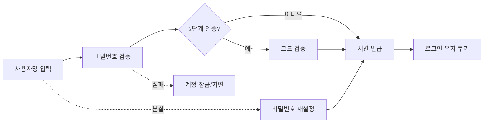
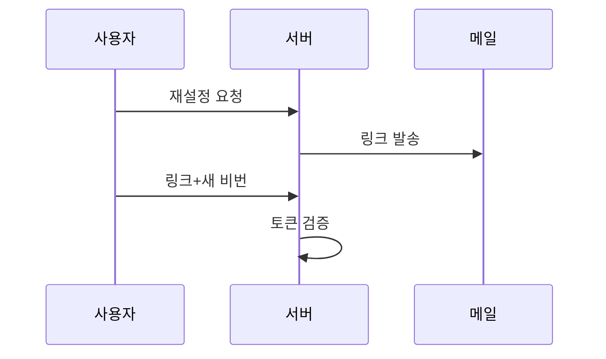

> 인증 취약점의 대부분은 암호학이 아니라 **흐름 설계**의 허점입니다. "맞는 비밀번호를 아는가"보다 "검증을 건너뛸 수 있는가, 반복해도 막히지 않는가, 응답이 정보를 흘리는가"를 봅니다.

## 원리: 인증 흐름의 점검 지점



각 화살표마다 취약점이 생길 수 있습니다. 특히 점선 쪽(실패 처리, 재설정)은 정상 경로보다 덜 검토되어 우회로가 되기 쉽습니다. "로그인은 튼튼한데 재설정이 약하다"는 가장 흔한 패턴입니다.

## 계정 열거 (Username Enumeration)

**원리**: 존재하는 계정과 없는 계정에서 응답이 달라 사용자 목록이 새는 것.

| 새는 경로 | 확인 방법 | 취약 신호 |
|---|---|---|
| 오류 메시지 | 존재할 법한 이름 vs 임의 문자열 | "비밀번호가 틀렸습니다"와 "없는 계정입니다"가 다름 |
| 응답 길이·상태 코드 | 두 응답의 바이트 길이 비교 | 문구가 같아도 1~2바이트 차이 |
| 응답 시간 | 존재하는 계정만 해시 검증을 수행 | 긴 비밀번호를 넣었을 때 시간 차이 |
| 가입·재설정 화면 | "이미 사용 중인 이메일" 메시지 | 가입/재설정에서 존재 여부 노출 |
| 잠금 동작 | 존재하는 계정만 N회 실패 후 잠김 | 반복 실패 시 메시지가 달라짐 |

여기서 많이 놓칩니다. 로그인 문구는 통일했는데 **비밀번호 찾기 화면이 존재 여부를 알려주는** 경우입니다. 화면 세 곳(로그인, 가입, 재설정)을 항상 같이 보세요. 응답 시간도 함정입니다. 비밀번호 검증 해시를 존재하는 계정에서만 계산하면 시간 차이로 새므로, 없는 계정에도 더미 해시 검증을 수행해야 합니다.

### 취약한 코드 → 고친 코드

취약한 예시입니다(직접 만든 최소 Flask 예제).

```python
# vulnerable.py
from flask import Flask, jsonify, request
from werkzeug.security import check_password_hash

app = Flask(__name__)
USERS = {"alice": "scrypt:...해시..."}   # 사용자명 -> 비밀번호 해시 (예시 자리표시)

@app.post("/login")
def login():
    name = request.form["username"]
    pw = request.form["password"]
    if name not in USERS:
        return jsonify(error="존재하지 않는 계정입니다"), 404   # 존재 여부 노출
    if not check_password_hash(USERS[name], pw):
        return jsonify(error="비밀번호가 틀렸습니다"), 401      # 문구, 코드가 다름
    return jsonify(ok=True)
# 시도 횟수 제한 없음. 없는 계정은 해시 계산을 건너뛰어 응답도 더 빠릅니다.
```

고친 예시입니다.

```python
# fixed.py
import time
from collections import defaultdict, deque

from flask import Flask, jsonify, request
from werkzeug.security import check_password_hash, generate_password_hash

app = Flask(__name__)
USERS = {"alice": generate_password_hash("example-only-pw")}   # 예시용 값
DUMMY_HASH = generate_password_hash("dummy-not-a-real-password")

WINDOW_SEC, MAX_FAILS = 900, 5
fails = defaultdict(deque)   # 키: 계정 + 클라이언트 주소 (운영에서는 공유 저장소 사용)

def too_many(key: str) -> bool:
    q = fails[key]
    while q and q[0] < time.time() - WINDOW_SEC:
        q.popleft()
    return len(q) >= MAX_FAILS

@app.post("/login")
def login():
    name = request.form.get("username", "")
    pw = request.form.get("password", "")
    key = f"{name}|{request.remote_addr}"        # 신뢰할 수 없는 X-Forwarded-For는 쓰지 않음
    if too_many(key):
        return jsonify(error="잠시 후 다시 시도하세요"), 429
    # 없는 계정에도 같은 비용의 해시 검증을 수행 -> 응답 시간 통일
    stored = USERS.get(name, DUMMY_HASH)
    ok = check_password_hash(stored, pw) and name in USERS
    if not ok:
        fails[key].append(time.time())
        return jsonify(error="계정 또는 비밀번호가 올바르지 않습니다"), 401   # 문구, 코드 통일
    fails.pop(key, None)
    return jsonify(ok=True)
```

- 계정이 없든 비밀번호가 틀리든 **같은 문구와 같은 상태 코드**를 돌려줍니다.
- 없는 계정에도 더미 해시를 검증해 **응답 시간을 맞춥니다.**
- 실패 횟수를 제한하고 한도에 도달하면 429로 지연시킵니다. 위 저장소는 설명용 메모리 구현이므로 운영에서는 Redis 같은 공유 저장소와 IP 단위 제한도 함께 둡니다. 계정만 키로 쓰면 비밀번호 스프레이를 못 막습니다.

## 무차별 대입과 잠금 정책

| 방식 | 설명 | 점검 포인트 |
|---|---|---|
| 단일 계정에 다수 비밀번호 | 고전적 브루트 포스 | 몇 회에서 막히는가 |
| 다수 계정에 흔한 비밀번호 하나 | 비밀번호 스프레이: 계정별 실패 횟수가 낮아 잠금을 피함 | 계정 단위 잠금만 있는가 |
| 유출 자격 증명 재사용 | 다른 서비스에서 유출된 쌍을 시도 | IP·행동 기반 탐지 유무 |
| 잠금 우회 | 헤더(`X-Forwarded-For`)로 IP 제한 회피, 성공 로그인 사이에 실패 카운터 초기화 | 제한이 신뢰할 수 없는 값에 기대는가 |

**잠금 정책의 두 얼굴**: 계정을 잠그면 공격자가 타인의 계정을 일부러 잠가 버리는 서비스 거부가 가능합니다. 그래서 영구 잠금보다 **점진적 지연 + CAPTCHA + 이상 징후 알림** 조합이 낫습니다.

진단에서는 상한을 정하세요. 실서비스에서 대량 시도는 실제 사용자 계정을 잠그고 로그를 오염시킵니다. 시도 횟수는 "정책이 있는지 알 수 있는 수준"(예: 10~20회)으로 제한하고, 테스트 계정으로만 수행합니다.

## 로그인 유지(쿠키) 취약점

| 문제 | 설명 | 확인 포인트 |
|---|---|---|
| 예측 가능한 토큰 | 사용자명이나 시각을 단순 인코딩(Base64) 또는 해시한 값 | 계정 두 개를 만들어 쿠키 값을 비교 |
| 서명 없는 쿠키 | 쿠키 값 자체에 권한 정보(`role=user`)를 담음 | 값 변조 후 동작 변화 |
| 만료 없음 | 로그아웃해도 토큰이 서버에서 유효 | 로그아웃 전 쿠키 재사용 |
| 쿠키 속성 부족 | `HttpOnly`, `Secure`, `SameSite` 누락 | 응답 헤더 확인 |

로그인 유지 토큰은 사실상 **비밀번호와 같은 가치**입니다. 서버에 해시로 저장하고 무작위 값으로 발급하세요.

## 2단계 인증(2FA) 결함

**5-1. 단계 건너뛰기**

비밀번호 통과 직후 "로그인 상태"가 이미 세션에 설정되고, 2FA 화면은 화면상으로만 가로막는 구조입니다. 2FA 페이지를 거치지 않고 로그인 후 URL로 바로 접근해 보세요. 서버가 단계 완료 여부를 세션에 기록하지 않으면 통과됩니다.

**5-2. 검증 대상이 요청자와 분리되지 않음**

두 번째 단계 요청이 `user=alice` 같은 파라미터로 대상을 지정하면, 본인 코드가 아닌 **다른 사용자의 코드 검증**으로 바꿀 수 있습니다. 대상은 항상 서버 세션에서 가져와야 합니다.

**5-3. 코드 무차별 대입**

숫자 4~6자리는 경우의 수가 1만~100만입니다. 시도 횟수 제한이 없거나 **오류 후 세션이 재발급되어 카운터가 초기화**되면 짧은 시간에 뚫립니다.

| 확인 | 보는 것 |
|---|---|
| 틀린 코드를 연속 제출 | 몇 번째에서 차단/재로그인 요구가 나오는가 |
| 차단 후 새 세션으로 재시도 | 카운터가 계정 기준인지 세션 기준인지 |
| 코드 유효시간 | 오래된 코드가 계속 통과하는가 |

**5-4. 우회 경로**: 인증 앱이 아닌 백업 코드, 이메일/SMS 재전송, 기억된 기기 쿠키가 2FA보다 약한 경우가 있습니다. 가장 약한 경로가 전체 강도를 결정합니다.

## 비밀번호 재설정 취약점



| 취약점 | 원리 | 확인 포인트 |
|---|---|---|
| 예측 가능한 토큰 | 시각·순번 기반 | 연속 요청한 토큰의 규칙성 |
| 토큰과 계정 미결합 | 최종 단계에서 `user` 파라미터를 신뢰 | 최종 요청의 대상 계정 변조 |
| 토큰 재사용·미만료 | 사용 후에도 유효 | 같은 링크 재사용 |
| Host 헤더 주입 | 메일 링크를 요청의 Host 값으로 생성 | Host 변조 시 링크 도메인 변화 |
| 토큰이 URL로 새어나감 | 외부 리소스로 Referer 전송 | 재설정 페이지의 외부 요청 |
| 새 비밀번호 단계 검증 누락 | 토큰 검증이 첫 단계에서만 수행 | 최종 POST에서 토큰 제거 |

판단 포인트: 이메일 링크의 **도메인이 어디서 만들어지는지** 꼭 보세요. 요청 Host 값을 그대로 쓰면 피해자에게 공격자 도메인 링크가 가고, 클릭만으로 토큰이 넘어갑니다.

## 대응 방안

**코드 수준**

1. 로그인 실패·존재하지 않는 계정·재설정 요청 응답을 **문구, 상태 코드, 시간 모두 동일**하게 만듭니다("메일이 존재하면 발송했습니다").
2. 비밀번호는 Argon2id, bcrypt 같은 적응형 해시로 저장하고, 계정이 없을 때도 더미 검증을 수행합니다.
3. 2FA 완료 여부는 서버 세션 상태로만 판단하고, 대상 사용자는 세션에서 가져옵니다.
4. 재설정 토큰은 CSPRNG로 생성한 긴 값, 해시 저장, 짧은 유효시간(예: 15분), 1회용, 계정 결합으로 설계합니다.
5. 링크 도메인은 설정값으로 고정합니다(Host 헤더 신뢰 금지).

**설정 수준**

1. 시도 제한은 계정 기준 + IP 기준 + 전체 기준을 함께 사용합니다. `X-Forwarded-For`는 신뢰 프록시에서만 받습니다.
2. 쿠키에 `HttpOnly`, `Secure`, `SameSite`를 설정합니다.
3. 2FA 코드는 시도 횟수 제한을 **계정 단위**로 걸고, 만료 시간을 짧게 둡니다.

**구조 수준**

1. 가능하면 패스키(WebAuthn)나 앱 기반 인증을 우선하고, SMS는 보조로 둡니다.
2. 새 기기 로그인, 비밀번호 변경은 사용자에게 알림을 보냅니다.
3. 유출 비밀번호 목록 대조와 이상 로그인 탐지를 도입합니다.

## 참고 자료

- OWASP, Authentication Cheat Sheet
- OWASP, Forgot Password Cheat Sheet
- OWASP, Multifactor Authentication Cheat Sheet
- OWASP Top 10, A07: Identification and Authentication Failures
- CWE-307: Improper Restriction of Excessive Authentication Attempts
- CWE-640: Weak Password Recovery Mechanism for Forgotten Password
