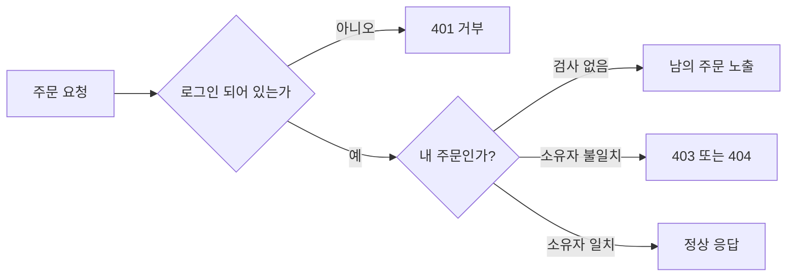

> 인증은 "누구인가"를, 인가는 "이걸 해도 되는가"를 확인합니다. 로그인만 확인하고 **요청한 자원이 그 사람의 것인지** 확인하지 않으면, 식별자만 바꿔도 남의 데이터에 닿습니다. 이것이 IDOR(안전하지 않은 직접 객체 참조)이며 접근 제어 실패의 가장 흔한 형태입니다.

## 원리: 인증과 인가는 다른 검사다



취약한 앱은 첫 번째 질문만 합니다. 두 번째 질문이 빠지면 번호가 순차적이든 예측 불가능하든, **알아낼 수 있는 식별자**는 곧 접근 권한이 됩니다. 영향 범위는 조회(개인정보 노출), 수정·삭제(무결성 파괴), 권한 상승(관리자 기능)까지 다양합니다.

## 취약한 코드 → 고친 코드

취약한 예시입니다(직접 만든 최소 Flask 예제).

```python
# vulnerable.py
from flask import Flask, jsonify, request, session

app = Flask(__name__)

@app.get("/api/memo/<int:memo_id>")
def get_memo(memo_id):
    if "user_id" not in session:           # 인증만 확인
        return "", 401
    memo = db.query("SELECT * FROM memo WHERE id = ?", memo_id)
    return jsonify(memo)                   # 소유자 확인 없음

@app.post("/api/memo/delete")
def delete_memo():
    memo_id = request.form["memo_id"]
    owner = request.form["user_id"]        # 클라이언트가 준 사용자 ID를 신뢰
    db.execute("DELETE FROM memo WHERE id = ? AND user_id = ?", memo_id, owner)
    return "", 204
```

- 조회는 소유자를 보지 않습니다.
- 삭제는 소유자 정보를 **요청 본문에서** 받습니다. 숨은 필드라도 클라이언트가 보낸 값은 사용자가 바꿀 수 있습니다.

고친 예시입니다.

```python
# fixed.py
@app.get("/api/memo/<int:memo_id>")
def get_memo(memo_id):
    uid = session.get("user_id")
    if uid is None:
        return "", 401
    memo = db.query(
        "SELECT * FROM memo WHERE id = ? AND user_id = ?", memo_id, uid
    )                                       # 소유자 조건을 쿼리에 포함
    if memo is None:
        return "", 404                      # 존재 여부도 숨김
    return jsonify(memo)

@app.post("/api/memo/delete")
def delete_memo():
    uid = session["user_id"]                # 사용자 ID는 서버 세션에서만
    n = db.execute(
        "DELETE FROM memo WHERE id = ? AND user_id = ?",
        request.form["memo_id"], uid,
    )
    return ("", 204) if n else ("", 404)
```

- 사용자 ID는 **항상 서버가 가진 세션**에서 가져옵니다.
- 소유자가 아닐 때 403 대신 404를 주면 자원 존재 여부 노출도 막습니다.

## 확인 방법(진단 순서)

1. **자원 식별자 목록화**: URL 경로, 쿼리, 본문, 헤더, 쿠키, 숨은 필드에 있는 ID·번호·파일명·이메일을 모두 모읍니다.
2. **계정 두 개 준비**: 진단용 계정 A, B를 만들어 각각 자원을 하나씩 만듭니다. 기준선이 필요합니다.
3. **수평 접근 확인**
   - 보내는 것: A의 세션으로, B의 자원 식별자를 넣은 조회·수정·삭제 요청
   - 보는 것: 정상 응답이나 변경 성공이면 취약합니다. 403·404여도 응답 길이·시간이 정상 자원과 다르면 존재 여부 노출을 의심합니다.
4. **수직 접근 확인**: 일반 계정으로 관리자 전용 경로와 기능을 호출했을 때 막히는지 봅니다. 화면에서 메뉴가 숨겨진 것은 방어가 아닙니다.
5. **메서드·경로 차이 확인**: 조회는 막혔는데 수정·삭제, 다른 API 버전, 내보내기는 열린 경우가 많습니다.
6. **숨은 신뢰 값 확인**: 사용자 ID, 역할 같은 값을 클라이언트가 보내는지, 바꾸면 서버가 따르는지 봅니다.

> **실무 포인트** 식별자가 UUID처럼 예측하기 어려워도 IDOR은 사라지지 않습니다. 목록 API, 공유 링크, 로그, 이메일에서 식별자가 새어 나오면 똑같이 성립합니다. UUID는 "알아내기 어렵게" 할 뿐이므로 **소유자 검사를 대체하지 않는다**고 보고서에 명확히 쓰세요.

> **실무 포인트** 인가 검사가 컨트롤러마다 흩어져 있으면 새 엔드포인트에서 반드시 빠집니다. 진단할 때는 가장 오래된 기능이 아니라 **가장 최근에 추가된 API, 모바일 전용 API, 내보내기·일괄 처리 기능**을 먼저 보세요. 같은 데이터를 다루는데 검사 코드가 다른 경로가 가장 흔한 누락 지점입니다.

## 유형·변형

| 유형 | 원리 | 확인 포인트 |
|---|---|---|
| 수평 권한 우회 | 같은 역할의 다른 사용자 자원 접근 | 소유자 조건이 쿼리나 검사 코드에 있는가 |
| 수직 권한 우회 | 일반 사용자가 관리자 기능 호출 | 서버가 역할을 매 요청마다 검사하는가 |
| 클라이언트 신뢰 값 | 숨은 필드·쿠키·헤더의 사용자 ID, 역할을 믿음 | 신원 정보가 서버 세션에서 오는가 |
| 메서드·경로 불일치 | GET은 막고 PUT·DELETE는 열림 | 모든 메서드·버전에 같은 검사가 있는가 |
| 대량 할당 | 요청 본문의 `role` 같은 필드가 그대로 저장됨 | 허용 필드 목록으로 바인딩하는가 |

## 대응 방안

### 코드 수준
- **기본 거부(deny by default)**: 명시적으로 허용하지 않은 접근은 막습니다.
- 사용자 ID, 역할, 테넌트는 **서버 세션·토큰에서만** 가져오고 요청 값으로 받지 않습니다.
- 자원 조회 쿼리에 소유자·테넌트 조건을 함께 넣어, 검사가 조회와 분리되지 않게 합니다.
- 요청 본문은 허용 필드만 바인딩합니다(대량 할당 방지).

### 설정 수준
- 인가 실패를 로그로 남기고 여러 식별자 시도에 경보합니다.

### 구조 수준
- 인가 로직을 **한 곳(미들웨어, 정책 계층)** 에 모아 모든 엔드포인트가 통과하게 합니다.
- "A가 B의 자원에 접근하면 거부"를 모든 엔드포인트에 대해 자동 테스트로 검증합니다.

## 함께 보기

- [인증 취약점](/notes/authentication-vulnerabilities/)
- [JWT 취약점](/notes/jwt-vulnerabilities/)
- [SQL 인젝션](/notes/sql-injection/)

## 참고 자료

- [OWASP Top 10 2021: A01 Broken Access Control](https://owasp.org/Top10/A01_2021-Broken_Access_Control/)
- [OWASP Cheat Sheet Series: Authorization](https://cheatsheetseries.owasp.org/cheatsheets/Authorization_Cheat_Sheet.html)
- [OWASP Cheat Sheet Series: Insecure Direct Object Reference Prevention](https://cheatsheetseries.owasp.org/cheatsheets/Insecure_Direct_Object_Reference_Prevention_Cheat_Sheet.html)
- [CWE-639: Authorization Bypass Through User-Controlled Key](https://cwe.mitre.org/data/definitions/639.html)
- [CWE-862: Missing Authorization](https://cwe.mitre.org/data/definitions/862.html)
