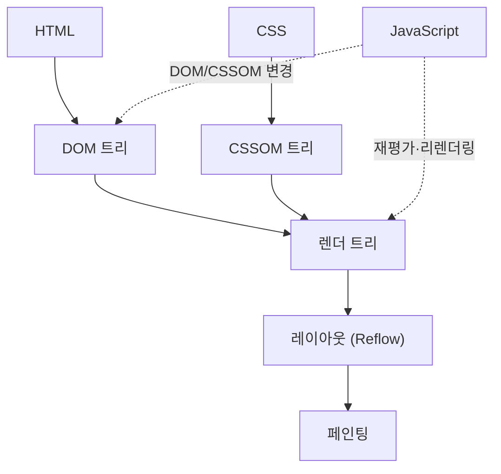

> 브라우저는 서버에서 받은 HTML·CSS·JavaScript를 **DOM → CSSOM → 렌더 트리 → 레이아웃 → 페인팅** 순으로 처리해 화면에 그린다. JavaScript가 중간에 끼어들어 이 과정을 다시 돌리기도 한다.

## 전체 순서

### 1. HTML 파싱 및 DOM 트리 생성

브라우저가 HTML 문서를 위에서 아래로 읽으며 각 태그를 파싱해 **DOM(Document Object Model)** 트리를 만든다. DOM은 문서 구조를 트리로 나타낸 것으로, 예를 들어 `
` 태그는 트리에서 div 노드가 된다.

### 2. CSS 파싱 및 CSSOM 트리 생성

링크된 CSS 파일이나 `<style>` 안의 규칙을 파싱해 **CSSOM(CSS Object Model)** 트리를 만든다. 이 트리는 CSS 규칙의 구조와 적용 관계를 나타낸다.

### 3. 렌더 트리 생성

DOM 트리와 CSSOM 트리를 결합해 **렌더 트리(Render Tree)** 를 만든다. 각 요소가 어떤 스타일로 화면 어디에 배치될지를 담는다. `display: none`처럼 보이지 않는 요소는 렌더 트리에서 제외된다.

### 4. 레이아웃 (Reflow)

렌더 트리의 각 노드가 화면에서 가질 **정확한 위치와 크기**를 계산한다. 크기·위치는 CSS 박스 모델을 기준으로 정해진다.

### 5. 페인팅 (Painting)

렌더 트리의 각 노드를 실제 픽셀로 바꿔 화면에 그린다. 색상·배경·테두리 등이 이때 표현된다.

### 6. JavaScript 실행

HTML 파서가 `<script>` 태그를 만나면 그 자바스크립트를 파싱·실행한다. JavaScript는 DOM API로 트리를 조작할 수 있고(요소 추가, 속성 변경 등), DOM이나 CSSOM이 바뀌면 브라우저는 렌더 트리를 **재평가**하고 필요하면 레이아웃·페인팅을 다시 수행한다.

## 바이트에서 트리까지: 디코딩 과정

HTML과 JavaScript 모두 네트워크에서는 **바이너리 데이터**로 도착한다. 트리와 AST가 되기까지의 단계가 있다.

### HTML

1. **네트워크 수신** — HTML 파일이 바이너리로 수신된다.
2. **바이트 → 텍스트** — 네트워크 계층에서 문자 인코딩(UTF-8, ISO-8859-1 등)을 적용해 텍스트로 변환한다.
3. **파싱 → DOM** — 변환된 텍스트가 HTML 파서로 전달되어 태그가 문법 요소로 해석되고 DOM 트리가 된다. 예: `
` → div 노드.

### JavaScript

1. **네트워크 수신** — 외부 스크립트 파일도 바이너리로 수신된다.
2. **바이트 → 텍스트** — HTML과 같은 방식으로 문자 인코딩을 적용해 텍스트로 변환한다.
3. **`<script>` 발견** — HTML 파서가 스크립트를 만나면 코드를 파싱·실행한다. 이때 텍스트가 **AST(추상 구문 트리)** 로 디코딩된다.
4. **파싱·실행** — JavaScript 엔진(V8, SpiderMonkey 등)이 텍스트를 파싱해 AST를 만들고 실행한다. 실행 중 DOM과 상호작용해 페이지를 동적으로 바꾼다.

## 참고 자료

- [MDN: Critical rendering path](https://developer.mozilla.org/en-US/docs/Web/Performance/Guides/Critical_rendering_path)
- [MDN: Populating the page — how browsers work](https://developer.mozilla.org/en-US/docs/Web/Performance/Guides/How_browsers_work)
- [web.dev: Constructing the Object Model](https://web.dev/articles/critical-rendering-path/constructing-the-object-model)
