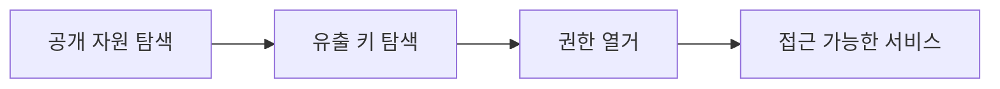

> 클라우드 정찰은 "공개된 것 → 유출된 키 → 그 키로 할 수 있는 것" 순으로 좁힙니다. 버킷 열람과 소스코드의 키 유출이 가장 흔한 진입점입니다. 예시의 계정·버킷·키는 전부 플레이스홀더입니다.

## 개념



- **공개 스토리지**: 잘못 공개된 버킷/오브젝트는 인증 없이 읽힙니다.
- **키 유출**: 저장소·설정·프런트엔드 번들에 하드코딩된 키.
- **권한 열거**: 확보한 키가 **무엇을 할 수 있는지** 먼저 확인(최소 권한 가정).

## 공격·우회 구문

허가된 범위에서만. 계정·버킷·키는 전부 예시입니다.

### 공개 자원 · 키 유출 탐색

```bash
# 공개 S3 버킷 나열/열람(인증 없이)
curl https://example-bucket.s3.amazonaws.com/
aws s3 ls s3://example-bucket --no-sign-request

# 소스/저장소에서 유출된 키 스캔
gitleaks detect --source ./repo -v

# 조직 자원 열거(퍼블릭 표면)
cloud_enum -k example
```

> 판단 포인트: 프런트엔드 JS 번들·`.env`·커밋 히스토리는 키가 가장 자주 나오는 곳입니다. "현재 파일"만 보지 말고 git 히스토리를 함께 훑습니다(gitleaks가 커밋 로그까지 봅니다).

### AWS 권한 열거

```bash
# 자격증명 설정 후 내가 누구인지
aws configure
aws sts get-caller-identity

# 내가 가진 권한 흔적(계정·서비스별로 조심스럽게)
aws iam list-attached-user-policies --user-name $USER
aws s3 ls
```

### pacu (AWS 공격 프레임워크)

```bash
pacu
# 세션 생성 → 키 import → 권한 열거 모듈
# import_keys ; run iam__enum_permissions ; run iam__privesc_scan
```

> 판단 포인트: 클라우드는 호출 하나하나가 **CloudTrail에 로그로 남습니다.** 평가 범위·탐지 요구를 먼저 확인하고, 열거는 필요한 최소한으로. "되는지 보자"식 전수 호출은 피합니다.

## 함께 보기

- [모의침투 작전 흐름](/notes/penetration-testing-operation-flow/)
- [정찰·스캐닝 도구 치트시트](/notes/recon-scanning-cheatsheet/)

## 참고 자료

- [AWS: Security best practices in IAM](https://docs.aws.amazon.com/IAM/latest/UserGuide/best-practices.html)
- [MITRE ATT&CK: Cloud Infrastructure Discovery (T1580)](https://attack.mitre.org/techniques/T1580/)
- [OWASP: Secrets Management Cheat Sheet](https://cheatsheetseries.owasp.org/cheatsheets/Secrets_Management_Cheat_Sheet.html)
