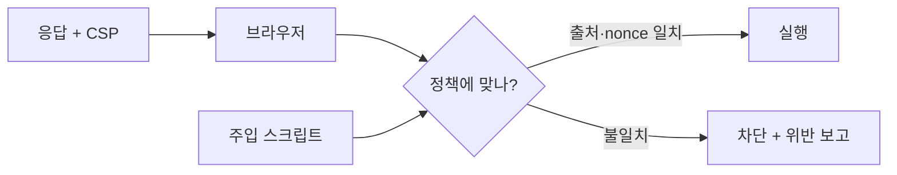

> CSP는 XSS를 "없애는" 장치가 아니라, XSS가 생겨도 **스크립트가 실행되거나 데이터가 나가는 길을 좁히는** 2차 방어선입니다. 정책이 느슨하면 헤더만 있고 효과는 없습니다.

## 원리: 브라우저가 "허용 목록"을 강제한다

서버가 `Content-Security-Policy` 응답 헤더로 정책을 내려 주면, 브라우저는 정책에 맞지 않는 리소스 로딩과 스크립트 실행을 차단합니다.



핵심 동작은 이렇습니다.

- 정책이 `script-src`를 가지면 **인라인 스크립트와 `eval` 계열이 기본 차단**됩니다. `unsafe-inline`, `unsafe-eval`을 넣어야 풀리는데, 그 순간 XSS 방어 효과가 사라집니다.
- 허용 방식은 출처 목록(host 기반), nonce, hash 세 가지입니다.

### 주요 디렉티브

| 디렉티브 | 역할 | 점검 포인트 |
|---|---|---|
| `default-src` | 다른 `*-src`가 없을 때의 기본값 | 너무 넓은 값(`*`, `https:`) |
| `script-src` | 스크립트 출처 | `unsafe-inline`, 와일드카드, 신뢰 도메인 |
| `object-src` | 플러그인 객체 | `'none'`이 아니면 우회 여지 |
| `base-uri` | `<base>` 태그 허용 | 지정이 없으면 상대 경로 스크립트 탈취 가능 |
| `frame-ancestors` | 이 페이지를 감쌀 수 있는 부모 | 클릭재킹 방어(`X-Frame-Options` 대체) |
| `form-action` | 폼 제출 대상 | 지정이 없으면 폼을 외부로 보내는 공격 가능 |
| `connect-src` | fetch/XHR 대상 | 데이터 유출 경로 |
| `report-to` / `report-uri` | 위반 보고 | 적용 전 `Report-Only`로 시험 |

## 취약한 정책 → 고친 정책

취약한 예시입니다.

```text
Content-Security-Policy: script-src 'self' https://cdn.example.com 'unsafe-inline'
```

- `'unsafe-inline'`이 있어 주입된 `<script>`가 그대로 실행됩니다.
- `base-uri`, `object-src`가 없어 다른 우회 경로도 열려 있습니다.

nonce 기반 strict 정책으로 고친 예시입니다. 아래는 직접 만든 최소 Flask 예제입니다.

```python
# app.py (Flask 최소 예제)
import secrets
from flask import Flask, make_response, render_template_string

app = Flask(__name__)

PAGE = """<!doctype html>
<script nonce="{{ nonce }}">console.log("허용된 스크립트");</script>
<p>{{ user_input }}</p>
"""

@app.get("/")
def index():
    nonce = secrets.token_urlsafe(16)   # 응답마다 새로 생성
    resp = make_response(render_template_string(PAGE, nonce=nonce, user_input="hello"))
    resp.headers["Content-Security-Policy"] = (
        f"script-src 'nonce-{nonce}' 'strict-dynamic'; "
        "object-src 'none'; base-uri 'none'; "
        "frame-ancestors 'self'; form-action 'self'"
    )
    return resp
```

- `nonce-...`: 서버가 응답마다 만든 임의 값. 같은 값을 가진 `<script>`만 실행됩니다.
- `'strict-dynamic'`(CSP Level 3): nonce로 신뢰받은 스크립트가 **동적으로 추가하는 스크립트**도 신뢰합니다. 이때 host 기반 허용 목록은 무시되므로 도메인 목록 관리가 필요 없어집니다.
- `object-src 'none'`, `base-uri 'none'`으로 흔한 우회 통로를 막습니다.

## 우회 패턴

CSP가 있어도 정책이 약하면 실행이 가능합니다. 진단에서 실제로 보는 패턴입니다.

| 유형 | 원리 | 확인 포인트 |
|---|---|---|
| 신뢰 도메인에 사용자 업로드 | `script-src`에 허용된 도메인에서 내가 올린 JS 파일을 서비스 | 허용 도메인이 파일 업로드·사용자 콘텐츠를 호스팅하는가 |
| JSONP 엔드포인트 | 허용된 도메인의 `?callback=` 응답이 스크립트로 실행됨 | 콜백 이름에 임의 코드를 넣을 수 있는가 |
| 예측·재사용 가능한 nonce | nonce가 고정이거나 요청마다 같음 | 새로고침 후 값이 바뀌는지, 캐시된 페이지에 박혀 있지 않은지 |
| `base-uri` 미지정 | 주입한 `<base href>`로 상대 경로 스크립트가 공격자 서버에서 로드됨 | 스크립트가 `<script src="/js/app.js">`처럼 상대 경로이고 nonce가 붙어 있는가 |
| 허용 도메인의 라이브러리 | 허용된 CDN에 올라 있는 템플릿 프레임워크로 코드를 실행 | CDN 전체를 허용했는지 |
| `unsafe-inline`·`unsafe-eval` | 정책이 사실상 무력 | 헤더 값에 직접 포함 |
| 비스크립트 유출 | 스크립트는 막아도 이미지·폼·링크로 데이터 전송 | `img-src`, `form-action`, `connect-src`가 느슨한가 |

> **실무 포인트** `Content-Security-Policy-Report-Only`와 실제 헤더를 혼동하지 마세요. 응답 헤더에 CSP가 보여도 Report-Only면 아무것도 차단하지 않습니다. 또한 **페이지마다 헤더가 다를 수** 있어서(로그인, 에러 페이지, 정적 파일 응답에서 헤더 누락) 메인 페이지만 보고 적용 완료로 판단하면 안 됩니다.

> **실무 포인트** 허용 목록의 **외부 호스트가 우회 통로**가 되는지 보세요. `script-src`에 CDN이나 분석 도구 도메인이 들어 있으면, 그 호스트가 JSONP 엔드포인트나 임의 스크립트를 제공할 때 정책이 통째로 무력화됩니다. 도메인 이름이 아니라 "그 호스트에서 내가 제어할 수 있는 응답이 나오는가"로 판단합니다.

실무 판단 포인트입니다. 여기서 많이 놓칩니다. `script-src 'self'`는 안전해 보이지만, **같은 출처에 사용자가 파일을 올릴 수 있고 그 파일이 `text/javascript`로 서빙된다면** 그냥 우회됩니다. 또 `base-uri` 한 줄 빠진 것은 눈에 안 띄지만, nonce를 쓰는 사이트에서 상대 경로 스크립트가 있으면 이 한 줄이 우회의 열쇠가 됩니다.

## 확인 방법(진단 순서)

1. **헤더 수집**: 주요 페이지의 `Content-Security-Policy`와 `Content-Security-Policy-Report-Only`를 모두 확인합니다. `Report-Only`는 **차단하지 않고 보고만** 하므로 실제 방어가 아닙니다.
2. **평가 도구로 1차 점검**: 정책 문자열을 CSP 평가 도구(구글 CSP Evaluator 같은 공개 도구)에 넣어 `unsafe-*`, 와일드카드, 누락 디렉티브를 훑습니다.
3. **디렉티브별 점검**
   - 보는 것: `script-src`(또는 `default-src`)에 `unsafe-inline`, `*`, `data:`, 넓은 CDN이 있는가 → 있으면 취약
   - 보는 것: `object-src`, `base-uri`가 정의되어 있는가 → 없으면 취약 후보
4. **nonce 검증**: 같은 페이지를 여러 번 요청해 nonce가 매번 다른지, 길이가 충분한지(최소 128비트 권장), 캐시에 고정되지 않는지 확인합니다.
5. **허용 도메인 조사**: `script-src`에 있는 도메인마다 JSONP 엔드포인트, 사용자 업로드 기능, 오래된 라이브러리가 있는지 확인합니다.
6. **주입 지점과 결합**: XSS 주입 지점이 있으면 위 우회 패턴 중 맞는 것을 시도하되, 실제 영향은 무해한 증거(예: 문서 도메인 출력)로만 보여 줍니다.

## 대응 방안

### 설정 수준
- **nonce 또는 hash 기반 strict 정책**을 기본으로 합니다. host 허용 목록만으로 만든 정책은 우회가 쉬워 권장되지 않습니다.
- `'strict-dynamic'`으로 도메인 목록 의존을 줄이고, 구형 브라우저용으로 `'unsafe-inline' https:` 폴백을 같이 쓰는 패턴이 있습니다(strict-dynamic을 이해하는 브라우저는 폴백을 무시).
- `object-src 'none'`, `base-uri 'none'` 또는 `'self'`, `frame-ancestors`, `form-action`을 반드시 지정합니다.
- 처음 도입할 때는 `Content-Security-Policy-Report-Only`와 `report-to`로 위반을 모은 뒤 차단 모드로 전환합니다.

### 코드 수준
- nonce는 **응답마다 암호학적 난수**로 생성하고 서버 템플릿에서만 삽입합니다. 정적 HTML이나 장기 캐시 페이지에 박지 않습니다.
- 인라인 이벤트 핸들러(`onclick="..."`)를 `addEventListener`로 옮깁니다.
- 출력 인코딩과 입력 검증이 1차 방어이고 CSP는 보조입니다. CSP 때문에 XSS 수정을 미루지 않습니다.

### 구조 수준
- 사용자 업로드 콘텐츠는 **별도 도메인**에서 서빙하고, 그 도메인은 `script-src`에 넣지 않습니다.
- JSONP를 쓰는 외부 도메인은 허용 목록에서 제거합니다.
- 서드파티 스크립트가 많다면 서브리소스 무결성(SRI)과 함께 최소한만 허용합니다.

## 참고 자료

- [W3C: Content Security Policy Level 3](https://www.w3.org/TR/CSP3/)
- [MDN: Content-Security-Policy 헤더](https://developer.mozilla.org/en-US/docs/Web/HTTP/Reference/Headers/Content-Security-Policy)
- [OWASP Cheat Sheet Series: Content Security Policy](https://cheatsheetseries.owasp.org/cheatsheets/Content_Security_Policy_Cheat_Sheet.html)
- [CWE-1021: Improper Restriction of Rendered UI Layers or Frames](https://cwe.mitre.org/data/definitions/1021.html)
- [CWE-79: Cross-site Scripting](https://cwe.mitre.org/data/definitions/79.html)
