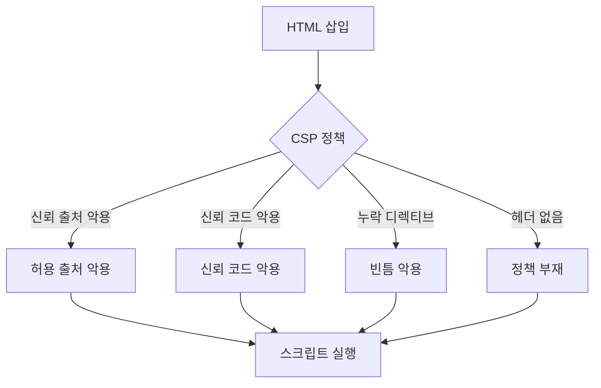

> 기본 개념은 [Content Security Policy](/notes/content-security-policy/)에서 다뤘습니다. 이 글은 그 글의 우회 패턴 표를 **"왜 그 정책이 뚫리는가"** 라는 원리로 다시 풀어, 정책을 읽고 평가하는 기준을 만드는 데 집중합니다.

## 이런 분께

- CSP를 배포했는데 "이게 정말 막고 있는지" 확신이 없는 분
- 진단에서 CSP 평가 도구의 경고를 읽고 우선순위를 정해야 하는 분
- nonce와 `strict-dynamic`을 도입하려는 개발자

## 원리: CSP는 "어디서 온 코드인가"만 본다

CSP는 스크립트의 **내용이 안전한지**를 판단하지 못합니다. 판단 기준은 출처(origin), nonce, 해시뿐입니다. 즉 정책 안에서 "신뢰한다"고 적은 대상이 공격자에게 조금이라도 통제될 때 우회가 시작됩니다.



따라서 평가의 질문은 "정책이 있는가"가 아니라 **"정책이 신뢰하는 것 중 공격자가 조종할 수 있는 것이 있는가"** 입니다.

## 취약한 정책 → 고친 정책

```http
# 취약한 예
Content-Security-Policy: script-src 'self' https://cdn.example.net; object-src 'self'

# 고친 예
Content-Security-Policy: default-src 'none'; script-src 'nonce-{요청마다 새 값}' 'strict-dynamic'; object-src 'none'; base-uri 'none'; frame-ancestors 'none'; form-action 'self'; img-src 'self'; connect-src 'self'; style-src 'self'
```

취약한 쪽의 문제는 세 가지입니다. `'self'`는 같은 출처의 **모든 파일**을 신뢰하고, CDN 도메인은 그 호스트의 **모든 경로**를 신뢰하며, `base-uri`와 `object-src`가 비어 있거나 느슨합니다. 고친 쪽은 기본을 전부 막고 필요한 것만 연 뒤, 스크립트는 nonce로만 허용합니다.

`strict-dynamic`을 지원하지 않는 구형 브라우저까지 고려한다면 `script-src 'nonce-...' 'strict-dynamic' 'unsafe-inline' https:`처럼 폴백을 덧붙입니다. `strict-dynamic`을 지원하는 브라우저는 `'unsafe-inline'`과 `https:`를 무시하므로 보안 수준이 낮아지지 않고, 구형 브라우저에서만 폴백이 적용됩니다.

## 우회가 생기는 구조 (원리별)

### 허용 출처 안에 신뢰할 수 없는 응답이 있는 경우

`script-src 'self'`나 CDN 허용은 "그 호스트가 내놓는 것은 전부 안전"이라는 가정입니다. 다음 중 하나라도 있으면 깨집니다.

- 같은 출처에 **사용자가 올린 파일**이 스크립트 MIME으로 서빙됨
- 같은 출처나 허용 CDN에 **응답 일부를 호출자가 정하는 엔드포인트**(예: 함수 이름을 받는 콜백형 응답)가 있음
- 허용된 호스트에 **스크립트 실행을 유도하는 템플릿·프레임워크 파일**이 있음

### 신뢰된 스크립트가 데이터를 코드로 바꾸는 경우

nonce가 붙은 정상 스크립트가 DOM 속성이나 URL 조각을 읽어 `eval`, 동적 `script` 생성, 템플릿 컴파일을 하면, 공격자는 **스크립트가 아니라 데이터**만 넣어 실행시킵니다. CSP는 이 경로를 구조적으로 막지 못합니다. (Trusted Types 같은 브라우저 기능으로 보완합니다.)

### `strict-dynamic`의 부수 효과

`'strict-dynamic'`은 nonce가 붙은 스크립트가 **동적으로 추가한 스크립트도 신뢰**하게 하고 허용 목록(호스트)을 무시하게 합니다. 허용 목록 우회는 줄지만, 그 신뢰된 스크립트가 외부 입력으로 스크립트를 만들어 내는 코드를 가지고 있으면 앞 절(신뢰된 스크립트가 데이터를 코드로 바꾸는 경우)과 같은 문제가 그대로 남습니다.

### 디렉티브 누락

| 누락 | 결과 |
|---|---|
| `base-uri` | 주입한 `<base>`로 상대 경로 스크립트의 기준 주소가 바뀜. nonce가 붙은 상대 경로 스크립트가 있으면 특히 위험 |
| `object-src` | 플러그인/객체 경로로 스크립트 실행 가능성(브라우저 지원이 줄었지만 평가 도구가 지적) |
| `form-action` | 폼 제출 대상을 외부로 바꿔 입력값 유출 |
| `frame-ancestors` | 클릭재킹 방어 부재(스크립트 실행과는 별개이지만 같은 헤더에서 점검) |
| `default-src` | 정의되지 않은 디렉티브가 아무 제한 없이 열림 |

## 확인 방법(진단 순서)

1. **응답 단위로 헤더 수집**: 주요 페이지뿐 아니라 오류 페이지, 리다이렉트 응답, 정적 리소스까지 CSP 헤더의 유무와 Report-Only 여부를 확인합니다.
2. **정책을 항목별로 해부**: `script-src`(없으면 `default-src`)의 값을 하나씩 "이 출처에서 공격자가 통제하는 응답이 나오는가"로 질문합니다.
3. **누락 디렉티브 표시**: `base-uri`, `object-src`, `form-action`, `default-src`를 점검표처럼 확인합니다.
4. **nonce 품질**: 새로고침마다 값이 바뀌는지, 응답 캐시에 고정돼 여러 사용자에게 같은 값이 가지 않는지, 길이가 충분한지 봅니다.
5. **허용 호스트 조사**: 허용된 각 호스트에서 사용자 콘텐츠 업로드, 콜백형 응답, 오래된 라이브러리가 있는지 문서와 응답으로 확인합니다.
6. **기존 스크립트의 동적 코드 사용**: 소스에서 `eval`, `innerHTML`, 동적 `script` 생성이 외부 입력과 이어지는지 봅니다.

> **실무 포인트** 평가 도구의 경고 개수보다 **"실제로 주입 지점과 결합되는가"** 로 우선순위를 정하세요. 주입 지점이 없는 앱의 `unsafe-inline` 경고와, 주입 지점이 있는 앱의 `base-uri` 누락은 위험도가 정반대입니다. 보고서에는 "정책 약점"과 "악용 가능한 조합"을 분리해서 쓰면 개발팀의 수정 순서가 분명해집니다.

> **실무 포인트** CDN 허용 목록은 배포 후에 **시간이 지나며 약해집니다.** 허용한 호스트가 나중에 기능을 추가하거나 사용자 영역이 생기는 것은 우리가 통제하지 못합니다. 장기적으로는 호스트 허용 목록을 nonce/해시 기반으로 바꾸는 것이 유지보수 면에서도 낫습니다. 여기서 많이 놓칩니다.

## 대응 방안

### 설정 수준
- **nonce 또는 해시 기반** 정책을 기본으로 하고 `'unsafe-inline'`, `'unsafe-eval'`, 와일드카드를 제거합니다.
- `default-src 'none'`에서 시작해 필요한 것만 엽니다. `object-src 'none'`, `base-uri 'none'`(또는 `'self'`), `form-action`, `frame-ancestors`를 명시합니다.
- nonce는 **요청마다 새로** 생성(최소 128비트, 암호학적 난수)하고, nonce가 들어간 HTML은 캐시하지 않거나 변형 캐시를 씁니다.
- 모든 응답(오류 페이지 포함)에 같은 헤더가 붙도록 **웹 서버·프록시 공통 설정**으로 둡니다. 도입 초기엔 Report-Only로 위반 보고를 모은 뒤 차단 모드로 전환합니다.

### 코드 수준
- 사용자 콘텐츠 업로드 도메인은 **앱과 다른 출처**로 분리하고, `X-Content-Type-Options: nosniff`와 올바른 MIME을 설정합니다.
- 클라이언트 코드에서 `eval`, `innerHTML`, 동적 `script` 생성을 제거하고 필요하면 Trusted Types를 도입합니다.

### 구조 수준
- CSP는 **XSS의 2차 방어선**입니다. 출력 인코딩과 입력 처리를 먼저 고치고, 정책은 남은 피해를 줄이는 용도로 둡니다.

## 점검 체크리스트

- [ ] 모든 응답 유형(오류·정적 포함)에 CSP 헤더가 붙는가
- [ ] Report-Only가 아닌 차단 모드로 동작하는가
- [ ] `script-src`에 `unsafe-inline`, `unsafe-eval`, 와일드카드, `data:`가 없는가
- [ ] 허용한 호스트마다 사용자 콘텐츠·콜백형 응답이 없음을 확인했는가
- [ ] `base-uri`, `object-src`, `form-action`, `default-src`가 정의돼 있는가
- [ ] nonce가 요청마다 달라지고 캐시에 고정되지 않는가
- [ ] 업로드 파일은 별도 출처에서 올바른 MIME으로 서빙되는가
- [ ] 신뢰 스크립트가 외부 입력을 코드로 변환하지 않는가

## 함께 보기

- [Content Security Policy](/notes/content-security-policy/)
- [XSS 필터 우회 패턴](/notes/xss-filter-bypass-patterns/)
- [파일 업로드 취약점](/notes/file-upload-vulnerability/)

## 참고 자료

- [OWASP Cheat Sheet: Content Security Policy](https://cheatsheetseries.owasp.org/cheatsheets/Content_Security_Policy_Cheat_Sheet.html)
- [W3C: Content Security Policy Level 3](https://www.w3.org/TR/CSP3/)
- [MDN: Content Security Policy (CSP)](https://developer.mozilla.org/en-US/docs/Web/HTTP/Guides/CSP)
- [CWE-693: Protection Mechanism Failure](https://cwe.mitre.org/data/definitions/693.html)
