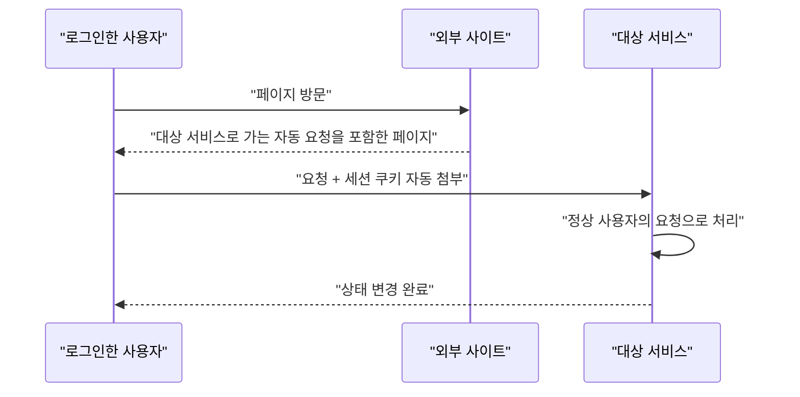

> CSRF(Cross-Site Request Forgery)는 **브라우저가 쿠키를 자동으로 붙여 보낸다는 점**을 이용해, 로그인한 사용자 모르게 상태 변경 요청을 보내게 만드는 공격입니다. 방어의 핵심은 "이 요청이 우리 화면에서 나온 것인가"를 서버가 확인하는 것입니다.

## 이런 분께

- 세션 쿠키로 로그인을 유지하는 웹 서비스를 개발하는 분
- 송금, 비밀번호 변경 같은 중요 기능의 요청 구조를 점검하는 분
- "CSRF 토큰이 있으니 안전하다"고 보고받은 분

## 1. 원리: 요청은 정상, 출처만 다릅니다

사용자가 서비스에 로그인한 상태에서 다른 사이트를 방문하면, 그 사이트가 서비스로 요청을 보내게 만들 수 있습니다. 브라우저는 서비스 도메인의 쿠키를 자동으로 붙입니다.



공격자가 응답을 읽을 필요는 없습니다. **상태가 바뀌는 것**이 목적이기 때문입니다.

성립 조건은 세 가지입니다.

| 조건 | 설명 |
|---|---|
| 쿠키 기반 인증 | 브라우저가 자동으로 보내는 자격 증명을 쓴다 |
| 상태 변경 엔드포인트 | 비밀번호 변경, 송금, 이메일 변경 등 |
| 요청 값을 공격자가 알 수 있다 | 예측 가능하거나 검증되지 않는 파라미터 |

## 2. 취약한 코드 → 고친 코드

취약한 예시입니다(직접 만든 최소 Flask 예제).

```python
# vulnerable.py
from flask import Flask, request, session

app = Flask(__name__)
app.secret_key = "change-me"   # 예시용. 실제는 환경 변수로 주입

@app.route("/transfer", methods=["GET", "POST"])
def transfer():
    user = session["user"]
    to = request.values["to"]            # GET 쿼리도 받아 줌
    amount = int(request.values["amount"])
    do_transfer(user, to, amount)        # 요청 출처 검증 없음
    return "ok"
```

- 상태를 바꾸는데 `GET`도 허용합니다. 이미지 로딩 같은 단순 요청만으로 실행됩니다.
- 요청이 우리 화면에서 왔다는 증거(토큰)를 확인하지 않습니다.

고친 코드입니다.

```python
# fixed.py
import hmac, secrets
from flask import Flask, request, session, abort

app = Flask(__name__)
app.config.update(
    SESSION_COOKIE_HTTPONLY=True,
    SESSION_COOKIE_SECURE=True,
    SESSION_COOKIE_SAMESITE="Lax",     # 크로스 사이트 POST에 쿠키 미첨부
)

def csrf_token():
    if "csrf" not in session:
        session["csrf"] = secrets.token_urlsafe(32)   # 예측 불가능한 난수
    return session["csrf"]

@app.post("/transfer")                  # 상태 변경은 POST만
def transfer():
    sent = request.form.get("csrf", "")
    if not hmac.compare_digest(sent, session.get("csrf", "")):
        abort(403)                      # 서버에서 반드시 검증
    do_transfer(session["user"], request.form["to"], int(request.form["amount"]))
    return "ok"
```

> **실무 포인트** 토큰을 발급하는 코드는 있는데 **검증 코드가 없는** 경우를 자주 봅니다. 폼에 hidden 필드가 보인다고 안전하다고 판정하지 말고, 토큰을 지우거나 바꿔 보내서 서버가 거부하는지 꼭 확인하세요.

## 3. 확인 방법(진단 순서)

허가된 계정과 테스트 환경에서 진행합니다.

1. **상태 변경 요청 목록화**: 비밀번호 변경, 이메일 변경, 송금, 권한 부여 등을 모읍니다.
2. **토큰 유무 확인**: 요청에 토큰 파라미터나 헤더가 있는지 봅니다. 없다면 SameSite 설정과 메서드 제한 여부를 봅니다.
3. **토큰 제거·변조**: 토큰을 빼거나 다른 값으로 바꿔 재전송 → 성공하면 서버 검증이 없는 것입니다.
4. **다른 계정의 토큰 사용**: 계정 A의 토큰을 계정 B 세션에 써 봅니다. 통과하면 토큰이 세션에 묶여 있지 않습니다.
5. **토큰 생성 방식 관찰**: 여러 번 발급해 사용자명, 시각, IP처럼 알 수 있는 값으로 만든 해시인지 봅니다. 예측 가능하면 위조할 수 있습니다.
6. **메서드 바꿔 보기**: `POST`를 `GET`으로 바꿔도 동작하는지 확인합니다.
7. **재인증 요구 확인**: 중요 기능이 비밀번호 재입력 같은 추가 확인 없이 한 번에 처리되는지 봅니다.

> **실무 포인트** 토큰은 있는데 사용자명과 IP 같은 값으로 만든 해시라면, 토큰이 아니라 "계산할 수 있는 값"입니다. 난수가 세션에 저장되어 있고 비교하는지를 확인하세요. 또한 XSS가 있으면 토큰을 읽어 갈 수 있으므로 CSRF 방어는 XSS 방어와 같이 봐야 합니다.

## 4. 유형·변형

| 유형 | 원리 | 확인 포인트 |
|---|---|---|
| GET 상태 변경 | 이미지·링크 요청만으로 실행 | 상태 변경 엔드포인트의 허용 메서드 |
| 토큰 미검증 | 발급만 하고 서버가 검증하지 않음 | 토큰 제거·변조 시 결과 |
| 예측 가능 토큰 | 사용자 정보 기반 해시 | 토큰 생성 입력 |
| 세션과 분리된 토큰 | 아무 사용자 토큰이나 통과 | 타 계정 토큰 사용 결과 |
| 클라이언트 측 검증 | 토큰 검증을 JS에만 둠 | 직접 요청 시 통과 여부 |
| 재인증 부재 | 중요 기능이 단일 요청으로 완료 | 추가 확인 단계 |

## 5. 대응 방안

### 코드 수준
- 상태 변경은 `POST`/`PUT`/`DELETE`로만 받고, `GET`으로는 처리하지 않습니다.
- 세션에 묶인 난수 토큰(synchronizer token)을 서버에서 검증합니다. 비교는 상수 시간 함수로 합니다.
- 프레임워크가 제공하는 CSRF 보호 기능을 쓰고, 예외 처리(`csrf_exempt` 등)는 목록으로 관리합니다.

### 설정 수준
- 세션 쿠키에 `SameSite=Lax` 이상(가능하면 `Strict`), `Secure`, `HttpOnly`를 설정합니다. SameSite는 보조 방어이며 토큰을 대체하지 않습니다.
- `Origin`/`Referer` 헤더를 검증하는 계층을 추가합니다.

### 구조 수준
- 송금, 비밀번호 변경 같은 중요 기능은 **재인증**(비밀번호, OTP)을 요구합니다. 토큰이 뚫려도 마지막 관문이 됩니다.
- XSS를 함께 막습니다. XSS가 있으면 토큰 기반 방어도 무력해집니다.

## 6. 점검 체크리스트

- [ ] 상태 변경 엔드포인트가 GET을 허용하지 않는가
- [ ] 모든 상태 변경 요청에서 토큰을 서버가 검증하는가
- [ ] 토큰이 예측 불가능한 난수이고 세션에 묶여 있는가
- [ ] 세션 쿠키에 SameSite, Secure, HttpOnly가 있는가
- [ ] 중요 기능에 재인증이 있는가
- [ ] CSRF 예외 처리 목록이 관리되는가

## 함께 보기

- [인증 취약점](/notes/authentication-vulnerabilities/)
- [Content Security Policy](/notes/content-security-policy/)

## 참고 자료

- [OWASP Cheat Sheet: Cross-Site Request Forgery Prevention](https://cheatsheetseries.owasp.org/cheatsheets/Cross-Site_Request_Forgery_Prevention_Cheat_Sheet.html)
- [CWE-352: Cross-Site Request Forgery (CSRF)](https://cwe.mitre.org/data/definitions/352.html)
- [OWASP Top 10 2021: A01 Broken Access Control](https://owasp.org/Top10/A01_2021-Broken_Access_Control/)
