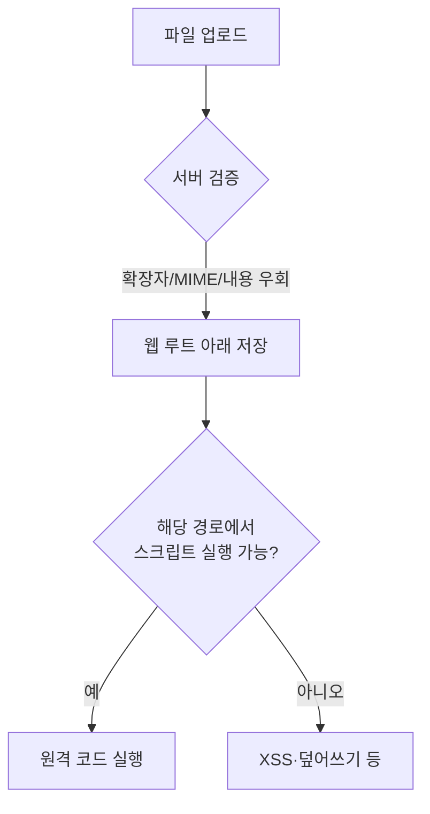

> 업로드 취약점은 "파일을 받는다"가 아니라 "받은 파일이 **서버에서 실행·해석되는 곳**에 놓인다"가 문제입니다. 검증은 많아도 실행 경계가 없으면 무너집니다.

## 원리: 취약해지는 세 가지 조건



공격이 성립하려면 보통 세 가지가 동시에 필요합니다.

1. 위험한 파일이 **업로드된다** (검증 미흡)
2. 업로드된 파일의 **경로를 알아낸다** (예측 가능한 이름, 응답에 경로 노출)
3. 그 경로에서 **실행·해석된다** (실행 권한, 핸들러 매핑)

방어자는 셋 중 하나만 끊어도 RCE는 막힙니다. 가장 싸고 확실한 것은 3번입니다.

## 취약한 코드와 고친 코드

**취약한 코드 (Flask)**

```python
@app.post("/upload")
def upload():
    f = request.files["file"]
    if f.content_type not in ("image/png", "image/jpeg"):   # 클라이언트가 정하는 값
        abort(400)
    f.save(os.path.join("static/uploads", f.filename))      # 원본 이름, 웹 루트 아래
    return jsonify(url=f"/static/uploads/{f.filename}")
```

문제는 세 가지입니다. `Content-Type`은 요청자가 마음대로 쓰는 헤더이고, 원본 파일명을 그대로 쓰며, 웹에서 바로 서빙되는 경로에 저장합니다.

**고친 코드**

```python
import os
import uuid

from flask import abort, jsonify, request
from PIL import Image

Image.MAX_IMAGE_PIXELS = 20_000_000           # 디컴프레션 폭탄 방어 (초과 시 예외)
MAX_UPLOAD_BYTES = 5 * 1024 * 1024            # 요청 크기 상한 (아래 설정과 함께)
ALLOWED = {"png": "PNG", "jpg": "JPEG"}
UPLOAD_DIR = "/var/app-data/uploads"          # 웹 루트 밖

app.config["MAX_CONTENT_LENGTH"] = MAX_UPLOAD_BYTES   # app은 위 취약 예제와 같은 Flask 앱

@app.post("/upload")
def upload():
    f = request.files.get("file")
    if f is None or not f.filename:            # 파일 누락, 빈 파일명 처리
        abort(400)
    ext = f.filename.rsplit(".", 1)[-1].lower() if "." in f.filename else ""
    if ext not in ALLOWED:
        abort(400)
    try:
        img = Image.open(f.stream)
        if img.format != ALLOWED[ext]:         # 내용과 확장자 일치
            abort(400)
        img = img.convert("RGB")
    except (OSError, ValueError, Image.DecompressionBombError):   # 깨진 파일, 폭탄
        abort(400)
    name = f"{uuid.uuid4().hex}.{ext}"          # 서버가 이름 결정
    img.save(os.path.join(UPLOAD_DIR, name))    # 재인코딩해서 저장
    return jsonify(id=name)                     # 경로는 노출하지 않음
```

`MAX_IMAGE_PIXELS`는 픽셀 수가 상한의 2배를 넘으면 `DecompressionBombError`를 내므로, 작은 파일 크기로 메모리를 고갈시키는 디컴프레션 폭탄을 막습니다. 요청 크기 상한(`MAX_CONTENT_LENGTH`)과 함께 두세요.

이미지를 **다시 인코딩**하면 파일 끝에 붙은 스크립트나 메타데이터 속 페이로드가 대부분 제거됩니다.

## 확인 방법(진단 순서)

| 단계 | 보내는 것 | 보는 것 | 취약 신호 |
|---|---|---|---|
| 1 | 정상 이미지 업로드 | 응답의 경로·이름 | 원본 이름, 예측 가능한 경로가 노출되면 3번 조건 충족 |
| 2 | 확장자만 바꾼 무해한 텍스트 파일(`.txt`에 마커 문자열) | 거부 여부 | 허용 목록이 아니라 차단 목록인지 판별 |
| 3 | 요청의 `Content-Type`만 `image/png`로 변경 | 수락 여부 | MIME만 검사하면 통과 |
| 4 | 파일 앞부분에 이미지 시그니처(매직바이트)를 붙인 무해 파일 | 수락 여부 | 시그니처만 검사하면 통과 |
| 5 | 업로드된 URL에 접근 | 실행되는가, 텍스트로 내려오는가 | 서버가 해석하면 치명적 |
| 6 | 파일명에 `../`, 긴 이름, 널 문자 | 저장 위치 변화 | 경로 이탈 |

진단에서는 **무해한 마커 파일**로 "해석 여부"만 증명합니다. 실제 웹셸을 올리면 서버에 상시 백도어가 남습니다. 증명 후 삭제하고 보고서에 기록하세요.

> **실무 포인트** 업로드 응답에는 경로가 없어도 **다운로드·미리보기 API**가 경로나 `Content-Type`을 그대로 내보내는 경우가 많습니다. 업로드 화면만 보지 말고 같은 파일을 꺼내는 모든 경로(썸네일, 첨부 다운로드, 관리자 목록)에서 `Content-Type`·`Content-Disposition`·`nosniff`를 확인하세요.

> **실무 포인트** 같은 업로드를 **다른 권한의 계정**(관리자 검수 화면, 내부 뷰어)이 열어 보는지 확인하세요. 일반 사용자 화면에서는 무해해도 관리자 화면에서 SVG·HTML이 렌더링되면 영향이 권한 상승으로 커집니다. 또한 업로드 직후가 아니라 비동기 후처리(썸네일·바이러스 검사)가 끝난 뒤의 상태를 다시 확인해야 합니다.

판단 포인트 두 가지.

- 검증이 막혀도 "실행 경로" 쪽 문제가 남는 경우가 많습니다. 확장자 필터를 뚫는 데 시간 쓰기 전에, 업로드 디렉터리가 실행 가능한지부터 보세요.
- 이미지 크기 검사, 안티바이러스, 썸네일 생성이 있어도 그 처리 단계 자체가 공격면입니다.

## 검증 우회의 유형(확인 관점)

| 검증 방식 | 허점 | 확인 포인트 |
|---|---|---|
| 확장자 차단 목록 | 목록에 없는 실행 확장자, 대소문자, 이중 확장자(`a.php.jpg`), 끝 공백·점 | 어떤 확장자까지 통과하는가 |
| 확장자 허용 목록 | 서버 매핑이 "마지막 확장자"가 아닌 경우 | 웹 서버의 핸들러 매핑 규칙 |
| Content-Type | 요청자가 임의 지정 | 헤더만 바꿔 통과하는가 |
| 매직바이트 | 앞부분만 보고 뒤는 안 봄 | 시그니처 뒤에 임의 내용이 허용되는가 |
| 파일명 정규화 | 검사 후 디코딩·정규화로 이름이 변함 | URL 인코딩, 유니코드 처리 순서 |
| 경쟁 조건 | 저장 후 검사하고 삭제하는 구조 | 삭제 전 짧은 시간에 접근 가능한가 |

## 설정·라이브러리를 통한 확장

스크립트 실행이 막혀 있어도 다음 경로가 남을 수 있습니다.

| 경로 | 원리 | 확인 포인트 |
|---|---|---|
| 서버 설정 파일 업로드 | 디렉터리별 설정 파일(`.htaccess`, `web.config` 등)이 업로드 가능하면 확장자 핸들러를 바꿀 수 있음 | 해당 이름의 파일이 거부되는가 |
| 저장형 XSS | SVG·HTML 업로드가 같은 출처에서 렌더링됨 | 응답 `Content-Type`, 다운로드 강제 여부 |
| 처리 라이브러리 취약점 | 이미지·문서 변환기가 특수 파일에서 파일 읽기·요청 유발 | 변환 기능의 라이브러리와 버전 |
| 압축 파일 | 압축 해제 시 `../` 경로 이탈, 대용량 폭탄 | 해제 경로 검증 |
| XML 계열(docx, svg) | 외부 엔티티 처리 | XML 파서 설정 |

## 대응 방안

**코드 수준**

1. 확장자는 **허용 목록**으로 제한하고, 내용(디코딩 성공 여부)을 실제로 파싱해 형식과 일치하는지 확인합니다.
2. 저장 이름은 서버가 생성(UUID)하고 원본 이름은 DB 메타데이터로만 보관합니다.
3. 이미지는 재인코딩, 문서는 가능하면 변환 후 저장합니다.
4. 크기·개수·압축 해제 총량 상한을 둡니다.

**설정 수준**

1. 업로드 디렉터리는 **웹 루트 밖**에 두거나, 불가피하면 해당 경로에서 스크립트 실행을 끕니다.
2. 디렉터리별 설정 파일 덮어쓰기 기능(`AllowOverride` 등)을 끕니다.
3. 파일 제공 시 `Content-Disposition: attachment`, 올바른 `Content-Type`, `X-Content-Type-Options: nosniff`를 붙입니다.

**구조 수준**

1. 사용자 파일은 별도 도메인(또는 객체 스토리지)에서 서빙해 쿠키와 출처를 분리합니다.
2. 변환 작업은 샌드박스된 워커에서 실행하고 아웃바운드를 제한합니다.
3. 필요하면 악성코드 스캔을 저장 전에 수행합니다.

## 참고 자료

- OWASP, File Upload Cheat Sheet
- OWASP Testing Guide, Test Upload of Unexpected File Types / Malicious File
- CWE-434: Unrestricted Upload of File with Dangerous Type
- CWE-22: Improper Limitation of a Pathname to a Restricted Directory
