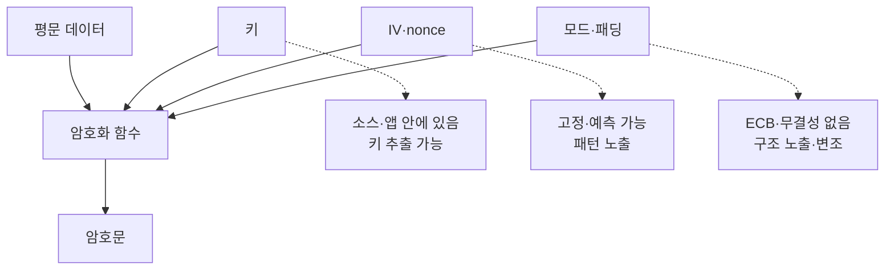

> AES 자체가 뚫리는 일은 드뭅니다. 실제 사고는 키가 소스에 있고, IV가 고정이고, 모드가 잘못 골라진 "사용법"에서 납니다.

## 이런 분께

- 서버나 앱에서 설정값·토큰·개인정보를 암호화해 저장하는 개발자
- 디컴파일 결과나 소스 리뷰에서 `Cipher.getInstance`, `AES.new` 같은 코드를 만나는 진단자
- "AES-256을 쓰니까 안전하다"는 설명의 빈틈을 짚고 싶은 분

## 1. 원리: 암호는 키와 사용법의 합

암호 알고리즘의 안전성은 **키의 비밀성**과 **올바른 사용법**을 전제로 합니다. 둘 중 하나가 깨지면 알고리즘 강도는 의미가 없어집니다.



특히 앱 바이너리나 서버 소스는 분석자가 열어 볼 수 있는 파일입니다. 키를 숫자 배열로 쪼개거나 문자열 연산으로 조립해도 **실행 시점에 한 번은 완성**되므로 숨김이 되지 않습니다. 난독화는 시간을 늦출 뿐 보호 수단이 아닙니다.

## 2. 취약한 코드 예시

가상의 설정 저장 모듈입니다.

```python
# vulnerable_crypto.py (가상 예제)
from Crypto.Cipher import AES
from Crypto.Util.Padding import pad, unpad

KEY = b"ExampleKey123456"        # 소스에 고정된 16바이트 키
IV  = b"0000000000000000"        # 고정 IV

def encrypt(plain: bytes) -> bytes:
    return AES.new(KEY, AES.MODE_CBC, IV).encrypt(pad(plain, 16))

def decrypt(data: bytes) -> bytes:
    return unpad(AES.new(KEY, AES.MODE_CBC, IV).decrypt(data), 16)
```

문제점입니다.

1. **하드코딩 키**: 소스, 빌드 산출물, 저장소 이력에서 키가 그대로 나옵니다. 키가 같은 모든 배포본이 한꺼번에 뚫립니다(CWE-798, CWE-321).
2. **고정 IV**: 같은 평문은 항상 같은 암호문이 되어 패턴이 드러납니다. CBC에서 IV는 예측 불가능해야 합니다(CWE-329).
3. **무결성 없음**: CBC만으로는 변조 여부를 알 수 없습니다. 복호화 오류 메시지가 달라지면 패딩 오라클 같은 부가 문제도 생깁니다.
4. 모드를 ECB로 두면 블록 단위 패턴이 그대로 보입니다. 처음 코드를 보면 모드 상수부터 확인합니다.

## 3. 고친 코드

```python
# safer_crypto.py (가상 예제)
import os
from cryptography.hazmat.primitives.ciphers.aead import AESGCM

def load_key() -> bytes:
    # 키는 환경변수·시크릿 매니저·KMS에서 주입. 소스에는 없음
    return bytes.fromhex(os.environ["APP_DATA_KEY"])   # 32바이트(AES-256)

def encrypt(plain: bytes, aad: bytes = b"") -> bytes:
    nonce = os.urandom(12)                        # 매번 새로 생성, 암호문 앞에 붙여 저장
    return nonce + AESGCM(load_key()).encrypt(nonce, plain, aad)

def decrypt(blob: bytes, aad: bytes = b"") -> bytes:
    nonce, ct = blob[:12], blob[12:]
    return AESGCM(load_key()).decrypt(nonce, ct, aad)   # 변조 시 예외 발생
```

핵심은 세 가지입니다. 키는 코드 밖에서 오고, nonce는 매번 난수이며, **인증된 암호화(AEAD)** 모드가 암호문 변조를 탐지합니다. `aad`에는 레코드 ID 같은 문맥을 넣어 다른 레코드로 암호문을 바꿔치기하는 것을 막을 수 있습니다.

> **실무 포인트** 키를 환경변수로 옮기는 것은 시작일 뿐입니다. 키가 유출됐을 때 **교체할 수 있는가**를 같이 설계해야 합니다. 암호문에 키 버전을 함께 저장해 두면 순환(rotation)이 가능해집니다.

## 4. 확인 방법(진단 순서)

소스 리뷰 또는 허가된 앱 분석 기준입니다.

1. **암호 API 호출 지점 찾기**
   - 보는 것: `Cipher.getInstance`, `AES.new`, `createCipheriv`, `MessageDigest` 등 암호 API 호출 위치를 모읍니다.
2. **키 출처 추적**
   - 보는 것: 키가 문자열 상수, 바이트 배열, 리소스 파일, 숫자 조합 등 **코드에 포함된 값**인지, 외부 주입인지 봅니다. 조각난 상수를 이어 붙이는 코드도 하드코딩입니다.
3. **IV·nonce 출처 확인**
   - 보는 것: 상수, 0으로 채운 배열, 키와 같은 값, 시간·카운터 기반의 예측 가능한 값인지 확인합니다.
4. **모드·패딩 확인**
   - 보는 것: ECB, 기본값 `AES`(구현에 따라 ECB가 기본)만 쓴 선언, 무결성 없는 CBC/CTR 사용 여부를 봅니다.
5. **키 길이·파생 확인**
   - 보는 것: 사람이 정한 짧은 문자열을 키로 바로 쓰는지, 비밀번호에서 키를 만들 때 전용 KDF(Argon2, scrypt, PBKDF2)와 솔트를 쓰는지 봅니다.
6. **저장소 이력 확인**
   - 보는 것: 키가 현재 코드에서는 지워졌어도 버전 관리 이력, 설정 샘플, 빌드 산출물에 남았는지 확인합니다.

> **실무 포인트** 하드코딩 키 하나가 발견되면 **같은 키로 보호되는 모든 데이터와 모든 배포본**이 영향 범위입니다. 보고서에는 "키 발견"이 아니라 "이 키로 무엇이 복호화·위조되는가"를 적어야 개발팀이 우선순위를 잡을 수 있습니다.

## 5. 유형·변형

| 유형 | 원리 | 확인 포인트 |
|---|---|---|
| 하드코딩 키 | 키가 소스·바이너리에 포함 | 상수, 분산 배열, 리소스 파일 |
| 고정·예측 IV | IV 재사용으로 패턴 노출 | 상수 IV, 키와 동일한 IV |
| 취약한 모드 | ECB는 블록 패턴 유지 | 모드 문자열, 기본값 의존 |
| 무결성 부재 | 암호문 변조를 탐지 못함 | HMAC 또는 AEAD 사용 여부 |
| 짧거나 약한 키 | 사람이 고른 문자열을 키로 사용 | 키 길이, KDF 사용 |
| 키 재사용 | 용도가 다른 데이터에 같은 키 | 용도별 키 분리 |
| 이력·로그 잔존 | 삭제된 키가 이력에 남음 | 커밋 이력, 로그, 샘플 설정 |

## 6. 대응 방안

### 코드 수준

- 라이브러리의 고수준 API(AEAD: AES-GCM, ChaCha20-Poly1305)를 쓰고, 모드·패딩을 직접 조합하지 않습니다.
- IV/nonce는 CSPRNG로 매번 생성하고 암호문과 함께 저장합니다. 공개돼도 됩니다.
- 비밀번호 기반 키는 전용 KDF와 솔트로 파생합니다.
- 자체 암호 알고리즘이나 XOR 기반 "암호화"를 만들지 않습니다.

### 설정 수준

- 키는 시크릿 매니저·KMS·환경 주입으로 관리하고, 저장소에는 `.env` 예시만 둡니다.
- 시크릿 스캐너를 CI에 넣어 커밋 전에 키 패턴을 차단합니다.
- 노출된 키는 즉시 폐기하고 교체합니다. 이력에서 지우는 것만으로는 충분하지 않습니다.

### 구조 수준

- 앱(클라이언트)에 대칭키를 넣어 서버 비밀을 보호하는 설계를 피합니다. 비밀이 필요한 연산은 서버로 옮깁니다.
- 용도별로 키를 분리하고 키 버전을 기록해 순환 절차를 정해 둡니다.
- 가능하면 KMS의 봉투 암호화(envelope encryption)로 데이터 키를 관리합니다.

## 7. 점검 체크리스트

- [ ] 소스·바이너리·설정 샘플·이력에 키와 IV가 없다
- [ ] 키는 외부 시크릿 저장소에서 주입되며 교체 절차가 있다
- [ ] IV/nonce를 CSPRNG로 매번 새로 만든다
- [ ] ECB를 쓰지 않고 AEAD 모드를 사용한다
- [ ] 비밀번호에서 키를 만들 때 KDF와 솔트를 쓴다
- [ ] 용도별로 키가 분리돼 있고 버전이 기록된다
- [ ] CI에 시크릿 스캔이 있다
- [ ] 클라이언트 앱에 서버 비밀 보호용 대칭키를 넣지 않았다

## 함께 보기

- [JWT 취약점](/notes/jwt-vulnerabilities/)
- [인증 취약점](/notes/authentication-vulnerabilities/)

## 참고 자료

- OWASP Cryptographic Storage Cheat Sheet: <https://cheatsheetseries.owasp.org/cheatsheets/Cryptographic_Storage_Cheat_Sheet.html>
- OWASP Secrets Management Cheat Sheet: <https://cheatsheetseries.owasp.org/cheatsheets/Secrets_Management_Cheat_Sheet.html>
- CWE-798 Use of Hard-coded Credentials: <https://cwe.mitre.org/data/definitions/798.html>
- CWE-321 Use of Hard-coded Cryptographic Key: <https://cwe.mitre.org/data/definitions/321.html>
- CWE-329 Generation of Predictable IV with CBC Mode: <https://cwe.mitre.org/data/definitions/329.html>
- CWE-327 Use of a Broken or Risky Cryptographic Algorithm: <https://cwe.mitre.org/data/definitions/327.html>
- CWE-326 Inadequate Encryption Strength: <https://cwe.mitre.org/data/definitions/326.html>
