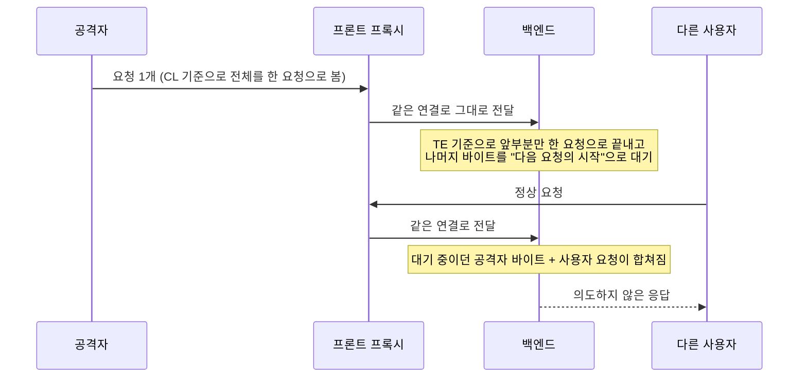

> 프록시와 백엔드 서버가 "이 요청이 어디서 끝나는가"를 서로 다르게 판단하면, 공격자가 보낸 요청의 뒷부분이 **다른 사용자의 요청 앞에 붙어버립니다**. 이것이 HTTP Request Smuggling(요청 밀수)입니다.

## 이런 분께

- 리버스 프록시, CDN, 로드밸런서 뒤에 애플리케이션 서버를 두고 운영하는 분
- 진단 중 "프록시 앞에서는 막히는데 뒤에서는 열려 있다"는 상황을 겪어 본 분
- `Content-Length`와 `Transfer-Encoding`이 헷갈리는 분

## 1. 원리: 요청의 끝은 누가 정하는가

HTTP/1.1은 하나의 TCP 연결에 여러 요청을 이어서 보냅니다(keep-alive). 요청 본문의 길이를 알려 주는 방법은 두 가지입니다.

| 방법 | 설명 |
|---|---|
| `Content-Length` (CL) | 본문 바이트 수를 숫자로 적습니다 |
| `Transfer-Encoding: chunked` (TE) | 본문을 `크기(16진수) + 데이터` 덩어리로 보내고, 크기 0인 덩어리로 끝냅니다 |

RFC 9112는 두 헤더가 함께 오면 **TE를 우선**하고, 그런 요청은 오류로 취급하거나 CL을 제거하라고 합니다. 문제는 실제 구현들이 이 규칙을 항상 같게 지키지는 않는다는 점입니다. 프록시는 CL로 읽고 백엔드는 TE로 읽으면, 같은 바이트 스트림이 서로 다른 요청 개수로 해석됩니다.



핵심 조건은 두 가지입니다.

1. 프록시와 백엔드 사이에서 **연결이 재사용**될 것
2. 두 쪽이 **요청 경계를 다르게 해석**할 것

## 2. 취약한 구성 예시

코드 한 줄의 버그라기보다 "두 파서의 조합"이 취약점입니다. 아래는 단순화한 개념 예시입니다.

```text
# 프론트: CL을 우선해 읽는 프록시 / 백엔드: TE를 우선해 읽는 서버 (CL.TE)
POST / HTTP/1.1
Host: example.com
Content-Length: 13
Transfer-Encoding: chunked

0

SMUGGLED
```

- 프론트는 `Content-Length: 13`만큼, 즉 `0\r\n\r\nSMUGGLED`까지를 한 요청의 본문으로 보고 통째로 전달합니다.
- 백엔드는 `0`짜리 덩어리에서 요청이 끝났다고 보고, 남은 `SMUGGLED`를 **다음 요청의 첫 줄**로 대기시킵니다.

그 다음에 같은 연결로 들어오는 누군가의 요청이 `SMUGGLED`로 시작하는 요청으로 합쳐집니다.

고친 구성은 코드가 아니라 설정입니다. 아래는 nginx 뒤에 앱을 둘 때 **업스트림 연결 재사용을 최소화하는 예시**입니다. 이 설정만으로 모호한 요청이 차단되지는 않습니다. 모호한 요청(CL+TE 동시, 중복 CL 등)을 400으로 거부하는지는 프록시 종류와 버전의 파서 동작에 달려 있으므로, 설정 뒤에도 진단으로 확인해야 합니다.

```nginx
# 참고: 구형 구성은 upstream 블록에 keepalive 32; 처럼 업스트림 연결을 재사용합니다.

# 예시: 업스트림 keepalive를 켜지 않아 desync가 다음 요청으로 번질 여지를 줄임
upstream app {
    server 127.0.0.1:8080;
    # keepalive 지시어를 쓰지 않습니다 (연결 재사용 최소화)
}
server {
    listen 443 ssl;
    http2 on;          # nginx 1.25.1 이상 문법. 이전 버전은 listen 443 ssl http2;
    location / {
        proxy_http_version 1.1;
        proxy_set_header Connection "close";   # 업스트림 연결을 요청마다 닫음
        proxy_pass http://app;
    }
}
```

> **실무 포인트** 프론트가 HTTP/2를 받는다고 안전하다고 판단하기 쉽습니다. 실제 위험은 프록시가 백엔드로 **HTTP/1.1로 다시 써서 보내는 구간**에 있으므로, 진단은 외부 프로토콜이 아니라 "프록시-백엔드 구간이 무엇이고 연결을 재사용하는가"부터 확인해야 합니다.

> **실무 포인트** CDN이나 로드밸런서가 앞에 한 겹 더 있으면 내가 보낸 변형 헤더가 첫 계층에서 이미 정규화되어 사라집니다. 지연 기법이 반응하지 않을 때 "안전"이 아니라 "어느 계층이 걸렀는지 모름"으로 기록하고, 가능하면 계층을 건너뛰는 내부 경로에서도 따로 확인하세요.

설정 한 줄로 끝나지 않는 점이 중요합니다. 실제로는 "프록시와 백엔드를 모두 최신으로 두고, 애매한 요청은 프록시가 400으로 끊게" 만드는 것이 핵심입니다.

## 3. 확인 방법(진단 순서)

허가된 환경에서, 가능하면 공유 트래픽이 없는 시간이나 별도 테스트 환경에서 진행합니다. 요청이 다른 사용자에게 섞일 수 있어 운영 환경에서는 특히 조심해야 합니다.

1. **구조 파악**: 응답 헤더(`Server`, `Via`, `X-Cache` 등)로 프록시 계층이 있는지 확인합니다. 계층이 하나뿐이면 가능성이 낮습니다.
2. **시간 지연 기법으로 유형 추정**
   - 보내는 것: 본문이 일부러 모자라게 `Content-Length`를 크게 적은 요청, 또는 chunked 종료를 빼먹은 요청
   - 보는 것: 응답이 **수 초간 멈추면** 한쪽 서버가 나머지 본문을 기다리고 있다는 신호입니다. 어느 쪽 조합에서 멈추는지로 CL.TE / TE.CL을 구분합니다.
3. **차이 응답으로 확인**
   - 보내는 것: 앞부분이 완결된 요청 + 뒷부분이 존재하지 않는 경로로 시작하는 밀수 조각
   - 보는 것: 바로 이어 보낸 **내 두 번째 요청**이 404 같은 엉뚱한 응답을 받으면 경계가 어긋났다는 증거입니다.
4. **영향 범위 판단**: 같은 연결을 공유하는 다른 사용자의 요청이 영향받는지, 프록시의 접근 제어(예: 특정 경로 차단)를 우회할 수 있는지를 따져 위험도를 정합니다. 여기서 보고서는 "재현 가능" 수준에서 멈추고, 타 사용자 데이터를 실제로 가로채는 단계까지 가지 않는 것이 일반적인 진단 범위입니다.

실무에서 많이 놓치는 부분입니다. 한 번 응답이 정상으로 보였다고 안전하다고 결론짓지 마세요. 프록시가 **클라이언트 연결과 백엔드 연결을 어떻게 묶는지**에 따라 재현이 간헐적일 수 있습니다. 같은 요청을 연결을 새로 맺어 여러 번 시도해야 합니다. 또 하나, 지연 기법이 반응하지 않는다고 해서 취약하지 않은 것이 아닙니다. 프록시가 모자란 본문 요청 자체를 거부하고 있을 수 있어서, 헤더 표기 변형 쪽을 따로 봐야 합니다.

## 4. 유형·변형

| 유형 | 원리 | 확인 포인트 |
|---|---|---|
| CL.TE | 프론트는 CL, 백엔드는 TE로 해석 | 백엔드가 TE를 우선하는데 프록시가 TE를 무시 |
| TE.CL | 프론트는 TE, 백엔드는 CL로 해석 | 프록시가 chunked를 처리하고 백엔드는 CL만 사용 |
| TE.TE | 양쪽 다 TE를 지원하지만, 변형된 헤더 표기에서 한쪽만 무시 | `Transfer-Encoding` 값에 공백·탭·대소문자·중복 헤더를 변형해도 한쪽만 인식하는지 |
| CL.CL | 중복된 `Content-Length` 값을 서로 다르게 선택 | 값이 다른 CL 헤더를 두 개 보냈을 때 허용되는지 |
| H2.CL / H2.TE (다운그레이드) | 프론트는 HTTP/2, 백엔드는 HTTP/1.1로 변환하면서 길이 정보가 어긋남 | HTTP/2 요청에 `content-length`나 `transfer-encoding` 헤더가 남아 변환될 때 일관성 검증 여부 |
| 응답 큐 오염 계열 | 밀수된 요청의 응답이 다음 사용자의 응답으로 밀림 | 연결 재사용 환경에서 응답이 한 칸씩 밀리는 현상 |

### HTTP/2 다운그레이드

HTTP/2는 메시지 길이를 프레임 구조로 알기 때문에 CL/TE 모호성이 원래는 없습니다. 하지만 프론트가 HTTP/2로 받고 백엔드에는 HTTP/1.1로 다시 써서 보낼 때 문제가 되살아납니다. 이때 클라이언트가 보낸 `content-length`나 `transfer-encoding`이 그대로 변환되거나, 헤더 값에 줄바꿈 문자가 섞여 들어가면 같은 desync가 생깁니다. RFC 9113은 HTTP/2에서 연결 단위 헤더(`transfer-encoding` 등)를 금지하고 줄바꿈이 든 헤더 값을 거부하라고 규정합니다. 즉 **규칙은 있는데 변환 계층에서 지켜지는지**가 진단 포인트입니다.

## 5. 대응 방안

### 구조 수준
- **프록시-백엔드 구간도 HTTP/2 end-to-end**로 구성합니다. 요청 경계가 프레임으로 정해져 모호성 자체가 사라집니다.
- 불가능하다면 업스트림 연결을 **요청마다 새로 맺거나** 재사용 범위를 줄입니다. 성능과 맞바꾸는 선택이므로 위험도에 따라 결정합니다.
- 프론트와 백엔드를 **같은 파서(같은 제품·같은 버전 계열)** 로 맞춥니다.

### 설정 수준
- 프록시, 웹 서버, 로드밸런서, 애플리케이션 서버를 **최신 버전으로 유지**합니다. 상당수 변형은 벤더가 파서를 엄격하게 고쳐서 막았습니다.
- 프록시에서 **모호한 요청은 거부(400)** 하도록 설정합니다. CL과 TE가 동시에 있는 요청, 중복 CL, 형식이 깨진 TE 값이 대상입니다.
- HTTP/2에서 HTTP/1.1로 내릴 때 **헤더를 새로 만들어** 쓰고(요청 길이를 프록시가 직접 계산), 줄바꿈 문자나 연결 단위 헤더가 있으면 거부합니다.
- WAF만 믿지 않습니다. 밀수는 WAF 앞단에서 이미 경계가 어긋나는 문제라 WAF 규칙으로 막기 어렵습니다.

### 코드 수준
- 애플리케이션이 직접 소켓을 읽거나 HTTP 파서를 자체 구현하고 있다면, 검증된 라이브러리로 교체합니다.
- 인증이나 접근 제어를 **프록시의 경로 차단에만 의존하지 않습니다.** 밀수는 바로 그 차단을 우회하는 용도로 쓰이므로, 백엔드에서도 권한을 한 번 더 검사합니다.

## 6. 점검 체크리스트

- [ ] 요청 경로 상에 프록시·CDN·로드밸런서가 몇 계층인지 파악했는가
- [ ] 각 계층의 제품과 버전이 현재 보안 패치 수준인가
- [ ] 프록시가 CL+TE 동시 요청, 중복 CL, 변형된 TE 값을 거부하는가
- [ ] 프록시와 백엔드 사이가 HTTP/2 end-to-end이거나, 연결 재사용 정책이 정리되어 있는가
- [ ] HTTP/2 다운그레이드 시 `content-length`, `transfer-encoding` 및 줄바꿈 포함 헤더를 검증하는가
- [ ] 백엔드에서도 접근 제어를 독립적으로 수행하는가
- [ ] 진단은 별도 테스트 환경에서 하거나, 운영이면 영향 범위를 합의했는가

## 7. 참고 자료

- [RFC 9112: HTTP/1.1 (메시지 본문 길이 결정 규칙)](https://www.rfc-editor.org/info/rfc9112/)
- [RFC 9113: HTTP/2 (연결 단위 헤더 금지, 메시지 검증)](https://www.rfc-editor.org/info/rfc9113/)
- [CWE-444: Inconsistent Interpretation of HTTP Requests ('HTTP Request/Response Smuggling')](https://cwe.mitre.org/data/definitions/444.html)
- [RFC 9112 6.3절: Message Body Length](https://www.rfc-editor.org/rfc/rfc9112.html#section-6.3)
