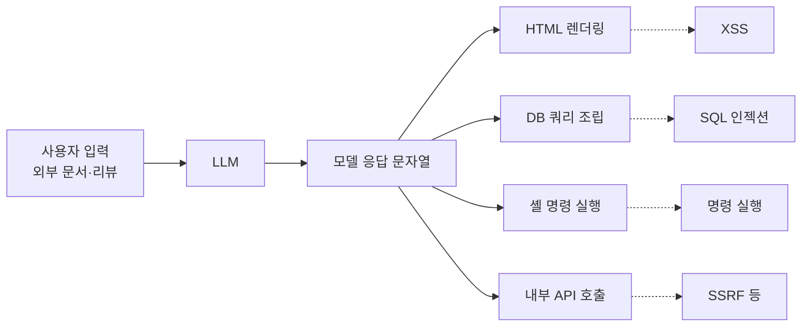

> LLM의 응답은 "사용자가 간접적으로 쓴 문자열"입니다. 응답을 화면, 쿼리, 명령어로 넘기기 전에 일반 사용자 입력과 똑같이 검증하고 인코딩해야 합니다.

## 이런 분께

- 챗봇 응답을 웹 화면에 바로 렌더링하거나, 모델이 만든 값을 DB·셸·내부 API로 넘기는 개발자
- "프롬프트 인젝션은 막았으니 출력은 괜찮다"는 설명을 들은 진단자
- OWASP Top 10 for LLM Applications(2025)의 LLM05(Improper Output Handling)를 실무로 옮기고 싶은 분

## 1. 원리: 출력은 다음 시스템의 입력

LLM05는 모델이 만든 출력이 **다른 시스템으로 넘어가기 전에** 검증·정화되지 않는 문제입니다. 입력 쪽 방어(LLM01)가 아무리 단단해도, 모델 응답에는 사용자 입력, 검색된 문서, 다른 사용자가 남긴 리뷰 같은 외부 문자열이 섞여 나옵니다. 그래서 응답은 "신뢰할 수 있는 내부 데이터"가 아닙니다.



핵심은 새로운 취약점이 아니라 **기존 취약점(XSS, SQLi, 명령 주입)이 LLM이라는 경로로 다시 열린다**는 점입니다. 모델이 "정상적인 말투"로 답한다는 이유로 신뢰 경계가 사라진 것처럼 취급하면 사고가 납니다.

## 2. 취약한 코드 예시

가상의 상품 문의 챗봇입니다. 모델 응답을 마크다운 변환 후 그대로 HTML에 넣고, 모델이 고른 정렬 기준을 쿼리에 이어 붙입니다.

```python
# vulnerable_chat.py (가상 예제)
from flask import Flask, request, jsonify
import markdown

app = Flask(__name__)
# llm: 모델 호출 클라이언트, db: DB 연결 객체 (예제에서는 생략한 가상 객체)

@app.post("/chat")
def chat():
    answer = llm.complete(request.json["message"])   # 외부 문서가 섞일 수 있음
    html = markdown.markdown(answer)                  # 원시 HTML을 그대로 통과시킴
    return jsonify({"html": html})                    # 프런트는 innerHTML로 삽입

@app.post("/search")
def search():
    sort = llm.complete("정렬 기준 한 단어만: " + request.json["message"])
    rows = db.execute(f"SELECT * FROM items ORDER BY {sort}")   # 모델 출력을 쿼리에 직접 연결
    return jsonify(rows)
```

문제점은 두 가지입니다.

1. 응답 HTML이 정화되지 않고 `innerHTML`로 들어가 저장형·반사형 XSS 경로가 됩니다. 다른 사용자가 남긴 리뷰가 응답에 인용되면 피해자는 챗봇을 쓴 본인이 아니라 그 응답을 보는 모든 사람입니다.
2. 모델이 "한 단어만" 답하도록 지시받았다는 사실은 보안 통제가 아닙니다. 형식 지시는 어겨질 수 있습니다.

## 3. 고친 코드

```python
# safer_chat.py (가상 예제)
import markdown
import nh3                       # bleach는 2023년 deprecated, 유지보수되는 nh3 사용
from flask import Flask, request, jsonify

app = Flask(__name__)
# llm, db는 앞 예제와 같은 가상 객체

ALLOWED_TAGS = {"p", "ul", "ol", "li", "strong", "em", "code", "pre", "a"}
ALLOWED_ATTRS = {"a": {"href"}}
SORT_ALLOWED = {"price": "price", "name": "name", "rating": "rating"}

@app.post("/chat")
def chat():
    answer = llm.complete(request.json["message"])
    html = markdown.markdown(answer)
    clean = nh3.clean(html, tags=ALLOWED_TAGS, attributes=ALLOWED_ATTRS,
                      url_schemes={"https"})                  # 허용 목록 기반 정화
    return jsonify({"html": clean})

@app.post("/search")
def search():
    sort = llm.complete("정렬 기준 한 단어만: " + request.json["message"]).strip().lower()
    column = SORT_ALLOWED.get(sort, "name")                   # 허용 목록에 없으면 기본값
    rows = db.execute(f"SELECT * FROM items ORDER BY {column}")  # 식별자는 매핑된 상수만
    return jsonify(rows)
```

`bleach`를 쓰는 기존 코드도 많지만 2023년에 deprecated 되었으므로 새 코드는 `nh3`(Rust 기반 ammonia 바인딩)를, 브라우저 쪽 정화는 DOMPurify 같은 검증된 라이브러리를 고려하세요. 프런트엔드에서도 가능하면 `innerHTML` 대신 `textContent`로 넣습니다. 마크다운 렌더링이 꼭 필요하면 서버에서 정화한 결과만 쓰고, 기본 CSP를 함께 둡니다.

> **실무 포인트** 값(value)은 바인딩으로 해결되지만, 컬럼명·정렬 방향 같은 **식별자**는 바인딩이 안 됩니다. 모델이 고르는 값이 식별자 자리에 들어간다면 허용 목록 매핑이 유일한 답입니다.

## 4. 확인 방법(진단 순서)

허가된 환경에서, 무해한 표식 문자열로만 확인합니다.

1. **출력이 가는 곳 지도 그리기**
   - 보는 것: 응답이 HTML, 마크다운, 쿼리, 명령, 파일 경로, 내부 API 중 어디로 들어가는지 코드와 화면으로 확인합니다.
2. **렌더링 방식 확인**
   - 보내는 것: 화면에서 구분 가능한 무해한 태그(예: 굵은 글씨 태그)가 응답에 포함되도록 요청합니다.
   - 보는 것: 태그가 글자 그대로 보이면 이스케이프된 것이고, 서식이 적용되면 정화 없이 렌더링되는 것입니다. 이 단계에서 멈추고 보고해도 충분합니다.
3. **간접 경로 확인**
   - 보는 것: 다른 사용자가 쓴 콘텐츠(리뷰, 문의, 문서)가 응답에 인용되는 구조인지 봅니다. 인용된다면 위험도가 한 단계 올라갑니다.
4. **하위 시스템 연결 확인**
   - 보내는 것: 모델이 만든 값(정렬 기준, 필터, 파일명)이 쿼리·명령·경로에 쓰인다면, 허용 범위 밖의 무해한 값으로 바뀌었을 때 서버가 거부하는지 봅니다.
5. **링크·이미지 확인**
   - 보는 것: 응답 속 URL이 자동으로 로드되는 이미지나 링크라면, 외부 주소로 데이터가 새어 나갈 수 있는 구조인지 봅니다.

> **실무 포인트** "모델이 그런 문장을 안 만들어요"는 방어가 아닙니다. 확인할 것은 모델이 만들 수 있는지가 아니라, **만들었을 때 화면과 백엔드가 막아 주는지**입니다. 여기서 많이 놓칩니다.

## 5. 유형·변형

| 유형 | 원리 | 확인 포인트 |
|---|---|---|
| 응답 HTML 렌더링 | 정화 없는 `innerHTML`·원시 HTML 허용 마크다운 | 서식 태그가 그대로 적용되는지 |
| 간접 저장형 XSS | 타 사용자 콘텐츠가 응답에 인용됨 | 인용 데이터의 출처와 정화 위치 |
| 쿼리 조립 | 모델 출력이 SQL·NoSQL 조건에 연결 | 식별자 허용 목록, 바인딩 사용 여부 |
| 명령·경로 조립 | 모델 출력이 셸 인자·파일 경로에 연결 | 인자 배열 사용, 경로 정규화 |
| 링크·이미지 자동 로드 | 응답 속 URL이 자동 요청됨 | 외부 도메인 허용 여부, CSP |
| 하위 API 연쇄 | 응답이 다른 서비스의 입력이 됨 | 수신 측의 독립 검증 |

## 6. 대응 방안

### 코드 수준

- 출력 컨텍스트에 맞게 인코딩합니다(HTML 본문, 속성, URL, JS는 각각 규칙이 다릅니다).
- 마크다운·HTML 렌더링은 허용 목록 기반 정화 라이브러리를 거치고, 허용 프로토콜은 `https` 정도로 제한합니다.
- 모델이 고른 값은 열거형·정규식·스키마로 검증하고, 식별자는 매핑 테이블로 치환합니다.
- 쿼리는 바인딩, 명령은 인자 배열(셸 비사용)로 호출합니다.

### 설정 수준

- 엄격한 CSP(Content Security Policy)로 인라인 스크립트와 외부 이미지 로드를 제한합니다.
- 챗봇 백엔드가 쓰는 DB·API 계정은 읽기 전용 등 최소 권한으로 둡니다.

### 구조 수준

- 모델 출력을 신뢰 경계 밖의 입력으로 분류하고, 수신하는 모든 시스템이 독립적으로 검증합니다.
- 모델이 직접 명령·쿼리 전문을 만들게 하지 말고, 목적별 좁은 함수의 매개변수만 고르게 합니다.

## 7. 점검 체크리스트

- [ ] 모델 응답이 가는 모든 목적지(화면, 쿼리, 명령, API)를 파악했다
- [ ] HTML 렌더링 전에 허용 목록 기반 정화를 한다
- [ ] 프런트에서 `innerHTML` 대신 안전한 삽입 방식을 쓴다
- [ ] 모델이 고른 식별자·옵션은 허용 목록으로 치환한다
- [ ] 쿼리는 바인딩, 명령은 인자 배열로 호출한다
- [ ] 다른 사용자 콘텐츠가 응답에 인용될 때의 정화 지점이 정해져 있다
- [ ] CSP가 인라인 스크립트와 외부 리소스를 제한한다
- [ ] 후속 시스템도 모델 출력과 무관하게 입력 검증을 한다

## 함께 보기

- [프롬프트 인젝션 방어 설계](/notes/prompt-injection-defense/)
- [LLM 에이전트의 과도한 권한](/notes/llm-excessive-agency/)
- [Content Security Policy](/notes/content-security-policy/)
- [SQL Injection](/notes/sql-injection/)

## 참고 자료

- OWASP LLM05:2025 Improper Output Handling: <https://genai.owasp.org/llmrisk/llm052025-improper-output-handling/>
- OWASP Top 10 for LLM Applications 2025: <https://genai.owasp.org/llm-top-10/>
- OWASP Cross Site Scripting Prevention Cheat Sheet: <https://cheatsheetseries.owasp.org/cheatsheets/Cross_Site_Scripting_Prevention_Cheat_Sheet.html>
- OWASP Content Security Policy Cheat Sheet: <https://cheatsheetseries.owasp.org/cheatsheets/Content_Security_Policy_Cheat_Sheet.html>
- CWE-79 Cross-site Scripting: <https://cwe.mitre.org/data/definitions/79.html>
- CWE-116 Improper Encoding or Escaping of Output: <https://cwe.mitre.org/data/definitions/116.html>
