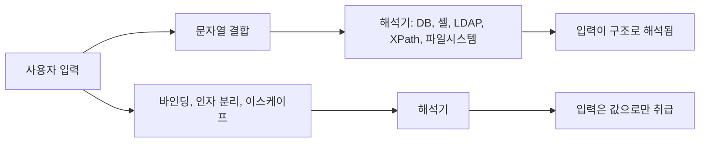

> 인젝션은 한 문장으로 요약됩니다. "데이터가 구조(질의·명령·경로)로 해석되는 지점"을 찾으면 됩니다.

## 이런 분께

- Java 서버 코드를 리뷰하며 무엇을 grep해야 하는지 정리하고 싶은 분
- 시큐어코딩 점검표를 팀 리뷰 절차에 넣으려는 개발자·진단자
- 인젝션 종류는 알지만 Java에서 어떤 API로 고치는지 헷갈리는 분

## 1. 원리: 문자열 결합이 만나는 지점



해결의 원칙은 모든 항목에서 같습니다. **구조와 값을 분리하는 API를 쓰고, 분리가 안 되는 곳(정렬 컬럼, 명령 이름 등)은 허용 목록으로 고르게 합니다.**

## 2. 항목별 점검표

### 2-1. SQL 인젝션 (CWE-89)

취약:

```java
String sql = "SELECT * FROM users WHERE name = '" + name + "'";
ResultSet rs = conn.createStatement().executeQuery(sql);
```

안전:

```java
String sql = "SELECT * FROM users WHERE name = ?";
try (PreparedStatement ps = conn.prepareStatement(sql)) {
    ps.setString(1, name);
    ResultSet rs = ps.executeQuery();
}
```

- 확인(grep): `createStatement`, `executeQuery(` 인자에 `+` 또는 `String.format`, MyBatis의 `${`.
- 정렬 컬럼·테이블명은 바인딩할 수 없으므로 허용 목록 맵으로 변환합니다.

> **실무 포인트** `PreparedStatement`를 쓰고도 `prepareStatement("... " + input)`처럼 **미리 결합한 문자열**을 넘기면 소용이 없습니다. 클래스 이름이 아니라 SQL 문자열이 상수인지 보십시오. MyBatis에서는 `#{}`는 안전하고 `${}`는 결합이라는 점도 많이 놓칩니다.

### 2-2. OS 명령 인젝션 (CWE-78)

취약:

```java
Runtime.getRuntime().exec("sh -c ping -c 1 " + host);
```

안전:

```java
if (!host.matches("[A-Za-z0-9.-]{1,253}")) throw new IllegalArgumentException();
ProcessBuilder pb = new ProcessBuilder("ping", "-c", "1", host);   // 인자를 분리
pb.redirectErrorStream(true);
Process p = pb.start();
```

- 확인(grep): `Runtime.getRuntime().exec`, `ProcessBuilder`, `"sh"`, `"cmd"`, `"-c"`.
- 인자 분리만으로 끝나지 않습니다. 값이 `-`로 시작해 옵션처럼 해석되는 경우를 막기 위해 허용 문자 검증을 하고, 가능하면 외부 명령 대신 Java API를 씁니다.

### 2-3. LDAP 인젝션 (CWE-90)

취약:

```java
String filter = "(&(uid=" + uid + ")(userPassword=" + pw + "))";
ctx.search("ou=people,dc=example,dc=com", filter, controls);
```

안전:

```java
String filter = "(&(uid={0})(objectClass=person))";
ctx.search("ou=people,dc=example,dc=com", filter, new Object[]{ uid }, controls);
```

- `search(name, filterExpr, filterArgs, cons)` 형태는 인자를 이스케이프해 줍니다. 비밀번호 비교는 필터가 아니라 **bind 인증**으로 합니다.
- 확인(grep): `DirContext`, `.search(` 인자에 문자열 결합. DN을 만드는 부분은 별도로 DN 이스케이프가 필요합니다.

### 2-4. XPath 인젝션 (CWE-643)

취약:

```java
String expr = "//user[name='" + name + "' and pw='" + pw + "']";
Node n = (Node) xpath.evaluate(expr, doc, XPathConstants.NODE);
```

안전:

```java
XPath xp = XPathFactory.newInstance().newXPath();
xp.setXPathVariableResolver(v -> "n".equals(v.getLocalPart()) ? name : null);
Node n = (Node) xp.evaluate("//user[name=$n]", doc, XPathConstants.NODE);
```

- 확인(grep): `XPathFactory`, `xpath.evaluate(`, `compile(`의 문자열 결합.
- XPath는 주석·이스케이프 규칙이 약해 문자열 치환 방어가 깨지기 쉽습니다. 변수 바인딩을 씁니다.

### 2-5. 로그 인젝션 (CWE-117)

취약:

```java
log.info("login failed for " + username);   // username에 줄바꿈이 포함될 수 있음
```

안전:

```java
String safe = username.replaceAll("[\\r\\n\\t]", "_");
log.info("login failed for {}", safe);
```

- 확인(grep): 로그 호출 인자에 요청 파라미터·헤더가 그대로 들어가는지(`getParameter`, `getHeader`).
- 줄 단위 로그라면 CR/LF 치환, JSON 로그라면 로거의 구조적 필드를 사용합니다. 로그 뷰어가 HTML이면 출력 시 이스케이프도 필요합니다.

### 2-6. 경로 조작 (CWE-22)

취약:

```java
File f = new File("/srv/files/" + request.getParameter("name"));
```

안전:

```java
Path base = Paths.get("/srv/files").toRealPath();
Path target = base.resolve(name).normalize();
if (!target.startsWith(base)) throw new SecurityException("invalid path");
```

- 확인(grep): `new File(`, `Paths.get(`, `FileInputStream(` 인자에 요청 값이 결합.
- 정규화(`normalize`) 후 **기준 디렉터리 안에 있는지** 검사합니다. 심볼릭 링크가 걱정되면 `toRealPath()`로 실제 경로를 비교합니다.

> **실무 포인트** `..` 문자열을 지우는 `replace("../", "")`식 방어는 `....//` 같은 입력에서 다시 `../`가 만들어집니다. 문자열을 지우지 말고 **정규화 후 경계 검사**를 하십시오.

## 3. 한눈에 보는 표

| 유형 | 위험 API 신호 | 안전한 방식 | 확인 포인트 |
|---|---|---|---|
| SQL | <code>createStatement</code>, <code>+</code>, <code>${}</code> | <code>PreparedStatement</code>, <code>#{}</code> | SQL 문자열이 상수인가 |
| OS 명령 | <code>exec(String)</code>, <code>sh -c</code> | <code>ProcessBuilder</code> 인자 분리 | 옵션처럼 해석되는 값 |
| LDAP | 필터 문자열 결합 | <code>{0}</code> 인자 필터, bind 인증 | DN·필터 모두 확인 |
| XPath | <code>evaluate</code>에 결합 | 변수 리졸버 | 인증 로직에 쓰이는가 |
| 로그 | 파라미터 직접 출력 | 치환·구조적 로깅 | 줄바꿈 포함 여부 |
| 경로 | <code>new File(base + input)</code> | 정규화 후 경계 검사 | 업로드·다운로드 모두 |

## 4. 확인 방법(리뷰 순서)

1. 위 표의 위험 API를 저장소 전체에서 grep으로 모읍니다.
2. 각 호출에서 인자가 **상수인지, 외부 입력이 섞이는지** 역추적합니다.
3. 입력이 섞이면 바인딩·분리·허용 목록 중 무엇으로 막고 있는지 확인합니다.
4. 허가된 환경의 테스트 서버에서 따옴표, 줄바꿈, `..` 입력으로 동작이 달라지는지 확인합니다.
5. 발견 항목마다 CWE 번호와 수정 예시를 함께 적어 개발팀에 전달합니다.

## 5. 대응 방안

### 코드 수준

- 질의·명령·경로 API는 값 바인딩 방식만 사용하고, 결합 코드는 리뷰에서 거절합니다.
- 바인딩이 불가능한 요소(정렬 컬럼, 명령 이름, 파일 종류)는 허용 목록으로 변환합니다.
- 입력 검증은 보조 수단입니다. 1차 방어는 항상 구조 분리입니다.

### 설정 수준

- DB 계정은 최소 권한으로, LDAP 조회 계정은 읽기 전용으로 둡니다.
- 서비스 계정에 셸 실행 권한과 파일 쓰기 범위를 제한합니다.

### 구조 수준

- 정적 분석(SAST) 규칙과 CI 단계의 grep 검사로 위험 패턴을 자동 차단합니다.
- 공용 유틸(안전한 경로 해석, 명령 실행 래퍼)을 만들어 팀이 직접 API를 호출하지 않게 합니다.

## 6. 점검 체크리스트

- [ ] SQL 문자열에 외부 입력이 결합된 곳이 없다 (MyBatis <code>${}</code> 포함)
- [ ] 정렬 컬럼·테이블명은 허용 목록으로 매핑한다
- [ ] OS 명령은 <code>ProcessBuilder</code> 인자 분리를 쓰고 셸을 경유하지 않는다
- [ ] LDAP 필터는 인자 바인딩을 쓰고 비밀번호는 bind로 검증한다
- [ ] XPath는 변수 바인딩을 쓴다
- [ ] 로그에 들어가는 외부 입력의 CR/LF를 처리한다
- [ ] 파일 경로는 정규화 후 기준 디렉터리 경계를 검사한다
- [ ] DB·LDAP·서비스 계정 권한이 최소화돼 있다
- [ ] CI에 위험 API grep 또는 SAST 규칙이 있다

## 함께 보기

- [SQL 인젝션](/notes/sql-injection/)
- [OS 명령 인젝션](/notes/os-command-injection/)
- [경로 조작](/notes/path-traversal/)

## 참고 자료

- OWASP SQL Injection Prevention Cheat Sheet: <https://cheatsheetseries.owasp.org/cheatsheets/SQL_Injection_Prevention_Cheat_Sheet.html>
- OWASP LDAP Injection Prevention Cheat Sheet: <https://cheatsheetseries.owasp.org/cheatsheets/LDAP_Injection_Prevention_Cheat_Sheet.html>
- OWASP Injection Prevention Cheat Sheet: <https://cheatsheetseries.owasp.org/cheatsheets/Injection_Prevention_Cheat_Sheet.html>
- OWASP Logging Cheat Sheet: <https://cheatsheetseries.owasp.org/cheatsheets/Logging_Cheat_Sheet.html>
- Oracle Java ProcessBuilder API: <https://docs.oracle.com/en/java/javase/17/docs/api/java.base/java/lang/ProcessBuilder.html>
- CWE-89: <https://cwe.mitre.org/data/definitions/89.html>
- CWE-78: <https://cwe.mitre.org/data/definitions/78.html>
- CWE-90: <https://cwe.mitre.org/data/definitions/90.html>
- CWE-643: <https://cwe.mitre.org/data/definitions/643.html>
- CWE-117: <https://cwe.mitre.org/data/definitions/117.html>
- CWE-22: <https://cwe.mitre.org/data/definitions/22.html>
