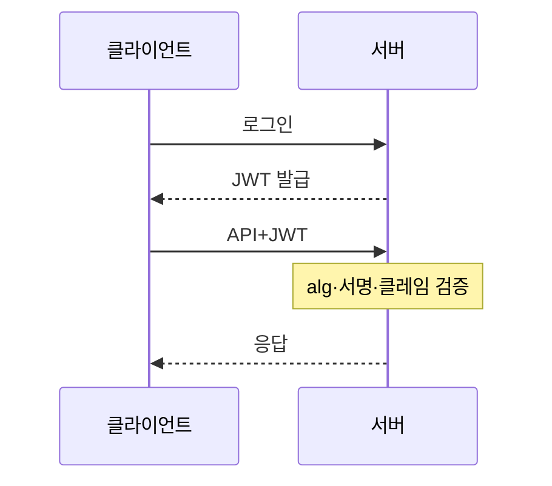
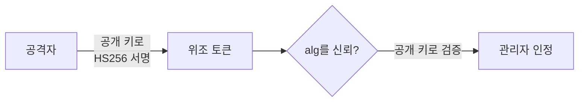

> JWT는 "서명이 맞으면 내용을 믿는다"는 토큰입니다. 그래서 **어떤 알고리즘으로, 어떤 키로 검증하는가**를 공격자가 건드릴 수 있으면 신원을 마음대로 쓸 수 있습니다.

## 원리: 구조와 서명 검증

JWT는 점(`.`)으로 나뉜 세 부분입니다. 각 부분은 Base64URL로 인코딩되어 있습니다. 인코딩은 암호화가 아니므로 **누구나 읽을 수 있습니다.**

```text
header.payload.signature
```

| 부분 | 내용 | 예시(디코딩 후) |
|---|---|---|
| header | 서명 알고리즘(`alg`), 키 식별자(`kid`) 등 | `{"alg":"HS256","typ":"JWT"}` |
| payload | 클레임: 사용자, 권한, 만료 시각 | `{"sub":"1001","role":"user","exp":1790000000}` |
| signature | header+payload에 대한 서명 | 바이너리 |

서버는 서명을 다시 계산해 일치하는지 봅니다. 알고리즘은 크게 두 계열입니다.

- **대칭(HS256)**: 서명과 검증에 같은 비밀 키를 씁니다.
- **비대칭(RS256, ES256)**: 개인 키로 서명, **공개 키로 검증**합니다. 공개 키는 공개되어도 됩니다.



취약점은 대부분 2) 단계에서 **헤더의 값(`alg`)을 신뢰**하거나, **키가 약할 때** 생깁니다.

## 취약한 코드 → 고친 코드

취약한 예시입니다(직접 만든 최소 PyJWT 예제).

```python
# vulnerable.py
import jwt   # PyJWT

PUBLIC_KEY = open("public.pem").read()   # RS256 공개 키 (서버가 보유, 공개 가능)

def current_user(token: str):
    header = jwt.get_unverified_header(token)
    # 헤더가 말하는 알고리즘으로 그대로 검증 -> 공격자가 alg를 고를 수 있음
    return jwt.decode(token, PUBLIC_KEY, algorithms=[header["alg"]])
```

고친 예시입니다.

```python
# fixed.py
import jwt

PUBLIC_KEY = open("public.pem").read()

def current_user(token: str):
    return jwt.decode(
        token,
        PUBLIC_KEY,
        algorithms=["RS256"],                 # 서버가 알고리즘을 고정
        audience="my-api",                    # aud 검증
        issuer="https://auth.example.com",    # iss 검증
        options={"require": ["exp", "iss", "aud", "sub"]},  # 필수 클레임
    )
```

- 알고리즘은 **서버 코드에 고정**하고, 토큰 헤더가 정하게 두지 않습니다.
- 만료(`exp`), 발급자(`iss`), 대상(`aud`)을 검증합니다.

## 대표 공격 유형

### none 알고리즘

`alg`를 `none`으로 바꾸고 서명을 비워서 보냅니다. 서명 검증을 건너뛰는 라이브러리 설정이거나, 알고리즘을 헤더에서 받아 쓰는 코드라면 통과합니다. 현대 라이브러리 대부분은 기본 거부하지만, **구버전이나 직접 구현한 검증 코드**에서 아직 나옵니다.

### RS256 → HS256 알고리즘 혼동

위 취약한 코드가 이 경우입니다. 단, 이 코드가 실제로 성립하는 것은 **구버전 라이브러리나 자체 구현 검증 코드**에서입니다. 최신 PyJWT는 PEM 형식 키를 HMAC 키로 쓰려 하면 거부하므로 위 코드도 최신 버전에서는 예외가 납니다. 그래도 `alg`를 헤더에서 받아 쓰는 패턴 자체가 위험하므로 고쳐야 합니다.

1. 서버는 RS256을 쓰고, 공개 키(누구나 얻을 수 있음)로 검증합니다.
2. 공격자가 토큰 헤더를 `HS256`으로 바꾸고, **공개 키 문자열을 HMAC 비밀 키처럼 써서** 직접 서명합니다.
3. 서버가 헤더의 `HS256`을 믿고, 같은 공개 키를 HMAC 키로 사용해 검증하면 **서명이 일치**합니다.



### 약한 HMAC 키

HS256의 비밀 키가 짧거나 사전에 있는 단어면, 공격자는 토큰 하나만 가지고 **오프라인으로 키를 추측**할 수 있습니다(서버에 요청이 필요 없어 탐지되지 않습니다). 키를 복구하면 임의의 클레임으로 토큰을 직접 서명할 수 있습니다.

### 헤더 값을 이용한 키 조작

- `kid`(키 식별자)를 파일 경로나 SQL 조회에 그대로 쓰면 경로 조작·인젝션이 생깁니다.
- `jku`, `jwk`, `x5u` 헤더로 공격자가 지정한 키를 서버가 가져다 쓰면 검증 키를 바꿔치기할 수 있습니다.

## 확인 방법(진단 순서)

1. **토큰 디코딩**: header와 payload를 읽습니다. 보는 것은 `alg`, `kid`, `jku` 같은 헤더, `exp` 유무, 민감 정보(개인정보, 내부 ID) 포함 여부입니다.
2. **서명 필수 여부 확인**
   - 보내는 것: 서명 부분을 비우거나 한 글자 바꾼 토큰
   - 보는 것: 200 응답이 오면 서명 검증이 없거나 약합니다.
3. **none 시험**
   - 보내는 것: `alg`를 `none`으로 바꾸고 서명을 뺀 토큰(대소문자 변형 포함)
   - 보는 것: 인증이 통과하면 취약
4. **알고리즘 혼동 시험** (RS256/ES256을 쓰는 경우)
   - 보내는 것: 공개 키를 얻어(예: 공개된 키 배포 경로) HS256으로 서명한 토큰
   - 보는 것: 수락되면 취약
5. **약한 키 확인** (HS256인 경우)
   - 방법: 허가된 범위에서 공개된 단어 목록으로 오프라인 대입을 시도합니다.
   - 보는 것: 키가 복구되면 취약. 키 값은 보고서에 마스킹합니다.
6. **클레임 검증 확인**: `exp`를 과거로 바꾼 서명 유효 토큰이 거부되는지, 다른 서비스용 `aud` 토큰이 수락되는지, 폐기(로그아웃) 후에도 토큰이 살아 있는지 봅니다.

> **실무 포인트** 토큰을 **어디서 검증하는지**를 먼저 나열하세요. API 게이트웨이는 엄격한데 내부 마이크로서비스나 웹소켓 핸드셰이크 쪽은 서명 확인 없이 payload만 디코딩해 쓰는 경우가 있습니다. 한 서비스만 테스트하고 "JWT 안전"으로 결론 내리면 가장 약한 검증 지점을 놓칩니다.

> **실무 포인트** 로그아웃과 비밀번호 변경 뒤에 **기존 토큰이 계속 통하는지** 꼭 보세요. JWT는 서버 상태가 없어서 폐기 수단(블록리스트, 토큰 버전)이 없으면 로그아웃은 클라이언트에서 지우는 시늉일 뿐입니다. 이 항목은 서명 공격이 모두 막힌 서비스에서도 자주 나옵니다.

여기서 많이 놓칩니다. 서명 검증은 잘 되어 있어도 **`exp`가 없거나 너무 길어서** 탈취된 토큰이 몇 달간 유효한 경우가 흔합니다. 또 하나는 payload의 `role`이나 `admin` 클레임을 서버가 DB 대신 **토큰 안의 값만 믿는** 구조입니다. 키가 안전해도 발급 로직이 사용자 입력을 클레임에 넣어 주면 권한 상승이 됩니다.

## 유형 정리

| 유형 | 원리 | 확인 포인트 |
|---|---|---|
| 서명 미검증 | 디코딩만 하고 verify를 안 함 | 변조 토큰이 수락되는가 |
| none 알고리즘 | 서명 생략을 허용 | `alg: none` 수락 여부 |
| 알고리즘 혼동 | 헤더 `alg`를 신뢰, 공개 키를 HMAC 키로 사용 | RS256 서비스에서 HS256 토큰 수락 여부 |
| 약한 HMAC 키 | 짧거나 흔한 키를 오프라인 대입 | 키 길이·무작위성 |
| kid 조작 | 키 조회에 입력을 그대로 사용 | 경로 조작·인젝션 가능성 |
| jku/jwk 신뢰 | 토큰이 가리키는 키를 서버가 가져다 사용 | 외부 키 URL을 허용하는가 |
| 클레임 미검증 | exp, aud, iss 확인 누락 | 만료·다른 대상 토큰 수락 여부 |
| 폐기 불가 | 로그아웃·권한 변경 후에도 유효 | 서버 측 폐기 수단 |

## 대응 방안

### 코드 수준
- **알고리즘을 서버에서 고정**하고(`algorithms=[...]`), `none`은 허용하지 않습니다.
- `exp`, `iss`, `aud`를 필수로 검증하고, 서비스별로 `aud`를 구분합니다.
- 검증 키는 코드에 고정된 키 저장소에서 가져오고, `kid`는 허용 목록과 대조합니다. `jku`, `jwk`, `x5u`는 무시하거나 신뢰하는 출처만 허용합니다.
- 한 키는 한 알고리즘에만 연결합니다(RS256 공개 키로 HS256 검증이 불가능하게).

### 설정 수준
- HMAC을 쓴다면 **해시 길이 이상(HS256은 256비트 이상)의 무작위 키**를 씁니다. 사람이 외우는 문자열을 쓰지 않습니다.
- 가능하면 비대칭(RS256/ES256 또는 EdDSA)을 쓰고, 개인 키는 서명하는 서비스만 갖게 합니다.
- 액세스 토큰 수명을 짧게(분 단위) 하고, 갱신 토큰은 서버 측에서 폐기할 수 있게 저장합니다.
- 키를 주기적으로 교체(rotation)하고, `kid`로 새 키와 옛 키를 구분합니다.

### 구조 수준
- 권한은 토큰 안의 클레임만 믿지 말고, 중요한 동작에서는 서버 측 상태나 DB로 다시 확인합니다.
- 로그아웃·비밀번호 변경·권한 회수 시 토큰을 무효화하는 방식(짧은 수명 + 거부 목록)을 설계합니다.
- 토큰 저장 위치(쿠키의 `HttpOnly`, `Secure`, `SameSite`)와 전송 보안(HTTPS)을 함께 점검합니다.
- RFC 8725(JWT Best Current Practices)의 권고를 기준표로 삼습니다.

## 참고 자료

- [RFC 7519: JSON Web Token (JWT)](https://www.rfc-editor.org/info/rfc7519/)
- [RFC 7515: JSON Web Signature (JWS)](https://www.rfc-editor.org/info/rfc7515/)
- [RFC 8725: JSON Web Token Best Current Practices](https://www.rfc-editor.org/info/rfc8725/)
- [OWASP Cheat Sheet Series: JSON Web Token](https://cheatsheetseries.owasp.org/cheatsheets/JSON_Web_Token_Cheat_Sheet.html)
- [CWE-347: Improper Verification of Cryptographic Signature](https://cwe.mitre.org/data/definitions/347.html)
- [CWE-326: Inadequate Encryption Strength](https://cwe.mitre.org/data/definitions/326.html)
