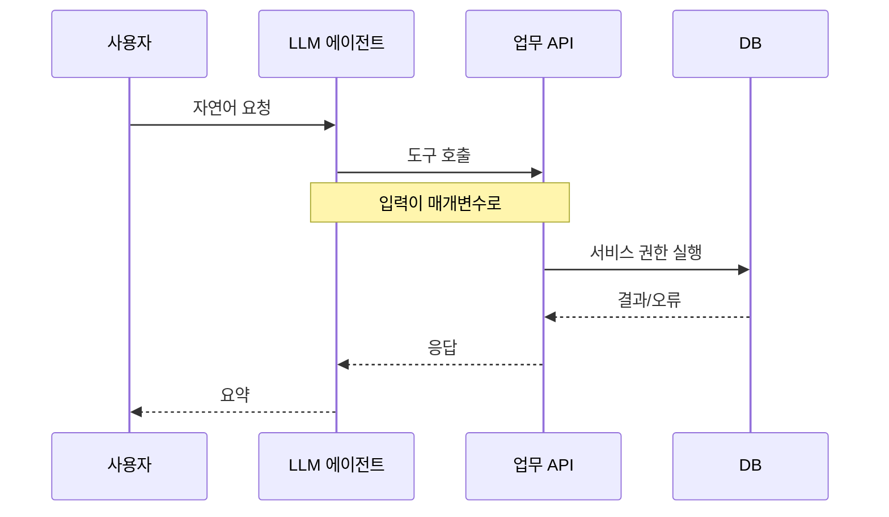

> LLM 에이전트는 사용자의 말을 API 호출로 바꿔 주는 번역기입니다. 번역된 호출을 서버가 다시 검증하지 않으면, 챗봇은 곧 "권한 검사가 없는 새 API 입구"가 됩니다.

## 이런 분께

- 챗봇에 주문 조회, 메일 발송, 결제, 코드 실행 같은 도구를 연결하는 개발자
- 에이전트형 서비스를 진단하면서 "모델이 거절하면 안전한 것 아닌가요?"라는 말을 들어 본 보안 담당자
- OWASP Top 10 for LLM Applications(2025)의 LLM06(Excessive Agency)을 실무로 옮기고 싶은 분

## 1. 원리: 세 가지 과도함

OWASP는 Excessive Agency의 뿌리를 세 가지로 나눕니다. 진단할 때도 이 세 축으로 나누어 보면 편합니다.

| 축 | 의미 | 예 |
|---|---|---|
| 과도한 기능(Functionality) | 필요 없는 도구가 붙어 있음 | 조회만 하면 되는 봇에 수정·삭제 기능이 연결됨 |
| 과도한 권한(Permissions) | 도구가 쓰는 계정 권한이 큼 | 봇이 관리자 DB 계정으로 쿼리 |
| 과도한 자율성(Autonomy) | 사람 확인 없이 고영향 동작 수행 | 환불·발송이 승인 없이 실행 |



핵심은 도구 호출의 매개변수를 모델이 만든다는 점입니다. 모델은 사용자 입력에 영향을 받으므로, 사실상 사용자가 매개변수를 간접적으로 쓰고 있는 셈입니다. 그런데 API 서버는 "호출자가 우리 에이전트니까 믿을 수 있다"고 가정하기 쉽습니다. 여기가 어긋나는 지점입니다.

## 2. 취약한 코드 예시

가상의 경비 처리 도우미입니다. 모델이 만든 JSON을 그대로 업무 API에 전달합니다.

```python
# vulnerable_agent.py (가상 예제)
import requests

TOOLS = {
    "submit_expense": "http://127.0.0.1:5000/api/expense",
    "send_mail":      "http://127.0.0.1:5000/api/mail",
    "run_query":      "http://127.0.0.1:5000/api/query",
}

def call_tool(name: str, args: dict) -> dict:
    # 모델이 만든 args를 검증 없이 전달
    resp = requests.post(TOOLS[name], json=args, timeout=10)
    return resp.json()  # 오류 본문도 그대로 모델과 사용자에게 전달

# 서버 측 (가상 예제)
@app.post("/api/expense")
def create_expense():
    data = request.get_json()
    return db.insert("expenses", data)  # status, approver 같은 필드도 그대로 저장
```

문제점입니다.

1. 허용 필드 목록이 없어서 `status` 같은 내부 필드가 요청에 들어와도 저장됩니다(Mass Assignment, 대량 할당).
2. 발신자·대상 같은 값이 세션이 아니라 모델이 만든 값에 의존합니다.
3. 임의 쿼리 도구(`run_query`)가 존재합니다. 편해서 만들지만 가장 위험한 도구입니다.
4. 오류 본문이 그대로 돌아와 DB 종류, 쿼리 구조가 노출됩니다.

## 3. 고친 코드

```python
# safer_agent.py (가상 예제)
from pydantic import BaseModel, ConfigDict, Field, ValidationError

class ExpenseArgs(BaseModel):
    model_config = ConfigDict(extra="forbid")   # 모르는 필드는 거부
    title: str = Field(max_length=100)
    amount: int = Field(gt=0, le=1_000_000)
    expense_type: str

ALLOWED_TOOLS = {"submit_expense": ExpenseArgs}  # 필요한 도구만

def call_tool(session, name: str, raw_args: dict) -> dict:
    schema = ALLOWED_TOOLS.get(name)
    if schema is None:
        return {"error": "not_allowed"}
    try:
        args = schema(**raw_args)                # 스키마 검증
    except ValidationError:
        return {"error": "invalid_args"}         # 모델에는 상세 사유를 돌려주지 않음
    # 사용자 식별과 상태는 서버가 채움. 모델이 정하지 않음
    payload = args.model_dump() | {
        "user_id": session.user.id,
        "status": "pending",
    }
    if args.amount >= 300_000:
        return request_human_approval(session, payload)   # 동의 절차
    resp = api_client.post("/api/expense", json=payload, user_token=session.token)
    return {"ok": resp.ok}                       # 상세 오류는 로그에만
```

```python
# 서버 측: 에이전트가 보낸 값도 일반 클라이언트처럼 다시 검증
@app.post("/api/expense")
@require_user_token
def create_expense(user):
    data = ExpenseIn(**request.get_json())       # 허용 필드만
    if data.amount > user.expense_limit:
        abort(403)
    return db.insert("expenses", {**data.model_dump(), "user_id": user.id, "status": "pending"})
```

차이는 세 가지입니다. 도구를 줄였고, 상태·소유자 같은 필드는 서버가 정하며, 에이전트 뒤에서도 API가 독립적으로 권한을 검사합니다.

## 4. 확인 방법(진단 순서)

허가된 환경에서 진행합니다. 순서는 "무엇이 연결되어 있는지 파악 → 매개변수 확인 → 권한 경계 확인 → 부작용 확인"입니다.

1. **도구 목록 파악**
   - 보내는 것: 사용할 수 있는 기능과 각 기능의 입력 항목을 묻습니다.
   - 보는 것: 업무에 불필요한 도구(삭제, 임의 쿼리, 파일 실행)가 노출되면 과도한 기능입니다. 모델이 매개변수 이름까지 알려 주면 이후 단계의 지도가 됩니다.
2. **매개변수 영향 확인**
   - 보내는 것: 정상 요청에 값을 약간 바꿔(다른 사용자 식별자, 범위 밖 금액) 요청합니다.
   - 보는 것: 서버가 거부하는지, 모델의 거절에만 의존하는지 봅니다. 모델이 거절해도 직접 API를 호출하면 통과하는 경우가 많습니다. 여기서 많이 놓칩니다.
3. **정의에 없는 필드 확인**
   - 보내는 것: 에이전트가 만든 요청 본문(프록시로 확인)에 원래 없던 필드를 추가해 봅니다. 예를 들어 상태나 승인자 필드입니다.
   - 보는 것: 응답이나 저장 결과에 반영되면 대량 할당 취약입니다. 승인 흐름이 있는 업무라면 승인 우회로 이어집니다.
4. **발신자·소유자 검증 확인**
   - 보내는 것: 메일 발송 등에서 "보내는 사람"을 본인이 아닌 값으로 지정하도록 요청합니다. 실제 발송은 테스트 수신처로 한정합니다.
   - 보는 것: 서버가 세션 계정으로 강제하는지, 모델이 만든 값을 쓰는지 확인합니다.
5. **동의 절차 확인**
   - 보내는 것: 되돌리기 어려운 동작(발송, 삭제, 결제 성격의 요청)을 한 번의 문장으로 요청합니다.
   - 보는 것: 사용자 확인 단계 없이 즉시 실행되면 과도한 자율성입니다.
6. **오류 메시지·민감정보 확인**
   - 보내는 것: 형식이 틀린 입력으로 도구를 호출시켜 오류를 유도합니다.
   - 보는 것: 응답에 쿼리문, 스택 트레이스, 내부 주소, 계정명이 보이면 정보 노출입니다. 모델은 오류를 요약해 주지만 원문을 그대로 붙이는 경우도 많습니다.
7. **실행 환경 확인**
   - 보내는 것: 코드를 실행하는 도구가 있다면 무해한 환경 조회(현재 사용자, 작업 디렉터리)만 요청합니다.
   - 보는 것: 호스트 권한으로 실행되거나 네트워크·파일 접근이 제한되지 않으면 샌드박스 부재입니다.

판단 포인트입니다.

- 에이전트에게만 질문하지 말고, 에이전트가 호출하는 API를 따로 두드려 봅니다. "챗봇 앞단은 단단하고 뒤 API는 열려 있는" 구성이 흔합니다.
- 임의 쿼리나 임의 코드 실행 도구는 발견 즉시 높은 위험도로 봅니다. 모델의 거절 문구가 아무리 단단해도 우회 가능성이 남기 때문입니다.

## 5. 유형·변형

| 유형 | 원리 | 확인 포인트 |
|---|---|---|
| 매개변수 변조 | 사용자 입력이 도구 인자로 그대로 전달 | 인자 값을 바꿨을 때 서버가 거부하는지 |
| 정의 외 필드 주입 | API 스키마에 없는 필드가 저장됨 | 상태·역할·승인 필드 반영 여부 |
| 발신자·소유자 위조 | 신원 값을 모델이 결정 | 세션 계정으로 강제되는지 |
| 과도한 도구 노출 | 불필요한 고위험 도구 연결 | 도구 목록 대비 업무 필요성 |
| 과도한 계정 권한 | 서비스 계정이 관리자급 | 에이전트 계정의 DB·API 권한 범위 |
| 동의 절차 누락 | 고영향 동작이 자동 실행 | 실행 전 사용자 확인 단계 |
| 샌드박스 부재 | 코드·명령 실행이 격리되지 않음 | 파일·네트워크·프로세스 제한 |
| 오류·민감정보 노출 | 내부 오류가 응답에 포함 | 쿼리문·경로·계정 정보 |
| 서드파티 의존 | 연결한 플러그인·도구의 취약점 상속 | 버전, 권한, 데이터 전달 범위 |

마지막 줄은 LLM03(Supply Chain)과 겹칩니다. 외부 도구나 플러그인은 에이전트의 권한을 그대로 물려받으므로, 연결할 때 권한 범위를 문서로 확인합니다.

## 6. 대응 방안

### 코드 수준

- 도구마다 입력 스키마를 정의하고 허용 필드만 받습니다(알 수 없는 필드는 거부).
- 사용자 식별, 소유자, 상태, 승인 여부는 서버가 세션에서 채웁니다. 모델이 만든 값을 신뢰하지 않습니다.
- 임의 쿼리·임의 명령 도구를 만들지 않고, 목적별 좁은 함수(예: 내 주문 조회)로 대체합니다.
- 오류는 코드 값만 모델에 전달하고, 상세 내용은 서버 로그에 남깁니다.

### 설정 수준

- 에이전트 전용 서비스 계정을 만들고 필요한 테이블·동작만 허용합니다. 조회 전용이면 읽기 권한만 줍니다.
- 사용자 본인 토큰으로 API를 호출하게 해서(권한 위임) 기존 접근 통제를 그대로 적용합니다.
- 도구 호출 횟수와 금액 한도를 설정하고, 호출 로그에 사용자·도구·인자를 남깁니다.

### 구조 수준

- API는 에이전트가 있든 없든 독립적으로 인증·인가·입력 검증을 합니다.
- 되돌리기 어려운 동작은 사용자 확인 또는 담당자 승인을 거칩니다(Human-in-the-loop).
- 코드 실행 도구는 격리 환경(컨테이너, 네트워크 차단, 읽기 전용 파일시스템, 실행 시간 제한)에서만 돌립니다.
- 새 도구를 붙일 때는 "이 도구가 악용되면 최대 피해가 무엇인가"를 먼저 적습니다.

## 7. 점검 체크리스트

- [ ] 연결된 도구가 업무에 꼭 필요한 것만이다
- [ ] 임의 쿼리·임의 명령 실행 도구가 없다
- [ ] 도구 입력이 스키마로 검증되고 알 수 없는 필드는 거부된다
- [ ] 사용자 식별·상태·승인 값은 서버가 정한다
- [ ] 에이전트 계정 권한이 최소이며 사용자 토큰 위임을 쓴다
- [ ] API가 에이전트와 무관하게 인가 검사를 한다
- [ ] 되돌리기 어려운 동작에 사용자 확인 단계가 있다
- [ ] 코드 실행은 격리 환경에서만 이루어진다
- [ ] 오류 상세가 응답에 노출되지 않는다
- [ ] 도구 호출이 사용자·인자 단위로 기록되고 한도가 있다
- [ ] 연결한 서드파티 도구의 권한 범위를 확인했다

## 참고 자료

- OWASP Top 10 for LLM Applications 2025: <https://genai.owasp.org/llm-top-10/>
- LLM06:2025 Excessive Agency: <https://genai.owasp.org/llmrisk/llm062025-excessive-agency/>
- LLM01:2025 Prompt Injection: <https://genai.owasp.org/llmrisk/llm01-prompt-injection/>
- OWASP API Security Top 10 2023 (API3 Broken Object Property Level Authorization): <https://api-security.owasp.org/editions/2023/en/0xa3-broken-object-property-level-authorization/>
- CWE-915 Improperly Controlled Modification of Dynamically-Determined Object Attributes: <https://cwe.mitre.org/data/definitions/915.html>
- CWE-250 Execution with Unnecessary Privileges: <https://cwe.mitre.org/data/definitions/250.html>
