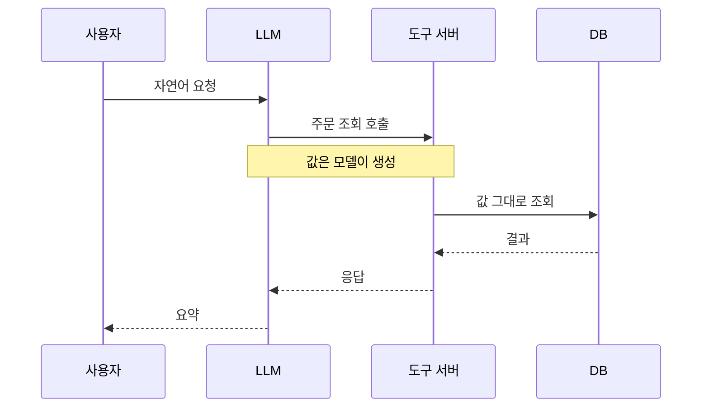

> 도구 호출의 인자는 모델이 쓴 문자열이고, 모델은 사용자 말에 영향을 받습니다. 인자를 "내부 값"으로 믿는 순간 챗봇은 IDOR(객체 직접 참조)의 새 입구가 됩니다.

## 원리: 인자의 출처가 흐려진다

일반 웹 API라면 `user_id`는 세션에서 오고, 클라이언트가 보낸 `order_id`는 "소유자 확인 대상"으로 취급됩니다. 그런데 에이전트 구조에서는 이 구분이 흐려집니다.



도구 서버가 `user_id`를 인자로 받는 순간, "누구의 요청인가"라는 신원 정보를 모델이 정하게 됩니다. 모델이 지시를 잘 따르는지와 상관없이, 신원은 서버가 아는 값이어야 합니다.

## 취약한 코드 예시

```python
# vulnerable_tools.py (가상 예제)
def get_order(args: dict):
    # args는 모델이 만든 JSON
    return db.execute(
        "SELECT * FROM orders WHERE id = ? AND user_id = ?",
        (args["order_id"], args["user_id"]),   # 신원도 인자로 받음
    )

def update_order(args: dict):
    # 모델이 넘긴 필드를 그대로 갱신
    sets = ", ".join(f"{k} = ?" for k in args["fields"])
    db.execute(f"UPDATE orders SET {sets} WHERE id = ?",
               (*args["fields"].values(), args["order_id"]))
```

문제점입니다.

1. `user_id`가 인자라서 다른 사용자를 가리키는 값이 들어오면 그대로 조회됩니다. 쿼리에 소유자 조건이 있어도 **그 값을 누가 채웠는지**가 문제입니다.
2. `fields`의 키를 검증하지 않아 `status`나 `price` 같은 내부 필드도 갱신됩니다(대량 할당).
3. 컬럼명이 쿼리 문자열에 직접 들어갑니다.

## 고친 코드

```python
# safer_tools.py (가상 예제)
from pydantic import BaseModel, ConfigDict, Field

class GetOrderArgs(BaseModel):
    model_config = ConfigDict(extra="forbid")      # 정의 밖 필드 거부
    order_id: int = Field(gt=0)

class UpdateOrderArgs(BaseModel):
    model_config = ConfigDict(extra="forbid")
    order_id: int = Field(gt=0)
    shipping_memo: str = Field(max_length=200)     # 바꿀 수 있는 필드만 명시

def get_order(ctx, raw: dict):
    a = GetOrderArgs(**raw)
    # 신원은 세션에서. 인자로 받지 않음
    row = db.execute("SELECT * FROM orders WHERE id = ? AND user_id = ?",
                     (a.order_id, ctx.user.id)).fetchone()
    if row is None:
        return {"error": "not_found"}              # 존재 여부를 구분해 알려주지 않음
    return row

def update_order(ctx, raw: dict):
    a = UpdateOrderArgs(**raw)
    n = db.execute("UPDATE orders SET shipping_memo = ? WHERE id = ? AND user_id = ? AND status = 'pending'",
                   (a.shipping_memo, a.order_id, ctx.user.id)).rowcount
    return {"ok": n == 1}
```

바뀐 점은 세 가지입니다. 신원은 서버가 주입하고, 바꿀 수 있는 필드는 이름으로 고정했으며, 상태 조건을 쿼리에 함께 넣었습니다.

> **실무 포인트** 도구 정의(함수 스키마)에서 `user_id`를 **빼는 것**이 가장 강한 방어입니다. 모델에게 보이지 않는 값은 모델 경유로 바뀔 수 없습니다. 검증 코드가 맞는지 고민하기 전에, 그 인자가 꼭 필요한지부터 묻습니다.

## 확인 방법(진단 순서)

허가된 환경에서, 본인 소유 테스트 계정 두 개로 진행합니다.

1. **도구 인자 목록 확보**
   - 보는 것: 모델이 알려주는 기능 목록과 프록시로 본 실제 호출 본문을 대조해, 인자 이름을 정리합니다.
2. **신원성 인자 분류**
   - 보는 것: `user_id`, `owner`, `from`, `tenant` 같은 신원·소유자 인자가 있는지 확인합니다. 있다면 그 자체가 지적 사항 후보입니다.
3. **소유자 경계 확인**
   - 보내는 것: 계정 A 대화에서 계정 B의 테스트 데이터를 가리키는 식별자를 요청합니다.
   - 보는 것: 서버가 거부하는지, 모델의 거절 문구에만 의존하는지 봅니다. 도구 API를 직접 호출해도 같은 결과인지 비교합니다.
4. **정의 외 필드 확인**
   - 보내는 것: 프록시에서 호출 본문에 정의에 없던 필드 하나를 추가합니다.
   - 보는 것: 무시·거부되면 정상, 저장에 반영되면 대량 할당입니다.
5. **값 범위·형식 확인**
   - 보내는 것: 범위 밖의 값(음수, 매우 큰 수, 빈 문자열, 배열로 바뀐 타입)을 보냅니다.
   - 보는 것: 검증 오류로 거부되는지, 서버 오류 상세가 응답에 노출되는지 봅니다.
6. **상태 전이 확인**
   - 보는 것: 이미 처리된 항목에 변경 도구를 호출해 상태 조건이 서버에서 강제되는지 봅니다.

> **실무 포인트** 모델에게 한 번 거절당했다고 안전하다고 보고하면 안 됩니다. 같은 요청을 **도구 API에 직접** 보내 서버가 막는지 확인해야 합니다. 두 결과가 다르면 방어는 모델의 말투에 있었던 것입니다.

## 유형·변형

| 유형 | 원리 | 확인 포인트 |
|---|---|---|
| 신원 인자 신뢰 | `user_id`·`from` 등을 모델이 채움 | 세션 값으로 강제되는지 |
| 객체 참조 변조 | 주문·문서 식별자를 다른 값으로 바꿈 | 쿼리에 소유자 조건이 있는지 |
| 숨은 필드 주입 | 상태·권한·가격 필드가 저장됨 | `extra` 거부, 필드 허용 목록 |
| 타입·범위 혼동 | 문자열↔배열, 음수, 거대한 값 | 스키마 타입과 범위 제한 |
| 식별자 조립 | 컬럼명·경로가 인자로 전달됨 | 매핑 테이블 사용 |
| 상태 전이 우회 | 완료 건에 변경 호출 | 서버 측 상태 조건 |

## 대응 방안

### 코드 수준

- 도구마다 스키마를 두고 정의 밖 필드는 거부합니다. 타입, 길이, 범위를 명시합니다.
- 신원·소유자·테넌트·승인 상태는 인자에서 제거하고 서버가 세션에서 주입합니다.
- 쿼리에 소유자 조건과 상태 조건을 항상 포함합니다.
- 갱신 가능한 필드는 이름으로 고정합니다(허용 목록).

### 설정 수준

- 도구 호출은 사용자 본인 토큰으로 수행해 기존 인가 규칙을 그대로 태웁니다.
- 검증 실패는 짧은 코드로만 모델에 돌려주고, 상세 사유는 서버 로그에 남깁니다.

### 구조 수준

- 도구 서버를 일반 외부 API와 동일한 신뢰 수준으로 설계합니다. "내부 호출이니 믿는다"는 가정을 두지 않습니다.
- 고영향 변경(환불, 권한 변경)은 호출 전 사용자 확인 단계를 둡니다.
- 호출 로그에 사용자, 도구, 인자를 남겨 이상 패턴을 추적합니다.

## 함께 보기

- [LLM 에이전트의 과도한 권한](/notes/llm-excessive-agency/)
- [프롬프트 인젝션 방어 설계](/notes/prompt-injection-defense/)
- [인증 취약점](/notes/authentication-vulnerabilities/)

## 참고 자료

- OWASP LLM06:2025 Excessive Agency: <https://genai.owasp.org/llmrisk/llm062025-excessive-agency/>
- OWASP Top 10 for LLM Applications 2025: <https://genai.owasp.org/llm-top-10/>
- OWASP Input Validation Cheat Sheet: <https://cheatsheetseries.owasp.org/cheatsheets/Input_Validation_Cheat_Sheet.html>
- CWE-20 Improper Input Validation: <https://cwe.mitre.org/data/definitions/20.html>
- CWE-639 Authorization Bypass Through User-Controlled Key: <https://cwe.mitre.org/data/definitions/639.html>
- CWE-915 Improperly Controlled Modification of Dynamically-Determined Object Attributes: <https://cwe.mitre.org/data/definitions/915.html>
