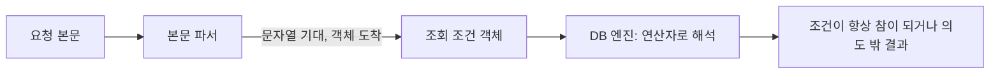

> NoSQL 인젝션은 SQL 문자열을 깨는 공격이 아니라, **문자열이어야 할 입력이 객체(쿼리 연산자)로 들어와** 조회 조건 자체가 바뀌는 문제입니다.

## 이런 분께

- Node.js(Express) + MongoDB 같은 조합으로 로그인·검색을 만드는 분
- "SQL이 아니니 인젝션은 없다"고 생각하는 팀을 설득해야 하는 분
- JSON API를 진단하는 분

## 1. 원리: 값 자리에 연산자가 들어온다

MongoDB 같은 문서 DB의 조회 조건은 객체입니다. `{ user: "kim" }`은 "user가 kim"이고, `{ user: { $ne: null } }`은 "user가 null이 아님"입니다. 요청 본문(JSON 또는 파서가 객체로 만든 폼)을 **검증 없이 조건 객체에 넣으면**, 값 대신 연산자 객체가 들어와 의미가 바뀝니다.



PHP·Express처럼 `a[b]=c` 형태를 중첩 객체로 풀어 주는 프레임워크에서는 JSON이 아닌 폼 요청도 같은 문제가 생깁니다.

## 2. 취약한 코드 → 고친 코드

최소 Express 예제입니다(예시는 구조 설명용입니다).

```javascript
// vulnerable.js
app.use(express.json());

app.post("/login", async (req, res) => {
  const { username, password } = req.body;          // 타입 확인 없음
  const user = await db.collection("users")
    .findOne({ username: username, password: password });
  if (user) return res.send("ok");
  res.status(401).send("fail");
});
```

- `username`/`password`가 문자열이라는 보장이 없습니다.
- 비밀번호를 평문 비교하는 것 자체도 별도의 결함입니다.

고친 예시입니다.

```javascript
// fixed.js
const bcrypt = require("bcrypt");

app.post("/login", async (req, res) => {
  const { username, password } = req.body;
  if (typeof username !== "string" || typeof password !== "string") {
    return res.status(400).send("bad request");      // 타입 강제
  }
  const user = await db.collection("users").findOne({ username });
  if (user && await bcrypt.compare(password, user.hash)) {
    return res.send("ok");
  }
  res.status(401).send("fail");
});
```

- 조회에는 **사용자 이름 하나만** 쓰고, 비밀번호는 해시 비교로 분리합니다. 조건 객체에 비밀번호가 들어가지 않으므로 연산자 주입 영향이 줄어듭니다.
- 스키마 검증 라이브러리(zod, Joi 등)로 입력 형태를 선언하면 더 견고합니다.

## 3. 확인 방법(진단 순서)

1. **입력 형식 파악**: 요청이 JSON인지, 폼인지, 쿼리스트링인지 확인합니다. 폼·쿼리도 `키[하위키]` 표기를 객체로 풀어 주는지 봅니다.
2. **정상 기준 확보**: 올바른 값과 틀린 값의 응답(상태 코드, 메시지, 길이)을 기록합니다.
3. **타입 변경 시험**
   - 보내는 것: 문자열이어야 할 필드에 객체나 배열을 넣은 요청
   - 보는 것: 서버 오류(500), 오류 문구 변화, 또는 틀린 값인데 성공 응답이면 입력이 조건 객체에 그대로 들어간다는 신호입니다.
4. **영향 범위 확인**: 인증 우회가 되는지, 다른 사용자 데이터가 조회되는지 최소한으로 확인하고 중단합니다. 실제 계정 정보를 대량으로 열람하지 않습니다.
5. **서버 측 JS 평가 확인**: 조건에 JavaScript 식을 받는 기능(`$where` 등)이 활성화돼 있는지 설정과 코드로 확인합니다. 켜져 있으면 영향이 더 큽니다.

> **실무 포인트** 로그인에서 성공 응답만 보면 놓칩니다. **검색·필터 API**처럼 조건을 받는 곳이 오히려 영향이 큽니다. 그리고 "응답이 같다"고 안전하다고 판단하지 말고, 오류 로그에 쿼리 에러가 남는지를 개발자에게 확인하세요. 타입 불일치로 에러가 나는 것만으로도 입력 검증 부재의 증거입니다.

> **실무 포인트** 방어 권고에서 "`$`로 시작하는 키를 지우는 필터"에만 기대면 위험합니다. 필터는 보조일 뿐이고 근본은 **필드별 타입 선언과 거부**입니다. 코드 리뷰에서는 `req.body`를 통째로 쿼리에 넘기는 줄(`find(req.body)`)부터 찾으세요.

## 4. 유형·변형

| 유형 | 원리 | 확인 포인트 |
|---|---|---|
| 연산자 주입 | 값 자리에 비교·논리 연산자 객체가 들어옴 | 문자열 필드에 객체를 보냈을 때 응답이 달라지는가 |
| 본문 통째 전달 | `find(req.body)`처럼 조건을 그대로 사용 | 코드에서 요청 객체가 쿼리로 직접 가는가 |
| 폼의 중첩 파싱 | `a[b]` 표기가 객체로 변환됨 | 폼·쿼리스트링에서도 객체가 만들어지는가 |
| 서버 측 JS 평가 | 조건에 JS 식을 허용 | 해당 기능이 켜져 있고 입력이 닿는가 |
| 정규식 조건 | 입력이 정규식 연산에 쓰여 전체 일치 우회 또는 과도한 연산 유발 | 입력을 정규식으로 쓰기 전에 이스케이프하는가 |
| 블라인드 추론 | 참/거짓 응답 차이로 값을 한 글자씩 추정 | 인증 없는 조회에서 응답 차이가 있는가 |

## 5. 대응 방안

### 코드 수준
- 모든 입력 필드에 **타입과 형식을 선언**하고 맞지 않으면 거부합니다(스키마 검증).
- 조건 객체는 **필요한 필드만 골라 직접 구성**합니다. 요청 객체를 통째로 넘기지 않습니다.
- 인증은 사용자 조회와 비밀번호 해시 비교를 분리합니다.
- 입력을 정규식 조건에 쓸 때는 이스케이프합니다.

### 설정 수준
- 서버 측 JavaScript 평가 기능은 필요 없으면 끄고, DB 계정에는 필요한 컬렉션 권한만 줍니다.
- 쿼리 에러 메시지를 클라이언트에 그대로 돌려주지 않습니다.

### 구조 수준
- ODM/ORM의 스키마 기능으로 필드 타입을 DB 접근 계층에서도 한 번 더 강제합니다.

## 6. 점검 체크리스트

- [ ] 요청 객체를 그대로 쿼리에 넘기는 코드가 없는가
- [ ] 모든 입력 필드의 타입을 검증하는가(문자열 기대 필드에 객체 거부)
- [ ] 폼·쿼리스트링의 중첩 객체 파싱 설정을 확인했는가
- [ ] 로그인은 사용자 조회와 해시 비교가 분리돼 있는가
- [ ] 서버 측 JS 평가 기능이 꺼져 있거나 입력과 격리돼 있는가
- [ ] 쿼리 에러가 응답에 노출되지 않는가
- [ ] DB 계정 권한이 최소인가

## 7. 함께 보기

- [SQL 인젝션](/notes/sql-injection/)
- [PHP 타입 저글링](/notes/php-type-juggling/)
- [인증 취약점](/notes/authentication-vulnerabilities/)

## 8. 참고 자료

- [OWASP WSTG: Testing for NoSQL Injection](https://owasp.org/www-project-web-security-testing-guide/latest/4-Web_Application_Security_Testing/07-Input_Validation_Testing/05.6-Testing_for_NoSQL_Injection)
- [CWE-943: Improper Neutralization of Special Elements in Data Query Logic](https://cwe.mitre.org/data/definitions/943.html)
- [OWASP Cheat Sheet Series: Injection Prevention](https://cheatsheetseries.owasp.org/cheatsheets/Injection_Prevention_Cheat_Sheet.html)
- [MongoDB 문서: Query and Projection Operators](https://www.mongodb.com/docs/manual/reference/mql/query-predicates/)
