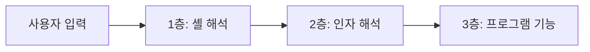

> 기본 개념은 [OS 명령 주입](/notes/os-command-injection/)에서 다뤘습니다. 이 글은 거기서 한두 줄로 지나간 **"셸을 안 써도, 이스케이프해도 왜 남는가"** 를 깊게 봅니다. 핵심은 "문자 막기"가 아니라 **입력이 명령의 어느 자리에 들어가는가**입니다.

## 원리: 입력이 들어가는 층이 세 개 있다

명령 실행에는 서로 다른 해석 층이 있고, 층마다 필요한 방어가 다릅니다.



| 층 | 취약 형태 | 막는 방법 |
|---|---|---|
| 1층 셸 | 문자열을 셸에 넘김 | 셸을 쓰지 않고 인자 배열로 실행 |
| 2층 인자 | 입력이 `-`로 시작해 옵션이 됨 | 옵션 종료 표시, 값 검증 |
| 3층 기능 | 프로그램이 가진 위험 옵션·기능 | 허용 옵션 고정, 권한 최소화 |

1층만 막으면 2, 3층이 남습니다. 이스케이프 함수가 "완전하지 않은" 이유도 여기에 있습니다.

## 취약한 코드 → 고친 코드

### 이스케이프만으로는 부족한 예

```python
# vulnerable.py
import subprocess, shlex

def archive(name: str):
    # 셸 메타문자는 quote로 막았지만, name이 "-"로 시작하는 경우를 놓침
    cmd = f"tar -cf out.tar {shlex.quote(name)}"
    subprocess.run(cmd, shell=True)
```

`shlex.quote`는 1층(셸 해석)은 막지만, `name`이 `-`로 시작하면 **tar 입장에서는 파일이 아니라 옵션**입니다. 이것이 인자 주입(argument injection)입니다. 일부 도구는 옵션 하나로 다른 명령을 실행하거나 파일을 덮어쓰는 기능을 가집니다.

### 고친 코드

```python
# fixed.py
import re, subprocess

SAFE = re.compile(r"[A-Za-z0-9_][A-Za-z0-9_.-]{0,63}")   # 첫 글자는 '-' 불가

def archive(name: str):
    if not SAFE.fullmatch(name):
        raise ValueError("invalid name")
    # 셸 없이 배열로 호출 + '--'로 옵션 종료를 명시
    subprocess.run(["tar", "-cf", "out.tar", "--", name], check=True, shell=False)
```

세 겹입니다. 허용 목록 정규식(전체 일치), 셸 미사용, `--` 옵션 종료 표시. `--`를 지원하지 않는 도구도 있으므로, 그런 도구는 값을 `./이름`처럼 경로 형태로 만들어 옵션으로 읽히지 않게 합니다.

## 글롭(와일드카드)은 어디서 확장되나

`*`, `?`, `[ ]` 같은 글롭 문자는 **셸이** 파일 목록으로 확장합니다. 두 가지 경로가 문제입니다.

1. 셸을 거치는 구조에서 입력에 글롭 문자가 그대로 들어가면, 의도하지 않은 파일들이 인자로 확장됩니다.
2. 더 교묘한 경우: 디렉터리에 **`-`로 시작하는 파일 이름**이 있으면, 관리자가 쓴 `tar cf out.tar *` 같은 스크립트에서 그 이름이 **옵션으로 확장**됩니다. 사용자 업로드 파일명이 같은 디렉터리에 놓이는 구조에서 발생합니다.

방어는 같습니다. 글롭에 의존하지 말고 파일 목록을 코드로 만들어 배열로 넘기며, 스크립트에서는 `./*`처럼 경로를 붙이거나 `--`를 씁니다. 업로드 파일명은 저장 시 서버가 생성한 이름으로 바꿉니다.

## 결과가 안 보일 때 확인하는 법

응답에 출력이 없거나 명령이 비동기로 실행돼도 신호는 남습니다. 허가된 범위에서만 씁니다.

| 신호 | 보내는 것 | 판단 |
|---|---|---|
| 시간 | 일정 시간 지연되는 명령과 지연 없는 대조 요청 | 설정값에 비례해 응답이 늘면 실행 확정 |
| 외부 이름 조회·접속 | 내가 통제하는 서버로 이름 조회/접속을 일으키는 명령 | 서버에 도착하면 확정(비동기 구조에서 특히 유효) |
| 오류 차이 | 존재하지 않는 대상 지정 | 상태 코드·메시지가 갈리는지 |
| 부수효과 | 정리 가능한 확인용 파일 생성 | 쓰기 권한 확인, 확인 후 반드시 삭제·기록 |

> **실무 포인트** 지연 하나로 확정하지 마세요. 대조군과 번갈아 두세 번 보내 **비례 관계**를 보이면 충분합니다. 입력이 큐에 들어갔다 워커가 뒤늦게 실행하는 구조는 응답 시간이 변하지 않고 외부 접속만 **몇 분 뒤** 도착합니다. "반응 없음"으로 끝내기 쉬운 지점이니 대기 시간을 충분히 두세요.

> **실무 포인트** "셸을 안 쓴다"는 개발팀 답변을 들으면 거기서 멈추지 말고 **어떤 프로그램을 어떤 옵션으로 호출하는지**를 물으세요. 변환기, 이미지 도구, 압축, `curl`류는 옵션 자체가 파일 접근·외부 통신·명령 실행 기능을 가진 경우가 많습니다. 보고서에는 "입력이 옵션 자리에 들어간다"는 구조를 증거로 적습니다. 여기서 많이 놓칩니다.

## 확인 방법(진단 순서)

1. **입력이 명령의 어디로 가는지 추정**: 파일명, 호스트, 옵션 값, 경로 중 무엇인지 봅니다.
2. **옵션 해석 확인**: 정상 값 앞에 `-`를 붙인 입력을 보내 동작/오류 메시지가 달라지는지 봅니다. 도구의 사용법(usage) 메시지가 나오면 옵션으로 해석된 증거입니다.
3. **글롭 확장 확인**: 이름이 와일드카드로 확장되는지(결과가 여러 파일로 늘어나는지) 봅니다.
4. **셸 해석 확인**: 연결자·치환 문법 입력으로 마커가 반사되는지 봅니다(기본 편 참고).
5. **블라인드 확정**: 위 4절 방법을 대조군과 함께 씁니다.
6. **증명은 최소로**: "실행 가능"을 무해한 명령 한 줄로 보이고 멈춥니다.

## 대응 방안

### 코드 수준
- 셸을 거치지 않는 **인자 배열 API**를 씁니다(`shell=False`, `execFile`, `ProcessBuilder` 인자 목록 등).
- 사용자 값은 **허용 목록(정규식 전체 일치)** 으로 검증하고, 첫 글자가 `-`인 값을 거부하거나 `--`/경로 접두로 옵션 해석을 막습니다.
- 가능하면 외부 프로그램 대신 **언어 라이브러리**(압축, 이미지, DNS 조회)를 씁니다.
- 호출할 옵션은 코드에 고정하고, 사용자가 옵션을 고르는 구조를 만들지 않습니다.

### 설정·구조 수준
- 실행 계정을 최소 권한으로 두고, 컨테이너/샌드박스에서 파일 시스템과 네트워크를 제한합니다.
- 업로드 파일명은 서버 생성 이름으로 저장해 파일명이 옵션이나 글롭으로 쓰이지 않게 합니다.
- 서버의 아웃바운드를 제한해 외부 확인 채널과 데이터 유출을 줄입니다.

## 함께 보기

- [OS 명령 주입](/notes/os-command-injection/)
- [경로 조작(Path Traversal)](/notes/path-traversal/)
- [파일 업로드 취약점](/notes/file-upload-vulnerability/)

## 참고 자료

- [OWASP Cheat Sheet: OS Command Injection Defense](https://cheatsheetseries.owasp.org/cheatsheets/OS_Command_Injection_Defense_Cheat_Sheet.html)
- [CWE-78: OS Command Injection](https://cwe.mitre.org/data/definitions/78.html)
- [CWE-88: Argument Injection or Modification](https://cwe.mitre.org/data/definitions/88.html)
- [Python 문서: subprocess](https://docs.python.org/3/library/subprocess.html)
