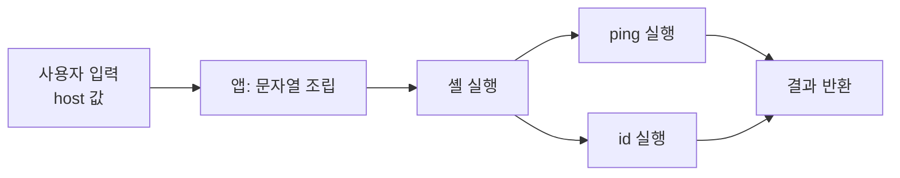

> 서버가 입력값을 셸에 문자열로 넘기면, 입력의 `;`, `|`, `&&` 같은 기호가 "명령 구분자"로 해석됩니다. 출력이 보이지 않아도 시간·DNS·오류로 실행 여부를 확인할 수 있습니다.

## 원리

`system()`, `exec()`, `Runtime.exec(문자열)`, `child_process.exec()`처럼 **문자열 하나를 셸이 파싱**하는 호출에 사용자 입력이 들어가면, 셸이 입력 안의 메타문자를 문법으로 읽습니다.



자주 쓰이는 메타문자는 아래와 같습니다.

| 목적 | Linux/macOS | Windows(cmd) |
|---|---|---|
| 순차 실행 | `;` | `&` |
| 앞이 성공하면 실행 | `&&` | `&&` |
| 앞이 실패하면 실행 | <code>&#124;&#124;</code> | <code>&#124;&#124;</code> |
| 파이프 | <code>&#124;</code> | <code>&#124;</code> |
| 명령 치환 | `` `cmd` ``, `$(cmd)` | 해당 없음(변수 확장 `%VAR%`) |
| 줄바꿈 | `%0a` (URL 인코딩) | `%0a` |

## 취약한 코드와 고친 코드

**취약한 코드 (Python)**

```python
import subprocess
from flask import request

@app.get("/ping")
def ping():
    host = request.args.get("host", "")
    out = subprocess.run(f"ping -c 1 {host}", shell=True, capture_output=True, text=True)
    return "ok" if out.returncode == 0 else "fail"
```

응답이 "ok/fail"뿐이라 결과가 안 보이지만, 명령은 그대로 실행됩니다. **출력이 안 보인다고 안전한 것이 아닙니다.** 이 점을 가장 많이 놓칩니다.

**고친 코드**

```python
import ipaddress, subprocess

@app.get("/ping")
def ping():
    host = request.args.get("host", "")
    try:
        ip = ipaddress.ip_address(host)       # 형식 검증
    except ValueError:
        abort(400)
    out = subprocess.run(["ping", "-c", "1", str(ip)],  # 인자 배열, 셸 없음
                         capture_output=True, text=True, timeout=5)
    return "ok" if out.returncode == 0 else "fail"
```

## 확인 방법(진단 순서)

### 결과가 보일 때

| 보내는 것 | 보는 것 | 취약 신호 |
|---|---|---|
| `127.0.0.1; echo probe123` | 응답에 `probe123` | 두 번째 명령 실행 |
| `127.0.0.1 && echo probe123` | 동일 | 첫 명령 성공 조건 확인 |
| <code>127.0.0.1 &#124; echo probe123</code> | 동일 | 파이프 해석 |
| `$(echo probe123)` | 동일 | 명령 치환 해석 |

### 결과가 안 보일 때: 블라인드

1. **시간 지연**: `127.0.0.1; sleep 5` 를 보내 응답이 5초 늦어지는지 봅니다. Windows는 `ping -n 6 127.0.0.1` 같은 자체 지연을 씁니다. 지연 시간을 5초, 10초로 바꿔 **비례해서 늘어나는지** 보면 우연한 네트워크 지연과 구분됩니다.
2. **외부 접속·DNS**: 통제하는 서버로 이름 조회나 요청을 보내게 해서 도착 여부를 봅니다. 응답 시간 차이가 불안정한 환경(캐시, 큐 처리)에서 가장 확실합니다. 허가 범위 안의 내 서버만 사용합니다.
3. **파일 쓰기 후 읽기**: 웹에서 접근 가능한 경로에 확인용 파일을 하나 만들고 브라우저로 조회합니다. 쓰기 권한이 필요하고 흔적이 남으므로 확인 후 반드시 정리하고 보고서에 기록합니다.
4. **조건부 지연**: 명령 결과를 비교해 참일 때만 지연시키면 블라인드 SQL 인젝션처럼 한 비트씩 정보를 읽을 수 있지만, 진단 목적상 "실행 가능함" 증명 후 멈춥니다.
5. **오류 차이**: 존재하지 않는 명령을 넣어 응답 코드나 메시지가 달라지는지 봅니다. 앱이 오류를 삼켜도 상태 코드가 갈리는 경우가 있습니다.

판단 포인트: 한 번의 지연으로 결론 내리지 마세요. **대조군**(지연 없는 같은 형태 요청)과 함께 두세 번 반복해야 합니다. 또 입력이 큐에 쌓여 **나중에 비동기로 실행**되는 구조면 응답 시간은 변하지 않고 외부 접속만 뒤늦게 도착합니다.

## 필터를 만났을 때의 발상

| 막는 것 | 우회 발상 (확인 목적) | 근본 대응 |
|---|---|---|
| 공백 | 셸의 `${IFS}`, 탭, 중괄호 확장 `{a,b}` | 셸 자체를 쓰지 않음 |
| 특정 명령어 문자열 | 따옴표 삽입 `c""at`, 변수 조립 | 허용 목록 |
| 슬래시 `/` | 환경 변수 일부 활용 | 경로 고정 |
| `;` `&` 등 | 줄바꿈 `%0a`, 다른 연결자 <code>&#124;</code> | 인자 배열 |
| 블랙리스트 전체 | 목록에 없는 구분자·치환 문법 | 블랙리스트 폐기 |

블랙리스트는 "빠진 것 하나"로 무너집니다. 진단 보고서에도 "필터가 있으나 우회됨"이 아니라 "**문자열 셸 호출 구조 자체가 원인**"으로 기술해야 개발팀이 같은 곳을 다시 고치지 않습니다.

## 유형·변형

| 유형 | 원리 | 확인 포인트 |
|---|---|---|
| 직접 출력형 | 명령 결과가 응답에 포함 | 마커 문자열 반사 |
| 블라인드형 | 결과가 응답에 없음 | 지연·외부 접속 |
| 인자 주입 | 셸은 안 쓰지만 인자에 `-o` 같은 옵션이 끼어듦 | 입력이 `-`로 시작할 때 동작 변화 |
| 코드 인젝션 | `eval`, 템플릿 엔진 등 언어 수준 실행 | 산술식·함수 호출 결과 반사 |
| 파일명 경유 | 업로드 파일명이 셸 명령에 사용 | 파일명에 메타문자 포함 |

인자 주입은 `shell=False`로 고쳐도 남습니다. `ping`에 사용자가 `-f` 같은 옵션을 넣게 두면 의도치 않은 동작이 됩니다. 옵션 종료 표시 `--`와 값 검증을 같이 쓰세요.

## 대응 방안

**코드 수준**

1. 외부 명령 대신 언어 라이브러리를 씁니다(이미지는 라이브러리, 압축은 표준 모듈 등). 가장 확실합니다.
2. 불가피하면 **인자를 배열로** 넘기고 셸을 거치지 않습니다(`shell=False`, `execve` 계열, Node의 `execFile`/`spawn`).
3. 입력은 허용 목록(IP 형식, 숫자, 열거형)으로 검증하고, 옵션처럼 보이는 값은 거부합니다.
4. 실행 파일은 절대 경로로 고정하고 `PATH`에 의존하지 않습니다.

**설정 수준**

1. 웹 서버 프로세스는 최소 권한 계정으로 실행합니다.
2. 컨테이너에서 읽기 전용 루트, 불필요한 바이너리 제거, 외부 아웃바운드 차단(egress 필터)을 적용하면 블라인드 확인과 후속 피해가 모두 줄어듭니다.

**구조 수준**

1. 명령 실행 기능은 별도의 격리된 작업자 서비스로 분리합니다.
2. 실행 시간 제한과 리소스 제한을 둡니다.

## 참고 자료

- OWASP, OS Command Injection Defense Cheat Sheet
- OWASP Testing Guide, Testing for Command Injection
- CWE-78: Improper Neutralization of Special Elements used in an OS Command
- CWE-88: Improper Neutralization of Argument Delimiters in a Command
- Python 공식 문서, subprocess 모듈의 보안 고려사항
