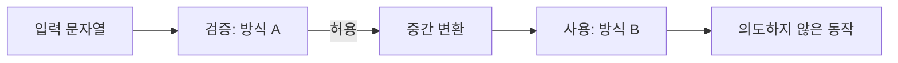

> 입력을 **검사하는 곳**과 **사용하는 곳**이 서로 다른 방식으로 문자열을 해석하면, 검사는 통과하고 사용은 위험해집니다. 필터 우회의 상당수는 이 한 가지 원리로 설명됩니다.

## 원리: 해석기가 둘이면 입력의 의미도 둘이다

문자열은 거쳐 가는 단계마다 **해석**됩니다. 대소문자 처리, 퍼센트 디코딩, 유니코드 정규화, 경로 정리, 공백·널 문자 처리가 단계마다 다를 수 있습니다. 검증 단계가 본 값과 최종 사용 단계가 본 값이 다르면 그 틈이 우회 지점입니다.



핵심 질문은 하나입니다. **"검증한 변수와 실제로 쓰는 변수가 같은가, 그 사이에 값을 바꾸는 단계가 있는가."**

## 취약한 코드 → 고친 코드

관리자 경로 접근을 막는 최소 Flask 예제입니다.

```python
# vulnerable.py
from urllib.parse import unquote
from flask import Flask, request, abort

app = Flask(__name__)

@app.get("/view")
def view():
    # request.args는 프레임워크가 이미 퍼센트 디코딩한 값입니다.
    path = request.args["path"]
    if "admin" in path:              # 1) 한 번 디코딩된 값을 검사
        abort(403)
    real = unquote(path)             # 2) 여기서 또 디코딩 = 이중 디코딩
    return open_page(real)           # 3) 두 번 디코딩된 값을 사용
```

- 검사는 디코딩이 **한 번** 된 값, 사용은 **두 번** 된 값입니다. 검사 뒤에 한 번 더 디코딩하는 단계가 불일치의 원인입니다(`%2561dmin`처럼 한 겹 더 인코딩된 값이 검사를 지나 두 번째 디코딩에서 달라집니다).
- 프레임워크마다 디코딩 시점이 다르므로 "내 코드가 받는 값이 이미 디코딩됐는가"를 먼저 확인해야 합니다.
- 대소문자 비교, 블랙리스트 문자열 비교도 같은 계열의 약점입니다.

```python
# fixed.py
import unicodedata
from flask import Flask, request, abort

app = Flask(__name__)
ALLOWED = {"home", "pricing", "contact"}

def canonical(s: str) -> str:
    # request.args는 이미 디코딩됨 → 여기서 unquote를 다시 하지 않는다(이중 디코딩 방지)
    s = unicodedata.normalize("NFKC", s)      # 유니코드 정규화
    if "\x00" in s or any(c.isspace() for c in s):
        abort(400)
    return s.casefold()

@app.get("/view")
def view():
    page = canonical(request.args["path"])    # 이후 이 값만 사용
    if page not in ALLOWED:                   # 블랙리스트가 아닌 허용 목록
        abort(404)
    return open_page(page)
```

- **정규화를 먼저, 검증을 나중에**, 그리고 검증한 값만 사용합니다.
- 막을 것을 나열하지 않고 **허용할 것을 나열**합니다.

## 확인 방법(진단 순서)

1. **필터의 존재 확인**: 평범한 값은 통과하고 위험해 보이는 값만 거부되는지 응답 차이로 확인합니다.
2. **검사 대상 값 추정**: 같은 의미를 다른 표기로 보내(대소문자 변경, 퍼센트 인코딩 한 번) 거부 여부가 바뀌는지 봅니다. 바뀌면 검사는 **표기 그대로**를 보고 있다는 뜻입니다.
3. **디코딩 횟수 확인**: 인코딩을 한 번 더 씌운 값이 다르게 처리되는지 봅니다. 응답이 한 번 인코딩한 값과 같다면 디코딩이 한 번 더 일어나고 있습니다.
4. **구성 요소별 차이 확인**: 프록시·WAF·애플리케이션이 겹쳐 있으면 같은 요청이 각각 다르게 해석되는지(중복 파라미터, 경로 구분 표기, 비표준 공백) 응답 차이로 비교합니다.
5. **확정**: 검사 단계가 막는 의미와 실제 처리되는 의미가 갈리는 입력 하나를 찾아 증거(응답 차이)로 남깁니다. 권한이 있는 데이터 접근으로 이어지면 영향 범위만 확인하고 멈춥니다.

> **실무 포인트** 필터를 만났을 때 규칙 목록을 외워 두드리지 말고 **"이 필터는 어느 시점의 문자열을 보는가"**를 먼저 가설로 세우세요. 한 가설을 응답 차이 두세 번으로 판정할 수 있습니다. 여기서 많이 놓칩니다: 필터가 거부 방식인지 삭제 방식인지 구별하지 않으면, 삭제 후 남은 조각이 다시 위험한 값이 되는 경우를 못 봅니다.

> **실무 포인트** 방어를 권고할 때 "이 패턴도 막으세요"를 목록에 하나 더하면 다음 변형에 또 뚫립니다. 보고서에는 **정규화 위치와 허용 목록 전환**을 근본 대책으로 쓰고, 막힌 특정 값은 재현 증거로만 쓰세요.

## 유형·변형

| 유형 | 원리 | 확인 포인트 |
|---|---|---|
| 대소문자 | 비교가 대소문자를 구분하지만 사용처는 구분하지 않음 | 검사와 사용 모두 같은 케이스 규칙인가 |
| 이중 디코딩 | 검사 후 한 번 더 디코딩됨 | 디코딩이 검사 앞에서 한 번만 일어나는가 |
| 유니코드 정규화 | 호환 문자가 정규화 후 일반 문자로 바뀜 | 검증 전에 정규화하는가 |
| 널 바이트·제어 문자 | 한쪽은 문자열 끝으로, 다른 쪽은 일반 문자로 취급 | 제어 문자를 입력 단계에서 거부하는가 |
| 비표준 공백 | 파서마다 공백으로 인정하는 범위가 다름 | 구분자 처리가 단일 파서를 거치는가 |
| 삭제형 치환 | 위험 표기를 한 번 지우면 조각이 재조합됨 | 치환이 아니라 거부 또는 반복 처리인가 |
| 중복·구성 요소 차이 | 프록시와 앱이 중복 파라미터·경로를 다르게 해석 | 한 곳에서만 해석하고 나머지는 그대로 전달하는가 |

## 대응 방안

### 코드 수준
- 입력은 **경계에서 한 번** 디코딩·정규화하고 이후 코드는 그 결과만 사용합니다.
- 검증 대상 변수와 사용 변수를 하나로 합니다(원본을 따로 들고 다니지 않습니다).
- 블랙리스트 대신 **허용 목록·타입 강제**를 씁니다.
- 널 바이트, 제어 문자, 예상 밖의 인코딩은 거부합니다.

### 설정 수준
- WAF·프록시 규칙은 보조 수단으로 두고, 최종 판단은 사용하는 쪽 코드에서 합니다.
- 프록시와 애플리케이션의 경로·파라미터 해석 규칙을 문서로 맞춥니다.

### 구조 수준
- 파일 경로, URL, 쿼리처럼 구조가 있는 값은 문자열 검사 대신 **파서가 만든 구조(객체)**로 판단합니다.

## 함께 보기

- [경로 조작(Path Traversal)](/notes/path-traversal/)
- [XSS 필터 우회 패턴](/notes/xss-filter-bypass-patterns/)
- [HTTP 요청 스머글링](/notes/http-request-smuggling/)

## 참고 자료

- [OWASP Cheat Sheet Series: Input Validation](https://cheatsheetseries.owasp.org/cheatsheets/Input_Validation_Cheat_Sheet.html)
- [CWE-180: Incorrect Behavior Order: Validate Before Canonicalize](https://cwe.mitre.org/data/definitions/180.html)
- [CWE-174: Double Decoding of the Same Data](https://cwe.mitre.org/data/definitions/174.html)
- [CWE-176: Improper Handling of Unicode Encoding](https://cwe.mitre.org/data/definitions/176.html)
