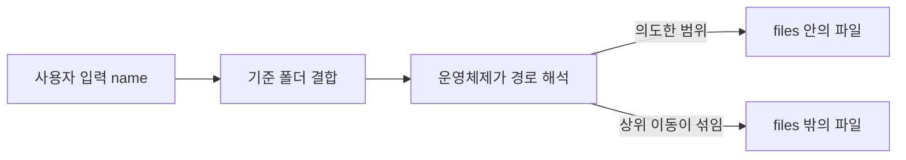

> 파일을 읽거나 쓰는 코드에 사용자 입력이 경로 일부로 들어가면, `..` 같은 상위 이동 표기로 **의도한 폴더 밖의 파일**에 닿을 수 있습니다. 이것이 경로 조작(Path Traversal)입니다.

## 원리: 기준 디렉터리는 문자열일 뿐이다

개발자는 `files/` 폴더 안의 파일만 내려줄 의도로 코드를 씁니다. 하지만 파일 시스템은 경로를 **문자열 그대로가 아니라 해석해서** 처리합니다. `files/../secret.txt`는 `files/` 밖의 `secret.txt`를 가리킵니다.



읽기에서는 설정 파일, 소스, 자격 증명 같은 **정보 노출**이 됩니다. 쓰기(업로드 파일명, 압축 해제)에서는 실행되는 파일이나 설정을 덮어써 **코드 실행**으로 이어질 수 있어 영향이 더 큽니다.

## 취약한 코드 → 고친 코드

취약한 예시입니다(직접 만든 최소 Flask 예제).

```python
# vulnerable.py
from flask import Flask, request

app = Flask(__name__)
BASE = "/srv/app/files"

@app.get("/download")
def download():
    name = request.args["name"]
    with open(BASE + "/" + name, "rb") as f:   # 입력을 그대로 결합
        return f.read()
```

- 입력에 경로 구분자와 상위 이동 표기가 들어가는지 전혀 보지 않습니다.
- 단순 문자열 결합이라 기준 폴더가 보장하는 것이 없습니다.

고친 예시입니다.

```python
# fixed.py
from pathlib import Path
from flask import Flask, abort, request, send_file

app = Flask(__name__)
BASE = Path("/srv/app/files").resolve()

@app.get("/download")
def download():
    name = request.args["name"]
    target = (BASE / name).resolve()          # 정규화: .., 심볼릭 링크 해석
    if not target.is_relative_to(BASE):       # 기준 폴더 안인지 확인
        abort(400)
    if not target.is_file():
        abort(404)
    return send_file(target)
```

- **정규화한 뒤에** 기준 폴더 안인지 비교합니다. 정규화 전에 문자열에서 `..`를 지우는 방식은 표기 변형에 약합니다.
- `resolve()`는 심볼릭 링크도 따라가므로, 링크로 밖을 가리키는 경우도 걸러집니다.

더 안전한 구조는 **경로를 입력으로 받지 않는 것**입니다. 파일마다 ID를 두고 서버가 ID로 실제 경로를 찾게 하면 조작할 경로 자체가 없습니다.

```python
FILES = {"manual": "manual-v2.pdf", "terms": "terms.pdf"}   # 허용 목록 매핑

@app.get("/doc/<key>")
def doc(key):
    if key not in FILES:
        abort(404)
    return send_file(BASE / FILES[key])
```

## 확인 방법(진단 순서)

1. **입력점 찾기**: 파일명, 경로, 언어·테마·템플릿 이름, 로그 이름을 받는 파라미터를 찾습니다. 다운로드, 이미지 로더, 미리보기, 업로드 파일명이 대표적입니다.
2. **정상 동작 기준 잡기**: 정상 파일명으로 응답 형태와 오류 메시지를 먼저 확인합니다.
3. **경계 이동 여부 확인**
   - 보내는 것: 정상 파일명 앞에 상위 이동 표기를 붙인 값, 또는 존재하는 다른 폴더의 알려진 파일명
   - 보는 것: 응답이 정상 파일과 다른 내용으로 바뀌거나, 오류 메시지가 "파일 없음"에서 "접근 거부" 또는 시스템 경로 노출로 바뀌면 입력이 경로 해석에 영향을 주는 것입니다.
4. **필터가 있다면 방식 파악**: 입력이 제거되는지, 거부되는지, 한 번만 치환되는지를 응답 차이로 구별합니다. 검증이 디코딩 전인지 후인지도 확인 대상입니다.
5. **쓰기 경로 확인**: 업로드 파일명, 압축 파일 항목명이 저장 경로에 그대로 반영되는지 봅니다. 읽기보다 영향이 큽니다.

> **실무 포인트** 검증은 통과했는데 뚫리는 대표 원인은 **검증 시점과 사용 시점의 해석 차이**입니다. 검증 코드가 URL 디코딩 전 문자열을 보고, 파일을 여는 코드는 디코딩 후 값을 쓰는 식입니다. 그래서 점검할 때는 필터 규칙을 외우기보다 "검증하는 값과 실제 여는 값이 같은 변수인가"를 코드에서 확인하세요.

> **실무 포인트** 읽기 기능만 보지 말고 **압축 해제와 업로드 저장**을 꼭 보세요. 압축 항목명이나 업로드 파일명이 경로로 쓰이는 코드는 개발자가 "내부 처리"라고 생각해 검증을 빼먹는 경우가 많습니다. 덮어쓸 수 있는 대상이 실행 코드나 설정이면 정보 노출을 넘어 코드 실행 영향으로 보고해야 합니다.

## 유형·변형

| 유형 | 원리 | 확인 포인트 |
|---|---|---|
| 상위 이동 | `..` 구간으로 기준 폴더를 벗어남 | 결합 전에 정규화·기준 비교를 하는가 |
| 절대 경로 주입 | 입력이 `/`로 시작해 기준 폴더를 무시하게 됨 | 경로 결합 함수가 절대 경로를 만나면 앞부분을 버리는 동작인가 |
| 인코딩 변형 | 퍼센트 인코딩, 이중 인코딩으로 필터 통과 | 검증이 디코딩 후 값에 대해 이루어지는가 |
| 일회성 치환 | 위험 표기를 한 번만 지워 재조합 가능 | 치환을 반복하거나 거부 방식으로 처리하는가 |
| 확장자·접두 검사 | 접미사나 시작 문자열만 확인 | 정규화 후 기준 경로 포함 여부를 보는가 |
| 심볼릭 링크 | 기준 폴더 안의 링크가 밖을 가리킴 | 실제 경로 해석(resolve) 결과를 검사하는가 |
| 쓰기형 | 업로드·압축 해제 파일명으로 임의 위치에 저장 | 저장 경로를 서버가 만드는가 |

## 대응 방안

### 코드 수준
- 가능하면 **경로를 입력으로 받지 않습니다.** ID나 키를 받아 서버의 허용 목록으로 실제 파일에 매핑합니다.
- 경로가 꼭 필요하면 **정규화 → 기준 디렉터리 포함 여부 확인** 순서를 지킵니다. 문자열에서 위험 표기를 지우는 방식은 쓰지 않습니다.
- 파일명만 필요하면 경로 구분자가 하나라도 있으면 거부하거나 basename만 사용합니다.
- 업로드는 **저장 이름을 서버가 새로 생성**합니다(임의 문자열 + 검증된 확장자). 원래 이름은 메타데이터로만 보관합니다.
- 압축 해제는 항목 하나하나의 최종 경로를 정규화해 기준 폴더 안인지 확인합니다.

### 설정 수준
- 서비스 계정은 필요한 폴더만 읽고, **쓰기 권한은 업로드 전용 폴더에만** 줍니다. 애플리케이션 소스 폴더는 실행 계정이 쓸 수 없게 합니다.
- 오류 메시지에 서버 내부 절대 경로를 싣지 않습니다.

## 함께 보기

- [파일 업로드 취약점: 확장자·MIME·콘텐츠 검증의 허점](/notes/file-upload-vulnerability/)
- [OS 명령어 주입](/notes/os-command-injection/)

## 참고 자료

- [OWASP: Path Traversal](https://owasp.org/www-community/attacks/Path_Traversal)
- [CWE-22: Improper Limitation of a Pathname to a Restricted Directory](https://cwe.mitre.org/data/definitions/22.html)
- [OWASP Cheat Sheet Series: File Upload](https://cheatsheetseries.owasp.org/cheatsheets/File_Upload_Cheat_Sheet.html)
- [Python 문서: pathlib](https://docs.python.org/3/library/pathlib.html)
