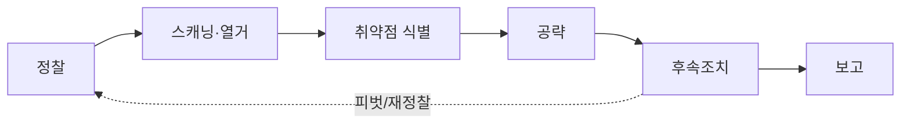

> 모의해킹은 즉흥이 아니라 **정해진 단계**를 반복 순환하는 작업이다. 각 단계는 다음 단계의 입력을 만든다 — 정찰이 공격면을 그리고, 스캐닝이 진입점을 좁히고, 공략이 발판을 얻고, 후속조치가 범위를 넓히고, 보고가 결과를 자산으로 바꾼다.

## 개념

표준 수명주기와 각 단계의 목표:

- **정찰(Reconnaissance)**: 대상의 자산·도메인·직원·기술스택을 수집. 수동(노출된 정보만)과 능동(직접 질의)으로 나뉜다.
- **스캐닝·열거(Scanning/Enumeration)**: 살아있는 호스트·열린 포트·서비스 버전을 식별하고, 서비스별로 계정·공유·설정을 캐낸다.
- **취약점 식별**: 수집한 버전·설정을 알려진 취약점·설정 오류와 대조.
- **공략(Exploitation)**: 검증된 취약점으로 최초 발판(initial access)을 얻는다.
- **후속조치(Post-Exploitation)**: 권한 상승·자격증명 수집·내부 이동(피벗)·지속성.
- **보고(Reporting)**: 재현 절차·영향·조치안을 문서화. 실무에서 가장 가치 있는 산출물.



핵심 사고방식: 단계마다 **증거를 남기고**, 막히면 이전 단계로 돌아가 열거를 더 한다. "열거가 부족해서" 막히는 경우가 대부분이다.

## 공격·확인 구문

허가된 범위·계약된 대상에서만.

### 단계별 산출물(무엇을 남기는가)

```
정찰    → 도메인/서브도메인, IP 범위, 직원·이메일, 기술스택 목록
스캐닝  → 호스트·포트·서비스 버전 표
열거    → 사용자/공유/디렉터리/설정 파일 목록
공략    → 재현 가능한 PoC, 획득한 셸/계정
후속    → 상승 경로, 수집 자격증명, 피벗 경로도
보고    → 요약·위험도·재현절차·조치안
```

### 진행 판단(막혔을 때)

```
발판이 없다        → 열거 부족: 서비스·버전·숨은 경로 다시
권한이 안 오른다   → 로컬 열거 자동화 재실행, 설정 오류 재검토
이동이 안 된다     → 수집 자격증명 재사용, 내부 네트워크 재스캔
```

## 참고 자료

- PTES: Penetration Testing Execution Standard (pentest-standard.org)
- [MITRE ATT&CK](https://attack.mitre.org/)
- [NIST SP 800-115: Technical Guide to Information Security Testing](https://csrc.nist.gov/pubs/sp/800/115/final)
