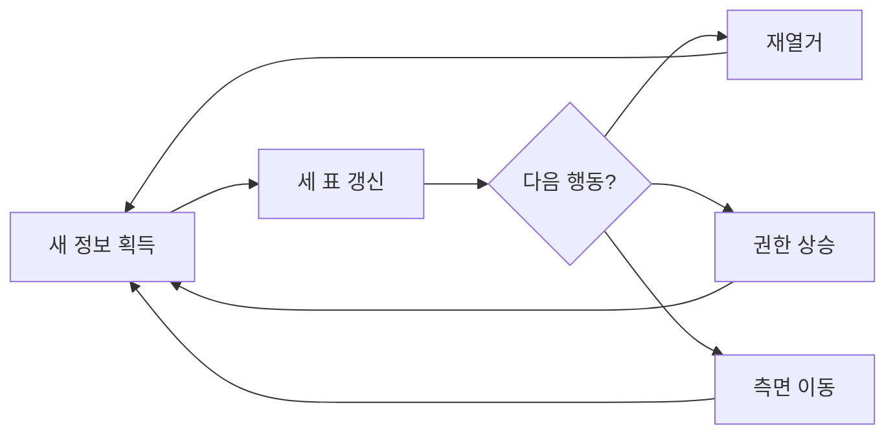
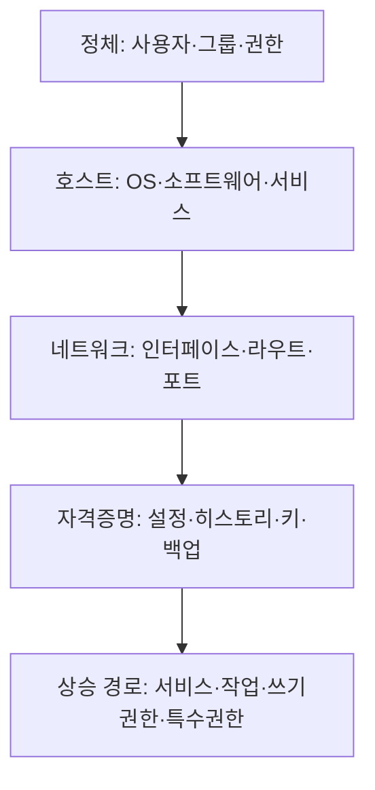
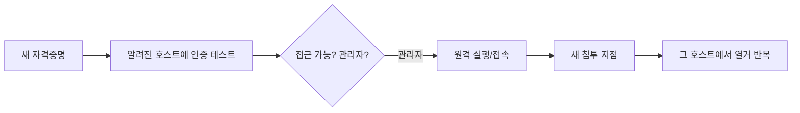

> 모의침투에서 막히는 이유는 대개 "기술이 없어서"가 아니라 **"지금 가진 정보로 다음에 뭘 봐야 할지"를 놓쳐서**입니다. 이 글은 개별 기법이 아니라, 초기 침투 후 **무엇을 확인하고 → 어디로 이동할지** 결정하는 작전 흐름을 정리합니다. 실제 명령은 각 단계의 치트시트 노트로 연결합니다.

## 개념

작전은 직선이 아니라 **순환**입니다. 새로운 것(호스트·자격증명·권한·네트워크)을 하나 얻을 때마다 상태를 갱신하고, 과거에 막혔던 경로를 다시 엽니다. 그래서 중심에는 항상 **세 가지 표(매트릭스)**가 있습니다.

- **호스트 표**: 각 호스트의 IP·이름·도메인·열린 포트·현재 접근 상태.
- **자격증명 표**: 사용자명·비밀번호·해시·티켓·키의 **출처와 검증 결과**(어디서 얻었고, 어느 호스트/서비스에서 먹혔는가).
- **접근 표**: "이 계정으로 이 호스트에서 일반 사용자인가 관리자인가".



이 글에서 가장 중요한 한 문장: **"막히면 열거가 부족한 것이다."** 상승이 안 되면 자격증명을 더 캐고, 이동이 안 되면 수집한 자격증명을 아직 안 써 본 호스트에 다시 검증합니다.

## 공격·우회 구문

허가된 범위·계약된 대상에서만. 모든 예시 대상은 플레이스홀더입니다.

### 1단계 — 초기 침투 직후 확인 (Initial Access)

셸 하나를 처음 잡으면, 공격을 서두르기 전에 **현재 위치부터** 파악합니다.

```
OS / 현재 사용자 / 권한 수준 / 셸 안정성은?
호스트 이름 / 도메인 소속 / 인터페이스 / 라우트 / 열린 포트는?
```

| 확인 결과 | 다음 단계 |
|---|---|
| Windows 셸 | → 윈도우 호스트 열거 |
| Linux 셸 | → 리눅스 호스트 열거 |
| 도메인에 소속됨 | → Active Directory 흐름 병행 |
| 새 네트워크 인터페이스가 보임 | → 피벗 준비 |

> 판단 포인트: 불안정한 셸로 바로 권한상승 도구를 돌리면 끊기기 쉽습니다. 먼저 셸을 안정화(TTY 업그레이드 등)하고 시작합니다.

### 2단계 — 호스트 열거 (무엇을 보는가)

권한상승의 90%는 "이미 거기 있는 설정 오류"를 **찾는** 일입니다. 아래를 빠짐없이 훑습니다.



- **자격증명 사냥**이 핵심입니다. 설정 파일·`.env`·셸 히스토리·백업·개인키·애플리케이션 저장소에서 평문·해시가 나옵니다. "여기서 많이 놓칩니다" — 홈 디렉터리만 보고 끝내지 말고 서비스 설정 경로까지 봅니다.
- **상승 후보**는 윈도우(토큰 특권·서비스·예약작업·쓰기 가능 바이너리·언쿼티드 경로)와 리눅스(sudo·SUID·capabilities·cron·특수 그룹)로 나뉩니다.

| 발견 | 의미 |
|---|---|
| 쓰기 가능한 서비스 바이너리/경로 | 서비스 재시작 시 내 코드 실행 |
| 토큰 위임 특권(Win) / 위험한 sudo·SUID(Linux) | 즉시 상승 후보 |
| 평문·해시·키 | → 자격증명 흐름으로 |
| localhost 전용 서비스 | → 피벗/포트포워딩으로 노출 |

### 3단계 — 자격증명을 얻으면 (가장 값진 전리품)

자격증명은 **형태마다 쓰는 길이 다릅니다.** 얻는 즉시 "어디에 먹히는가"를 전수 검증합니다.

| 가진 것 | 할 수 있는 것 |
|---|---|
| 사용자명만 | 유효성 확인, 제한적 스프레이, 사전인증 비활성 계정 탐색 |
| 사용자명+비밀번호 | 모든 서비스/호스트에 재사용 검증, 관리자 범위 확인 |
| NT 해시 | Pass-the-Hash(원격 실행), 동일 로컬 관리자 재사용 범위 |
| 네트워크 인증 응답 | 오프라인 크래킹 또는 중계(서명 미적용 대상) |
| 티켓(.ccache 등) | 티켓 기반 인증, 유효시간·대상 서비스 확인 |
| 개인키 | 대응 사용자/호스트 매핑, 패스프레이즈 오프라인 크래킹 |
| 인증서 | 인증서 기반 인증, 발급 경로 악용 가능성 |

> 판단 포인트: 새 비밀번호 하나가 과거에 막힌 SMB·WinRM·DB·SSH를 **한꺼번에** 열 수 있습니다. 그래서 자격증명을 얻으면 공격 매트릭스를 통째로 다시 돌립니다([재열거](/notes/network-service-enumeration/)).

### 4단계 — 권한 상승 (상승이 안 될 때 순서)

막혔을 때 기계적으로 아래 순서를 탑니다.

```
자격증명/재사용?  →  설정 오류?  →  서비스/작업/cron?
→  쓰기 가능한 바이너리/스크립트?  →  특수 권한/그룹/capability?
→  (마지막) 알려진 취약점
```

익스플로잇은 버전·조건·안정성·영향·복구 가능성을 검토한 **뒤에** 후보로 둡니다. 설정 오류 경로가 거의 항상 더 안전하고 조용합니다.

### 5단계 — 관리자/루트 이후 (Post-Exploitation)

관리자·SYSTEM·root를 잡으면 **추가 자격증명 수집**으로 넘어갑니다. 메모리·로컬 비밀 저장소·캐시된 티켓·로그온 세션·설정/백업에서 다음 호스트로 가는 열쇠가 나옵니다. 여기서 얻은 것은 다시 3단계의 자격증명 표로 들어갑니다.

### 6단계 — 측면 이동 (Lateral Movement)



필요한 **최소 경로**를 고릅니다 — 대화형 접속이면 충분한지, 원격 실행이 필요한지. 새로 침투한 호스트마다 2단계 호스트 열거를 처음부터 반복합니다.

### 7단계 — 피벗 (닿지 않는 내부망으로)

장악한 호스트가 내·외부 양쪽에 붙어 있으면(dual-homed) 경유지로 삼습니다. 단일 포트면 포트포워딩, 여러 대상이면 SOCKS 프록시, 전체 경로가 필요하면 터널을 세웁니다. 피벗 뒤에는 DNS·시간 동기화가 깨지지 않았는지부터 확인합니다. 그 다음 내부 호스트를 다시 1단계부터 돌립니다.

### Active Directory를 만나면

도메인에 들어서면 흐름이 "자격증명 유무"로 갈립니다.

| 상태 | 핵심 행동 |
|---|---|
| 자격증명 없음 | 익명·게스트 열거로 사용자명 수집 → 사전인증 비활성 계정 확인 |
| 도메인 사용자 확보 | 디렉터리 열거(사용자·그룹·ACL·SPN), 공격 경로 그래프 분석 |
| 흥미로운 권한 발견 | 비밀번호 변경·그룹 편입·ACL 변경·인증서 경로 중 가능한 것 |
| 로컬 관리자 확보 | 비밀·티켓·세션 수집 → 새 자격증명 전수 재검증 |

> 판단 포인트: AD에서는 **새 권한을 얻을 때마다 공격 경로 그래프를 다시 그립니다.** 어제 막혔던 edge가 오늘 얻은 ACL 하나로 열립니다.

## 함께 보기

- [모의해킹 수명주기와 방법론](/notes/penetration-testing-lifecycle/)
- [정찰·스캐닝 도구 치트시트](/notes/recon-scanning-cheatsheet/)
- [리눅스 권한 상승](/notes/linux-privilege-escalation/) · [윈도우 권한 상승](/notes/windows-privilege-escalation/)
- [피벗팅과 터널링](/notes/pivoting-and-tunneling/)

## 참고 자료

- [MITRE ATT&CK Matrix for Enterprise](https://attack.mitre.org/matrices/enterprise/)
- [NIST SP 800-115: Technical Guide to Information Security Testing](https://csrc.nist.gov/pubs/sp/800/115/final)
- PTES: Penetration Testing Execution Standard (pentest-standard.org)
