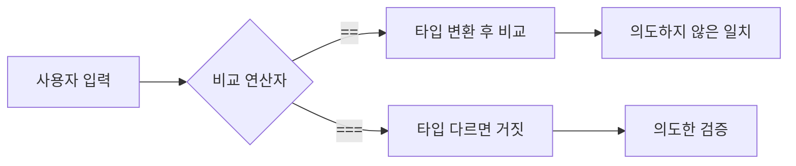

> PHP의 `==`는 값을 비교하기 전에 **타입을 맞추려고 변환**합니다. 그 변환 규칙을 모르고 쓴 인증·검증 코드는 의도와 다른 입력에서 "같다"고 판단합니다.

## 이런 분께

- PHP로 로그인, 토큰 비교, 권한 분기를 작성하는 분
- 코드 리뷰에서 `==`와 `===`의 차이를 설명해야 하는 분
- JSON 본문의 값 타입을 확인하지 않고 쓰는 API를 점검하는 분

## 1. 원리: 비교 전에 타입이 바뀝니다

`==`(느슨한 비교)는 양쪽 타입이 다르면 한쪽을 변환한 뒤 비교합니다. `===`(엄격 비교)는 타입이 다르면 곧바로 거짓입니다.



개발자가 놓치기 쉬운 변환은 다음과 같습니다.

| 상황 | 동작 | 위험 |
|---|---|---|
| 불리언과 문자열 비교 | 비어 있지 않은 문자열은 `true`로 취급 | `true == "admin"`이 참 |
| 숫자 모양 문자열끼리 비교 | 양쪽이 모두 숫자로 해석되면 숫자로 비교 | 서로 다른 문자열이 같은 수로 판단됨 |
| 문자열을 정수로 캐스팅 | 앞부분의 숫자만 읽고, 숫자가 없으면 0 | 숫자 아닌 문자열이 0과 같아짐 |
| `switch` 문 | 내부적으로 `==` 사용 | `case` 분기가 느슨하게 일치 |
| `in_array` 기본 호출 | 느슨한 비교 | 목록 검사가 무력화 |

PHP 8부터 "숫자와 숫자 아닌 문자열" 비교 규칙이 바뀌어 `0 == "abc"`는 거짓이 되었습니다. 그래도 **불리언·null·숫자 모양 문자열** 사이의 변환은 남아 있고, 구버전을 쓰는 서비스도 많습니다. 버전에 기대지 말고 엄격 비교를 기본으로 두는 편이 안전합니다.

## 2. 취약한 코드 → 고친 코드

취약한 예시입니다(직접 만든 최소 예제).

```php
<?php
// vulnerable.php - JSON 본문으로 로그인
$in = json_decode(file_get_contents('php://input'), true);

switch ($in['role']) {          // switch는 == 로 비교
    case 'admin':
        grant_admin();
        break;
    default:
        grant_user();
}

// 서명 비교도 마찬가지
if (hash_hmac('sha256', $body, $key) == $_GET['sig']) {
    process($body);
}
```

- `role`에 JSON 불리언 `true`가 들어오면 `true == 'admin'`이 참이라 첫 `case`로 들어갑니다.
- 서명이 `0e`로 시작하는 숫자 모양 문자열끼리 만나면 둘 다 "0"으로 해석되어 일치할 수 있습니다. 서명·해시 비교에서 `==`는 금지입니다.

고친 코드입니다.

```php
<?php
declare(strict_types=1);

$in = json_decode(file_get_contents('php://input'), true);

// 1) 타입을 먼저 확인
if (!is_array($in) || !isset($in['role']) || !is_string($in['role'])) {
    http_response_code(400);
    exit;
}

// 2) 엄격 비교, 허용 목록으로 분기
$role = match ($in['role']) {   // match는 === 로 비교
    'admin' => grant_admin(),
    default => grant_user(),
};

// 3) 비밀값 비교는 상수 시간 함수
$expected = hash_hmac('sha256', $body, $key);
if (is_string($_GET['sig'] ?? null) && hash_equals($expected, $_GET['sig'])) {
    process($body);
}
```

> **실무 포인트** 관리자 분기는 `role` 값 자체를 클라이언트에서 받지 않는 것이 먼저입니다. 서버 세션의 권한을 쓰세요. 입력으로 받더라도 타입 검사 후 엄격 비교를 거쳐야 합니다.

## 3. 확인 방법(진단 순서)

허가된 환경에서, 요청을 보내 타입이 바뀌는지 봅니다.

1. **소스가 있을 때**: `==`, `!=`, `switch`, `in_array(`, `array_search(`, `(int)` 를 검색합니다. 비교 대상 한쪽이 사용자 입력이면 후보입니다.
2. **입력 타입 바꿔 보기**: JSON 값을 문자열 대신 불리언, 숫자, 배열로 바꿔 보내고 → 인증 결과나 분기가 달라지면 취약합니다.
3. **쿼리 파라미터 배열화**: `field[]=x` 형태로 보내고 → 500 오류나 비교 함수 경고가 보이면 타입 검사가 없다는 신호입니다.
4. **응답 차이 보기**: 같은 요청에서 타입만 바꿨을 때 상태 코드·본문 길이가 달라지는지 비교합니다.

> **실무 포인트** 로그인 폼은 문자열만 오니 안전해 보이지만, 같은 서버의 JSON API는 타입이 자유롭습니다. 폼 경로만 보고 "안전"으로 판정하는 경우가 많습니다. API 경로도 같은 검증 함수를 쓰는지 확인하세요.

## 4. 유형·변형

| 유형 | 원리 | 확인 포인트 |
|---|---|---|
| 불리언 일치 | 비어 있지 않은 값이 `true`와 느슨 비교에서 일치 | JSON에 `true`를 보냈을 때 분기 변화 |
| 숫자 모양 문자열 | 둘 다 숫자로 해석되면 수 비교 | 해시·토큰 비교에 `==` 사용 여부 |
| 정수 캐스팅 | 숫자 아닌 문자열이 0이 됨 | `(int)` 후 비교하는 권한·ID 검사 |
| switch / in_array | 내부가 느슨한 비교 | 허용 목록 검사의 `strict` 인자 여부 |
| 배열 입력 | 문자열 함수에 배열이 들어가 오류 또는 우회 | `[]` 파라미터 처리 |

## 5. 대응 방안

### 코드 수준
- 비교는 `===`, `!==`가 기본입니다. `switch` 대신 `match`를 씁니다.
- `in_array`, `array_search`에는 세 번째 인자 `true`를 넣습니다.
- 파일 첫 줄에 `declare(strict_types=1);`을 두어 함수 인자의 암묵 변환을 막습니다.
- 비밀값(서명, 토큰, 해시) 비교는 `hash_equals`, 비밀번호는 `password_verify`를 씁니다.

### 설정·구조 수준
- 입력은 경계에서 스키마로 검증합니다(타입, 길이, 허용 값). 검증을 통과한 값만 도메인 코드로 넘깁니다.
- 정적 분석 도구에서 느슨한 비교 관련 규칙을 켜고 CI에서 실패시킵니다.
- PHP 버전을 최신 지원 버전으로 유지합니다.

## 6. 점검 체크리스트

- [ ] 인증·권한·서명 비교에 `==`/`!=`가 없는가
- [ ] `switch`로 권한을 분기하지 않는가
- [ ] `in_array`/`array_search`에 `strict`를 넣었는가
- [ ] JSON 입력의 타입(문자열 여부)을 검사하는가
- [ ] 해시·토큰 비교에 `hash_equals`를 쓰는가
- [ ] `declare(strict_types=1)`을 적용했는가

## 함께 보기

- [인증 취약점](/notes/authentication-vulnerabilities/)
- [SQL 인젝션](/notes/sql-injection/)

## 참고 자료

- [PHP 공식 문서: Comparison Operators](https://www.php.net/manual/en/language.operators.comparison.php)
- [PHP 공식 문서: PHP type comparison tables](https://www.php.net/manual/en/types.comparisons.php)
- [PHP 공식 문서: hash_equals](https://www.php.net/manual/en/function.hash-equals.php)
- [PHP 공식 문서: password_verify](https://www.php.net/manual/en/function.password-verify.php)
- [CWE-1025: Comparison Using Wrong Factors](https://cwe.mitre.org/data/definitions/1025.html)
