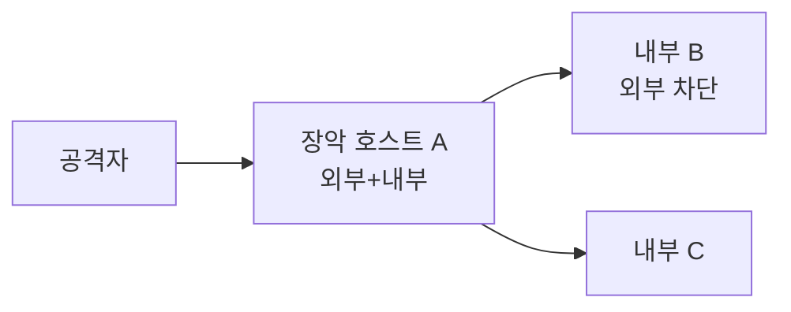

> 침투 지점 하나로는 내부망 전체에 닿지 못한다. **피벗팅**은 장악한 호스트를 경유지로 삼아 격리된 내부 대역에 접근하는 것이고, **터널링**은 그 경로로 트래픽을 흘려보내는 기법이다. 외부에서 안 보이던 서비스가 피벗을 통해 보인다.

## 개념

- **상황**: 공략한 호스트(A)는 외부와 내부망 양쪽에 붙어 있고, 내부의 B는 외부에서 직접 못 닿는다. A를 경유해 B에 접근해야 한다.
- **로컬 포트 포워딩**: 내 포트로 온 트래픽을 A를 거쳐 B:포트로 전달 → 내부 서비스를 로컬처럼 사용.
- **리모트 포워딩**: A에서 접근 가능한 서비스를 내 쪽으로 당겨온다(인바운드가 막힐 때).
- **동적 포워딩(SOCKS)**: A를 SOCKS 프록시로 만들어 여러 내부 대상에 도구를 통째로 흘린다(proxychains).
- **중계 트래픽은 로그에 남는다**: 경유 호스트·포트 선택과 흔적을 의식한다.



## 공격·확인 구문

허가된 범위·계약된 대상에서만.

### SSH 포트 포워딩

```bash
# 로컬 포워딩: 내 9000 → A경유 → 내부 B:80
ssh -L 9000:<internal-host>:80 user@A
# 리모트 포워딩: A의 접근을 내 쪽으로
ssh -R 9000:127.0.0.1:80 user@A
# 동적(SOCKS): A를 프록시로
ssh -D 1080 user@A
```

### SOCKS 프록시로 도구 흘리기

```bash
# proxychains 설정: socks5 127.0.0.1 1080
proxychains nmap -sT -Pn <internal-subnet>/24
proxychains curl http://<internal-host>/
```

### 확인 관점

```
경유 호스트가 내부 대역에 실제로 붙어 있는가(ip a / route)
어떤 내부 대상·포트가 피벗으로 보이는가
인바운드가 막히면 리모트/동적 포워딩으로 전환
```

## 참고 자료

- [SSH Port Forwarding (OpenSSH manual)](https://man.openbsd.org/ssh#L)
- [proxychains-ng](https://github.com/rofl0r/proxychains-ng)
- [MITRE ATT&CK: Lateral Movement](https://attack.mitre.org/tactics/TA0008/)
