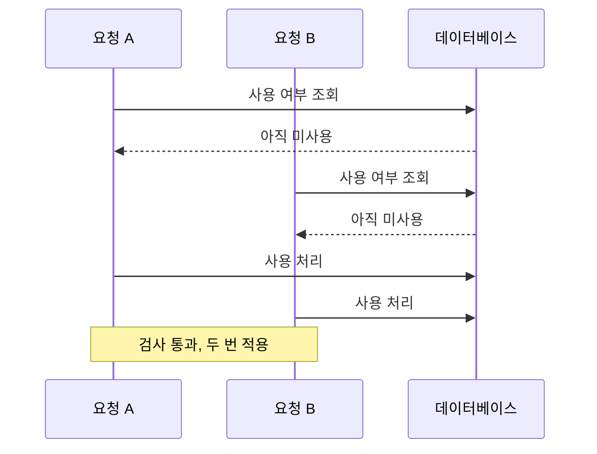

> 서버는 요청을 한 번에 하나씩 처리하지 않습니다. "조건을 확인하고, 그다음에 값을 바꾸는" 두 단계 사이에 **다른 요청이 끼어들면** 한 번만 허용되어야 할 일이 여러 번 일어납니다. 이것이 경쟁 조건, 특히 TOCTOU(검사 시점과 사용 시점의 차이)입니다.

## 이런 분께

- 쿠폰, 포인트, 재고, 송금처럼 "한 번만" 또는 "한도까지만" 규칙이 있는 기능을 만드는 분
- 코드 리뷰에서 동시성 문제를 놓치기 쉬운 분
- 병렬 요청은 확인해 본 적 없는 분

## 원리: 확인과 변경이 하나의 동작이 아니다



각 요청의 코드는 단독으로 보면 올바릅니다. 문제는 **둘이 겹칠 때만** 나타나므로 일반 기능 테스트에서는 거의 드러나지 않습니다. 영향은 한도 초과(쿠폰, 이체, 재고), 중복 처리(이중 결제, 중복 가입), 검증 우회(인증 단계 건너뛰기)까지 이어집니다.

## 취약한 코드 → 고친 코드

취약한 예시입니다(직접 만든 최소 Flask + SQL 예제).

```python
# vulnerable.py
@app.post("/redeem")
def redeem():
    uid = session["user_id"]
    code = request.form["code"]
    row = db.query("SELECT used FROM coupon WHERE code = ?", code)
    if row is None or row["used"]:            # 1) 검사
        return "invalid", 400
    db.execute("UPDATE coupon SET used = 1 WHERE code = ?", code)   # 2) 변경
    db.execute("UPDATE account SET point = point + 1000 WHERE id = ?", uid)
    return "ok"
```

- 1)과 2) 사이에 다른 요청이 같은 쿠폰을 읽으면 모두 미사용으로 보입니다.

고친 예시입니다. 핵심은 **검사와 변경을 한 문장으로 합치는 것**입니다.

```python
# fixed.py
@app.post("/redeem")
def redeem():
    uid = session["user_id"]
    code = request.form["code"]
    with db.transaction():
        n = db.execute(
            "UPDATE coupon SET used = 1 WHERE code = ? AND used = 0", code
        )                                      # 조건부 갱신: 검사+변경이 원자적
        if n != 1:                             # 영향 행 수로 성공 판정
            return "invalid", 400
        db.execute("UPDATE account SET point = point + 1000 WHERE id = ?", uid)
    return "ok"
```

- `WHERE used = 0` 조건과 갱신이 한 문장이라, 두 요청 중 하나만 영향 행 수 1을 얻습니다.
- 잔액도 `point = point + 1000`처럼 DB가 계산하게 하고, 값을 읽어 앱에서 더해 되쓰지 않습니다.

한도형 규칙은 행 잠금을 씁니다.

```python
with db.transaction():
    acc = db.query("SELECT balance FROM account WHERE id = ? FOR UPDATE", uid)
    if acc["balance"] < amount:
        return "insufficient", 400
    db.execute("UPDATE account SET balance = balance - ? WHERE id = ?", amount, uid)
```

`FOR UPDATE`는 같은 행을 다루는 다른 트랜잭션이 끝날 때까지 기다리게 합니다. 중복 방지는 유일 제약(UNIQUE)도 씁니다. "사용자당 한 번"이면 `(user_id, event_id)`에 유일 제약을 걸어 DB가 두 번째 삽입을 거부하게 합니다.

## 확인 방법(진단 순서)

1. **"한 번만 / 한도까지만" 규칙 찾기**: 쿠폰·초대 코드 사용, 포인트·잔액 차감, 재고 구매, 투표·좋아요, 가입·이메일 인증, 출금 한도가 후보입니다.
2. **단건 동작 기준 확인**: 규칙이 정상 동작해 두 번째 요청이 거부되는지 순차 요청으로 먼저 봅니다.
3. **동시 요청 비교**
   - 보내는 것: 같은 요청을 **소량(수 건~수십 건)** 동시에 보냅니다. 상태를 바꾸는 요청이므로 테스트 계정과 소액·테스트 자원에서만 합니다.
   - 보는 것: 성공 응답이 한 번을 넘거나, 최종 잔액·사용 횟수가 규칙의 한도를 넘으면 경쟁 조건입니다. 순차 요청과 동시 요청의 결과 차이가 근거입니다.
4. **재현성 판단**: 타이밍 문제라 한 번 안 됐다고 안전하지 않습니다. 반복해 재현율을 보고서에 적고, 최소 건수로 규칙 위반 사실만 증명합니다.

> **실무 포인트** 점검 시 "서버가 느려서" 안 되는 경우가 많습니다. 요청이 서로 다른 시점에 도착하면 틈이 닫히기 때문입니다. 네트워크 지연의 차이를 줄이려면 가능한 한 요청을 같은 연결에 묶어 거의 동시에 도착시켜야 하며, 이것이 실패 원인이어서 **취약하지 않다**는 결론으로 넘어가면 안 됩니다. 결과는 "재현되지 않음"이지 "안전함"이 아닙니다.

> **실무 포인트** 방어 쪽에서 가장 놓치는 것은 **애플리케이션 락**입니다. 프로세스 안의 락이나 캐시 확인은 서버가 두 대 이상이면 무력합니다. 코드 리뷰에서 "조회 후 조건 판단 후 갱신"이 보이면 락의 위치가 아니라 **DB 한 문장 또는 DB 락으로 보장되는가**를 확인하세요.

## 유형·변형

| 유형 | 원리 | 확인 포인트 |
|---|---|---|
| 한도 초과(limit overrun) | 한도 검사와 차감 사이에 다른 요청이 통과 | 동시 요청 후 총합이 한도를 넘는가 |
| 중복 처리 | 같은 작업이 두 번 실행 | 멱등성 키나 유일 제약이 있는가 |
| 비원자적 비즈니스 규칙 | "한도 이하 자동 승인" 같은 규칙이 트랜잭션 밖 | 합계 검사와 반영이 한 트랜잭션인가 |
| 다단계 흐름 틈 | 인증·승인 중간 상태에서 다른 요청 통과 | 중간 상태에서 보호된 기능이 열리는가 |

## 대응 방안

### 코드 수준
- **검사와 변경을 한 문장으로** 합칩니다(`UPDATE ... WHERE 조건`, 영향 행 수 확인).
- 값은 앱에서 읽고 계산해 되쓰지 않고 `col = col + n`처럼 **DB가 계산**하게 합니다.
- 한도·잔액처럼 읽고 판단해야 하는 경우 `SELECT ... FOR UPDATE`로 행을 잠그거나, 낙관적 락(버전 번호 비교)으로 충돌 시 재시도합니다.

### 설정 수준
- "사용자당 1회" 같은 규칙은 **유일 제약**으로 DB가 거부하게 합니다.
- 결제·지급 API는 **멱등성 키**를 받아 같은 요청이 두 번 와도 한 번만 처리합니다.

### 구조 수준
- 서버가 여러 대여도 **최종 판단은 단일 저장소**(DB 또는 분산 락)에서 합니다.
- 같은 요청을 병렬로 보냈을 때 불변 조건(잔액 ≥ 0, 쿠폰 사용 ≤ 1)이 유지되는지 자동 테스트합니다.

## 점검 체크리스트

- [ ] "한 번만", "한도까지만" 규칙을 목록화했는가
- [ ] 검사와 변경이 한 문장 또는 한 트랜잭션 + 잠금으로 보장되는가
- [ ] 잔액·카운터를 DB 쪽에서 계산하는가
- [ ] 중복 방지에 유일 제약이나 멱등성 키를 쓰는가
- [ ] 프로세스 내부 락에만 의존하지 않는가
- [ ] 동시 요청 테스트가 있는가

## 함께 보기

- [인증 취약점](/notes/authentication-vulnerabilities/)
- [SQL 인젝션](/notes/sql-injection/)

## 참고 자료

- [CWE-362: Concurrent Execution using Shared Resource with Improper Synchronization](https://cwe.mitre.org/data/definitions/362.html)
- [CWE-367: Time-of-check Time-of-use (TOCTOU) Race Condition](https://cwe.mitre.org/data/definitions/367.html)
- [OWASP Web Security Testing Guide: Test for Race Conditions](https://owasp.org/www-project-web-security-testing-guide/latest/4-Web_Application_Security_Testing/10-Business_Logic_Testing/05-Test_Number_of_Times_a_Function_Can_Be_Used_Limits)
- [PostgreSQL 문서: Explicit Locking](https://www.postgresql.org/docs/current/explicit-locking.html)
