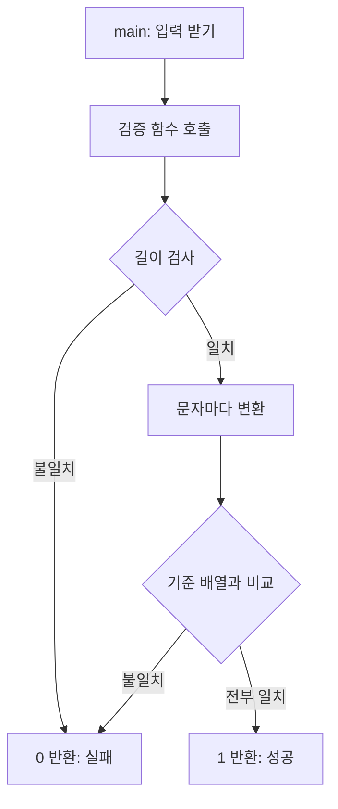

> 입력 검증이 클라이언트 바이너리 안에 있다면, 그 코드는 "숨겨진 비밀"이 아니라 "읽을 수 있는 문서"입니다. 읽는 순서만 알면 됩니다.

## 이런 분께

- 리버싱을 처음 시작해 디컴파일러 화면에서 어디부터 봐야 할지 막막한 분
- 앱·데스크톱 프로그램의 라이선스·입력 검사 코드가 얼마나 쉽게 읽히는지 위험도를 판단해야 하는 진단자
- 클라이언트 검증을 설계하는 개발자

이 글은 **내가 만든 작은 프로그램을 읽는 법**을 다룹니다. 소프트웨어 보호를 우회하는 안내가 아니라, 정적 분석(실행하지 않고 코드를 읽는 분석)의 사고 순서와 방어 관점을 정리한 것입니다.

## 1. 원리: 검증 함수는 항상 같은 모양입니다

입력을 검사하는 코드는 대부분 다음 구조를 가집니다.



분석자가 찾을 것은 세 가지입니다.

1. **성공·실패 메시지**: 사람이 읽는 문자열은 가장 좋은 단서입니다.
2. **조기 반환(early return)**: 하나라도 틀리면 바로 0을 돌려주는 구조입니다.
3. **기준 상수**: 비교 대상 배열이나 변환 키가 `.data`(초기화된 전역 데이터) 영역에 그대로 있습니다.

## 2. 예제: 직접 만든 검사 함수

```c
// check.c (설명용 예제)
#include <stdio.h>
#include <string.h>

static const unsigned char target[8] =
    {0x1b, 0x70, 0xa5, 0xf1, 0xf1, 0x87, 0xd8, 0x11};

static unsigned char rol8(unsigned char v, int n) {
    return (unsigned char)((v << n) | (v >> (8 - n)));
}

int check(const char *in) {
    if (strlen(in) != 8) return 0;
    for (int i = 0; i < 8; i++) {
        unsigned char t = rol8((unsigned char)in[i] ^ 0x5a, i & 7);
        if (t != target[i]) return 0;
    }
    return 1;
}

int main(void) {
    char b[64];
    printf("code: ");
    if (scanf("%63s", b) != 1) return 1;
    puts(check(b) ? "OK" : "NO");
    return 0;
}
```

## 3. 읽는 순서

### 3-1. 문자열에서 시작해 교차참조로 들어가기

1. 디컴파일러(Ghidra 등)에서 프로그램을 열고 **Defined Strings** 목록을 봅니다. `code: `, `OK`, `NO`가 보입니다.
2. `OK` 문자열을 선택해 **References(교차참조, XREF)** 를 따라가면 `main` 안의 `puts` 호출 지점에 도착합니다.
3. 바로 위의 호출 `check(b)`가 판정 함수입니다. 이름이 지워져 있어도(`FUN_00101234` 등) 위치는 같습니다.

### 3-2. 디컴파일 결과의 모양

디컴파일러는 대략 이런 의사코드를 보여 줍니다(변수명은 도구가 붙인 것).

```c
// 디컴파일 결과의 형태 (예시)
undefined8 FUN_check(char *param_1)
{
  size_t len = strlen(param_1);
  if (len == 8) {
    for (long i = 0; i < 8; i++) {
      byte b = param_1[i] ^ 0x5a;
      b = (b << (i & 7)) | (b >> ((8 - (i & 7)) & 0x1f));
      if (b != (&DAT_00102010)[i]) return 0;
    }
    return 1;
  }
  return 0;
}
```

여기서 읽어 낼 것은 다음과 같습니다.

| 보이는 것 | 의미 |
|---|---|
| `len == 8` | 입력 길이 조건. 후보 공간이 크게 줄어듭니다 |
| `^ 0x5a` | 고정 키 XOR |
| `<< (i & 7)` 와 `>> (8 - ...)` 의 OR | 비트 회전(ROL). 회전 폭은 인덱스의 하위 3비트 |
| `DAT_00102010` 배열 비교 | 기준 상수. `.data`에서 8바이트를 그대로 읽을 수 있음 |
| `return 0` 이 여러 곳 | 조기 반환 구조 |

### 3-3. 어셈블리로 확인하기

디컴파일러가 틀릴 때도 있으므로 핵심 구간은 어셈블리로 한 번 대조합니다. x86-64 기준 개념만 옮긴 표기입니다.

```text
movzx  eax, byte [rdi+rcx]    ; 입력 i번째 바이트
xor    eax, 0x5a              ; 고정 키 XOR
mov    edx, ecx
and    edx, 7                 ; 회전 폭 = i & 7
rol    al, dl                 ; 8비트 회전
cmp    al, byte [target+rcx]  ; 기준 배열과 비교
jne    fail                   ; 다르면 실패 분기
```

컴파일러 최적화에 따라 `rol` 한 줄이 시프트 두 개와 OR로 풀려 나올 수도 있습니다. 둘 다 같은 의미라는 것을 알아보는 것이 읽기의 절반입니다.

## 4. 단순 변환을 거꾸로 읽는 법

변환이 **가역(되돌릴 수 있는)** 연산만으로 이루어져 있으면 기준 상수에서 입력 조건을 거꾸로 계산할 수 있습니다.

| 연산 | 역연산 | 이유 |
|---|---|---|
| `x ^ k` | `x ^ k` | 같은 값을 한 번 더 XOR하면 원래 값 |
| `ROL(x, n)` | `ROR(x, n)` | 밀려난 비트를 반대편에서 되돌림 |
| `x + k` | `x - k` | 8비트 모듈러 연산 |
| 합성 변환 | 단계의 **역순**으로 역연산 | 마지막에 적용된 것부터 풀기 |

이 예제의 순방향은 "XOR 후 회전"이므로 역방향은 "ROR 후 XOR"입니다.

```python
# invert.py: 내 예제 검증식을 이해했는지 확인하는 용도
target = [0x1b, 0x70, 0xa5, 0xf1, 0xf1, 0x87, 0xd8, 0x11]
ror = lambda v, n: ((v >> n) | (v << (8 - n))) & 0xFF

chars = [ror(t, i & 7) ^ 0x5a for i, t in enumerate(target)]
print(bytes(chars))
```

> **실무 포인트** 역산 결과가 나왔다고 끝내지 말고, **순방향 코드에 다시 넣어 통과하는지** 확인해야 합니다. 부호 확장, 8비트 절단, 회전 폭 해석이 한 군데만 틀려도 결과가 어긋나는데, 눈으로 보면 맞는 것 같아 가장 많이 놓칩니다.

## 5. 확인 방법(분석 순서)

허가된 환경에서 자신이 만들었거나 분석 권한이 있는 바이너리 기준입니다.

1. **파일 정보 확인**: 아키텍처, 심볼 유무, 스트립 여부를 봅니다.
2. **문자열 수집**: 안내·성공·실패 메시지를 모으고 XREF로 호출 지점을 찾습니다.
3. **판정 함수 특정**: 반환값이 0/1이고 조건 분기 직전에 호출되는 함수를 고릅니다.
4. **구조 분류**: 길이 검사, 반복문, 변환식, 비교 대상 중 무엇이 있는지 표로 적습니다.
5. **상수 추출**: 비교 배열을 `.data`에서 읽고 ASCII·정수 중 어느 해석이 자연스러운지 판단합니다.
6. **역연산 구성**: 변환을 단계로 나누어 역순으로 되돌립니다.
7. **재검증**: 순방향 함수에 넣어 1이 나오는지 테스트 코드로 확인합니다.

> **실무 포인트** 처음부터 모든 함수를 읽으려 하면 길을 잃습니다. "메시지 문자열 → 판정 함수 → 비교 상수" 세 지점만 잡아도 검증 로직의 난이도를 대부분 평가할 수 있습니다. 보고서에는 이 세 지점이 **몇 분 만에 찾아졌는지** 적으면 위험도가 전달됩니다.

## 6. 유형·변형

| 유형 | 원리 | 확인 포인트 |
|---|---|---|
| 문자열 직접 비교 | 정답이 평문으로 바이너리에 존재 | `strcmp`·`memcmp` 인자 상수 |
| 문자별 상수 비교 | 인덱스마다 상수와 비교 | 의사코드의 연속된 `== 0x..` |
| XOR·회전 변환 | 가역 연산 합성 | 시프트 쌍, `rol`/`ror` |
| 누적합·선형식 | 인접 차이로 복원 가능 | 앞 원소까지의 합 비교 |
| 블록 단위 처리 | 고정 크기 블록 반복 | 포인터 증가폭, 길이 조건 |
| 해시 후 비교 | 일방향이라 역산 불가 | 해시 상수, 라운드 구조 |

## 7. 대응 방안

### 코드 수준

- 정답·키·허용 목록을 평문 상수로 두지 않습니다.
- XOR·회전·덧셈만으로 된 "암호화"는 암호가 아닙니다. 표준 알고리즘을 씁니다.
- 비교는 상수 시간 함수로 하고, 오류 메시지는 단서가 되지 않게 단순하게 둡니다.

### 설정 수준

- 릴리즈 빌드에서 심볼과 디버그 정보를 제거합니다. 이는 읽는 시간을 늘릴 뿐이라는 점은 인지해야 합니다.

### 구조 수준

- **클라이언트에 비밀과 판정을 두지 않습니다.** 라이선스·권한·결제처럼 가치가 있는 판단은 서버에서 검증합니다.
- 클라이언트 검사는 사용자 편의(빠른 피드백)용으로만 쓰고, 최종 결정은 서버가 다시 합니다.
- 변조 탐지가 필요하면 서명과 서버측 증명을 결합합니다.

## 8. 점검 체크리스트

- [ ] 성공·실패 문자열에서 판정 함수까지 XREF로 몇 단계인지 확인했다
- [ ] 판정 함수의 구조(길이·반복·변환·비교)를 표로 정리했다
- [ ] 비교 상수와 변환 키가 평문으로 존재하는지 확인했다
- [ ] 변환이 가역 연산뿐인지 판단했다
- [ ] 역산 결과를 순방향 코드로 재검증했다
- [ ] 중요 판단이 서버에서 다시 검증되는지 확인했다
- [ ] 클라이언트에 비밀·키가 들어 있지 않다

## 함께 보기

- [하드코딩 키·IV와 암호 오용](/notes/hardcoded-keys-iv-crypto-misuse/)

## 참고 자료

- Ghidra 공식 저장소와 문서: <https://github.com/NationalSecurityAgency/ghidra>
- CWE-798 Use of Hard-coded Credentials: <https://cwe.mitre.org/data/definitions/798.html>
- CWE-602 Client-Side Enforcement of Server-Side Security: <https://cwe.mitre.org/data/definitions/602.html>
- CWE-656 Reliance on Security Through Obscurity: <https://cwe.mitre.org/data/definitions/656.html>
