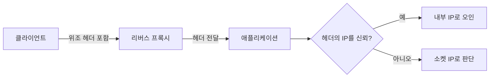

> 리버스 프록시(앞단에서 요청을 대신 받아 전달하는 서버) 뒤의 애플리케이션은 클라이언트 IP와 호스트 이름을 **헤더**로 전달받습니다. 그 헤더를 누가 썼는지 확인하지 않고 믿으면 접근 제어가 무너집니다.

## 이런 분께

- "내부망 IP만 허용" 같은 IP 기반 규칙을 코드나 설정에 둔 분
- 비밀번호 재설정 링크, 리다이렉트에 `Host` 값을 쓰는 분
- 프록시·로드밸런서 뒤 구성을 진단하는 분

## 원리: 헤더는 전달 경로의 누구나 쓸 수 있다

`X-Forwarded-For`(원래 클라이언트 IP), `X-Forwarded-Host`, `X-Real-IP`, `Host`는 **그냥 HTTP 헤더**입니다. 프록시가 덮어쓰거나 정리하지 않으면 클라이언트가 보낸 값이 그대로 앱에 도착합니다. 프록시가 값을 **덧붙이는** 구성에서는 앞쪽 항목이 클라이언트가 넣은 값입니다.



영향은 크게 두 가지입니다.
- **IP 기반 접근 제어 우회**: 관리 기능, 레이트 리밋, 로그인 시도 제한이 위조된 IP로 무력화됩니다.
- **Host 값 오용**: 재설정 메일 링크나 리다이렉트가 공격자가 지정한 도메인을 가리키게 됩니다.

## 취약한 코드 → 고친 코드

```python
# vulnerable.py
from flask import Flask, request, abort

app = Flask(__name__)
INTERNAL = ("203.0.113.", "127.")

@app.get("/admin")
def admin():
    ip = request.headers.get("X-Forwarded-For", request.remote_addr)
    if not ip.startswith(INTERNAL):          # 헤더 값을 그대로 신뢰
        abort(403)
    return "admin panel"

@app.post("/reset")
def reset():
    link = f"https://{request.headers['Host']}/reset?token=..."   # Host로 링크 생성
    send_mail(link)
    return "sent"
```

고친 예시입니다. 신뢰하는 프록시 **홉 수를 명시**하고, 링크는 설정값으로 만듭니다.

```python
# fixed.py
from flask import Flask, request, abort
from werkzeug.middleware.proxy_fix import ProxyFix
import ipaddress

app = Flask(__name__)
app.wsgi_app = ProxyFix(app.wsgi_app, x_for=1, x_host=0)   # 앞단 프록시 1개만 신뢰
PUBLIC_BASE = "https://example.com"                         # 설정값
INTERNAL_NET = ipaddress.ip_network("203.0.113.0/24")

@app.get("/admin")
def admin():
    if request.remote_addr is None:                 # 소켓 주소가 없는 환경(테스트 클라이언트, 일부 소켓)
        abort(403)
    ip = ipaddress.ip_address(request.remote_addr)  # ProxyFix가 정리한 값
    if ip not in INTERNAL_NET:
        abort(403)
    return "admin panel"

@app.post("/reset")
def reset():
    send_mail(f"{PUBLIC_BASE}/reset?token=...")
    return "sent"
```

- 문자열 `startswith`로 IP를 비교하지 않고 네트워크 객체로 비교합니다.
- `X-Forwarded-For`는 오른쪽부터 신뢰 프록시 수만큼 제거하고 남은 맨 오른쪽 값을 씁니다. 예: `203.0.113.9, 198.51.100.4`에서 신뢰 프록시가 1개면 프록시가 본 접속 주소인 `198.51.100.4`가 클라이언트이고, 왼쪽 `203.0.113.9`는 클라이언트가 임의로 써 넣은 값이라 믿지 않습니다(`x_for=1`이 이 계산).
- 프록시가 `X-Forwarded-For`를 **덮어쓰도록** 설정하고, 앱은 그 값만 신뢰합니다.

## 확인 방법(진단 순서)

1. **구조 파악**: 응답 헤더와 오류 페이지로 앞단에 프록시·CDN·로드밸런서가 있는지 추정합니다.
2. **IP 기반 기능 찾기**: 관리 화면, 제한 구역 전용 기능, 로그인 시도 제한, "내 IP 표시" 기능을 찾습니다.
3. **헤더 반영 확인**
   - 보내는 것: 허가된 대상에 `X-Forwarded-For`로 문서용 IP(`203.0.113.7` 등)를 넣은 요청
   - 보는 것: 응답, 로그 화면, 제한 횟수 카운터에 그 값이 반영되면 앱이 헤더를 신뢰하는 것입니다.
4. **Host 반영 확인**: 재설정 메일 링크, 리다이렉트 `Location`, 절대 URL이 요청의 `Host`(또는 `X-Forwarded-Host`) 값을 따라 바뀌는지 봅니다. 바뀌면 링크가 외부 도메인을 가리킬 수 있습니다.
5. **우회 가능성 판단**: 프록시를 거치지 않고 앱에 직접 닿는 경로(내부 주소, 다른 포트)가 있는지 확인합니다. 있으면 헤더 정리가 무의미합니다.

> **실무 포인트** `X-Forwarded-For`는 여러 IP가 쉼표로 이어진 목록일 수 있습니다. 앱이 **맨 앞** 값을 쓰는지 **맨 뒤** 값을 쓰는지가 결과를 가릅니다. 프록시가 덧붙이는 구성에서 맨 앞은 클라이언트가 쓴 값이므로, 신뢰 프록시 개수만큼 **뒤에서부터** 세어야 합니다. 이 방향을 틀린 코드를 정말 자주 봅니다.

> **실무 포인트** 비밀번호 재설정 메일은 영향이 분명해서 보고 가치가 높습니다. 다만 Host를 바꾼 요청이 **피해자 계정으로 메일을 발송**시키는 시험은 허가 범위를 확인하고, 본인 테스트 계정으로만 확인하세요.

## 유형·변형

| 유형 | 원리 | 확인 포인트 |
|---|---|---|
| 클라이언트 IP 위조 | 앱이 `X-Forwarded-For` 맨 앞 값을 사용 | 신뢰 프록시 수와 읽는 방향이 맞는가 |
| 제한 우회 | 레이트 리밋·잠금이 헤더 IP 기준 | 요청마다 다른 값으로 카운터가 갈라지는가 |
| 내부망 판정 | `127.`/`203.0.113.` 문자열 비교 | 실제 소켓 주소 또는 정제된 값으로 비교하는가 |
| Host 오용 | 링크·리다이렉트·캐시 키에 `Host` 사용 | 외부 도메인이 반영되는가 |
| 헤더 변형 | `X-Real-IP`, `Forwarded`(RFC 7239) 등 다른 헤더도 읽음 | 앱이 읽는 헤더 목록이 최소인가 |
| 프록시 우회 | 앱이 프록시를 거치지 않고도 접근 가능 | 앱 포트가 프록시에서만 열려 있는가 |

## 대응 방안

### 코드 수준
- 프록시 헤더는 **신뢰 프록시 수를 지정한 미들웨어**(ProxyFix, Express의 `trust proxy` 등)로만 해석합니다. 직접 파싱하지 않습니다.
- 링크 생성과 리다이렉트는 **설정에 고정된 기준 URL**을 씁니다. 허용 `Host` 목록을 두고 나머지는 거부합니다.
- IP는 문자열이 아니라 IP/네트워크 타입으로 비교합니다.

### 설정 수준
- 프록시에서 `X-Forwarded-For`, `X-Forwarded-Host`, `X-Real-IP`를 **덮어쓰거나 외부에서 온 값은 제거**합니다.
- 앱 서버는 프록시 주소에서 오는 연결만 받도록 방화벽·바인딩을 설정합니다.

### 구조 수준
- 관리 기능은 IP 조건에만 기대지 않고 **인증·인가**를 별도로 요구합니다. IP 제한은 보조 수단입니다.

## 점검 체크리스트

- [ ] 앞단 프록시 구성(몇 단계인지)을 문서로 확인했는가
- [ ] 프록시가 클라이언트가 보낸 `X-Forwarded-*`를 덮어쓰거나 제거하는가
- [ ] 앱이 신뢰 프록시 수를 지정해 헤더를 해석하는가
- [ ] 접근 제어에 헤더 IP만 쓰는 곳이 없는가
- [ ] 재설정 링크·리다이렉트가 요청의 `Host`가 아닌 설정값을 쓰는가
- [ ] 앱 포트가 프록시를 거치지 않고 직접 노출되지 않는가

## 함께 보기

- [깨진 접근 제어와 IDOR](/notes/broken-access-control-idor/)
- [인증 취약점](/notes/authentication-vulnerabilities/)
- [HTTP 요청 스머글링](/notes/http-request-smuggling/)

## 참고 자료

- [RFC 7239: Forwarded HTTP Extension](https://www.rfc-editor.org/rfc/rfc7239)
- [OWASP WSTG: Testing for Host Header Injection](https://owasp.org/www-project-web-security-testing-guide/latest/4-Web_Application_Security_Testing/07-Input_Validation_Testing/17-Testing_for_Host_Header_Injection)
- [CWE-348: Use of Less Trusted Source](https://cwe.mitre.org/data/definitions/348.html)
- [Werkzeug 문서: X-Forwarded-For Proxy Fix](https://werkzeug.palletsprojects.com/en/stable/middleware/proxy_fix/)
- [Express 문서: Express behind proxies](https://expressjs.com/en/guide/behind-proxies.html)
