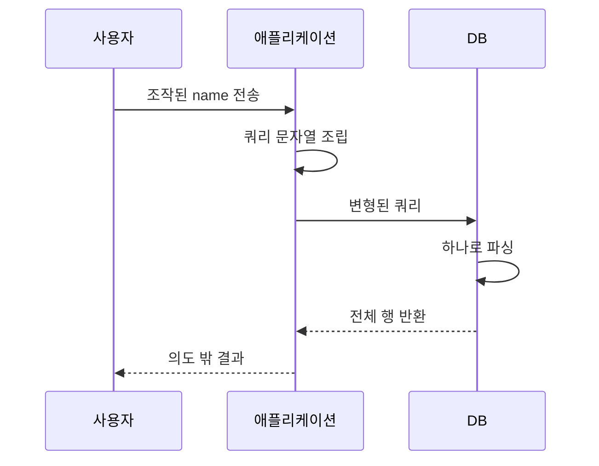

> SQL 인젝션은 "데이터로 넣은 값이 SQL 문법으로 해석되는" 문제입니다. 확인은 문법을 깨 보는 것에서 시작하고, 방어는 값과 문법을 처음부터 분리하는 것으로 끝납니다.

## 원리: 왜 입력이 문법이 되는가

애플리케이션이 SQL 문자열을 **문자열 이어붙이기**로 만들면, DB는 "개발자가 쓴 부분"과 "사용자가 넣은 부분"을 구분하지 못합니다. 완성된 문장 하나만 받기 때문입니다.



핵심은 따옴표(`'`)입니다. 문자열 리터럴이 따옴표로 끝나는 순간, 그 뒤는 문자열이 아니라 SQL 코드가 됩니다. 숫자 파라미터는 따옴표조차 필요 없어서 더 단순하게 뚫립니다.

## 취약한 코드와 고친 코드

**취약한 코드 (Python + sqlite3)**

```python
@app.get("/items")
def items():
    category = request.args.get("category", "")
    sort = request.args.get("sort", "id")
    sql = f"SELECT id, name FROM items WHERE category = '{category}' ORDER BY {sort}"
    return jsonify(db.execute(sql).fetchall())
```

**고친 코드**

```python
ALLOWED_SORT = {"id", "name", "price"}

@app.get("/items")
def items():
    category = request.args.get("category", "")
    sort = request.args.get("sort", "id")
    if sort not in ALLOWED_SORT:          # 식별자는 허용 목록으로만
        abort(400)
    sql = f"SELECT id, name FROM items WHERE category = ? ORDER BY {sort}"
    return jsonify(db.execute(sql, (category,)).fetchall())  # 값은 바인딩
```

여기서 많이 놓칩니다. `category`만 바인딩하고 `ORDER BY`의 `sort`는 그대로 두는 경우입니다. 바인딩은 **값** 자리에만 쓸 수 있고, 컬럼명·테이블명·정렬 방향은 바인딩이 안 됩니다. 이 자리는 허용 목록이 유일한 정답입니다.

## 확인 방법(진단 순서)

### 주입 지점 찾기

| 보내는 것 | 보는 것 | 취약 신호 |
|---|---|---|
| `'` 하나 | 500 오류, 응답 길이 변화, 빈 결과 | 정상 입력과 다른 반응 |
| `''` (따옴표 두 개) | 다시 정상으로 복귀 | `'`는 깨지고 `''`는 정상이면 문자열 문맥 |
| `1 AND 1=1` / `1 AND 1=2` | 두 응답이 서로 다름 | 숫자 문맥 불리언 |
| `1-0` vs `1-1` 등 산술 | 결과 행이 달라짐 | 숫자 문맥에서 식이 계산됨 |

### 응답에 결과가 나올 때: UNION

`UNION`은 두 SELECT의 결과를 합칩니다. 조건은 두 가지입니다.

1. 열 개수가 같아야 합니다. `ORDER BY 1`, `ORDER BY 2`를 늘려 가며 오류가 나는 지점으로 열 수를 찾거나, `UNION SELECT NULL,NULL`의 NULL 개수를 맞춥니다.
2. 열 자료형이 호환되어야 합니다. 각 위치에 문자열 값을 하나씩 넣어 어느 열이 화면에 출력되는지 봅니다.

```sql
-- 열이 2개이고 둘째 열이 화면에 출력되는 경우의 확인용 최소 예
' UNION SELECT NULL, 'probe'-- 
```

### 결과가 안 보일 때: 블라인드

| 방식 | 보내는 것 | 판단 |
|---|---|---|
| 불리언 | 참/거짓 조건을 넣고 응답 차이 관찰 | 참일 때만 특정 문구·길이가 나오면 한 비트씩 추출 가능 |
| 시간 | 조건이 참이면 지연 함수 실행 | 응답 시간이 일정하게 늘어나면 참 |
| 에러 | 조건이 참일 때만 오류를 유발하는 식 | 오류 유무로 참/거짓 구분 |
| 외부 채널 | DB가 외부로 이름 조회·접속을 하게 함 | 통제하는 서버에 요청이 도착하면 확정 |

시간 기반 판단 포인트: 네트워크 지연은 흔들립니다. 지연을 5초처럼 충분히 크게 주고, **참/거짓을 번갈아 두세 번** 보내서 일관되게 갈리는지 확인해야 오탐이 줄어듭니다.

진단에서는 "존재 증명" 수준(버전 문자열 한 줄 정도)에서 멈춥니다. 대량 추출은 DB 부하와 로그 폭주만 부릅니다.

## DB별 차이

같은 의도라도 문법이 다릅니다. 확인 단계에서 DB 종류를 먼저 좁히면 시간이 크게 줄어듭니다.

| 항목 | MySQL | PostgreSQL | MSSQL | Oracle |
|---|---|---|---|---|
| 주석 | `-- ` (뒤 공백 필수), `#` | `--` | `--` | `--` |
| 문자열 연결 | `CONCAT(a,b)` | <code>a&#124;&#124;b</code> | `a+b` | <code>a&#124;&#124;b</code> |
| 버전 조회 | `@@version` | `version()` | `@@version` | `v$version` 뷰 |
| 지연 | `SLEEP(n)` | `pg_sleep(n)` | `WAITFOR DELAY` | 패키지 호출 계열 |
| 열 없는 SELECT | 가능 | 가능 | 가능 | `FROM dual` 필요 |
| 스택 쿼리(`;`) | 드라이버에 따라 제한 | 대체로 가능 | 대체로 가능 | 보통 불가 |

판단 포인트: 오류 메시지가 숨겨져 있어도 **함수 한 개의 성공 여부**로 DB를 가립니다. 예를 들어 지연 함수가 먹히는 쪽이 어느 DB인지만 알아도 나머지 시도를 절반 이상 줄일 수 있습니다.

## 유형·변형

| 유형 | 원리 | 확인 포인트 |
|---|---|---|
| In-band (UNION/에러) | 결과나 오류가 응답에 직접 노출 | 응답 본문에 DB 값이 나타나는지 |
| 블라인드 불리언 | 참/거짓이 응답 차이로만 드러남 | 길이·상태 코드·특정 문구 |
| 블라인드 시간 | 응답 지연으로만 드러남 | 반복 측정 일관성 |
| 2차(Second-order) | 저장 시점엔 안전, 나중에 다른 쿼리에서 꺼내 쓰며 발동 | 가입 정보·프로필 값이 다른 화면 쿼리에 쓰이는지 |
| 헤더·쿠키 주입 | User-Agent, Cookie 값을 로그·조회 쿼리에 사용 | 입력창이 아닌 모든 요청 필드 |
| ORDER BY/식별자 주입 | 바인딩 불가 자리에 입력 | 정렬·컬럼 선택 파라미터 |

2차 인젝션이 가장 자주 빠집니다. 저장 시 이스케이프했으니 안전하다고 믿은 값을, 다른 기능이 "신뢰된 DB 값"으로 보고 그대로 이어붙이기 때문입니다.

### 필터·WAF를 만났을 때의 발상

- 막는 것은 "알려진 문자열 패턴"일 뿐 취약점 자체가 아닙니다. 대소문자, 주석으로 공백 대체(`/**/`), 인코딩(URL 이중 인코딩), 동치 함수 치환이 대표 발상입니다.
- 진단 보고서에는 "WAF 우회 성공"이 아니라 "**앱 코드가 여전히 취약**"이라고 써야 합니다. WAF는 방어선이지 수정이 아닙니다.

## 대응 방안

**코드 수준**

1. 값은 전부 파라미터 바인딩(Prepared Statement)으로 넘깁니다. 드라이버가 값과 문법을 분리해 전달합니다.
2. 컬럼명·테이블명·정렬 방향은 코드에 고정한 허용 목록으로 매핑합니다.
3. ORM을 쓰더라도 `raw()`, `text()`, 문자열 보간 쿼리는 같은 문제를 다시 만듭니다. 리뷰 때 이 호출만 따로 검색하세요.

**설정 수준**

1. 애플리케이션 DB 계정은 필요한 테이블에 필요한 권한만 부여합니다. 관리자 계정으로 접속하면 인젝션 한 번이 서버 전체 문제가 됩니다.
2. 오류 상세 메시지는 사용자에게 노출하지 않고 서버 로그에만 남깁니다.
3. 파일 읽기/쓰기, 외부 접속, 명령 실행에 쓰일 수 있는 DB 기능은 끕니다.

**구조 수준**

1. WAF는 보조 수단으로만 둡니다.
2. 쿼리 로그와 비정상 지연 쿼리를 모니터링합니다.

## 참고 자료

- OWASP, SQL Injection Prevention Cheat Sheet
- OWASP, Query Parameterization Cheat Sheet
- OWASP Testing Guide, Testing for SQL Injection
- CWE-89: Improper Neutralization of Special Elements used in an SQL Command
