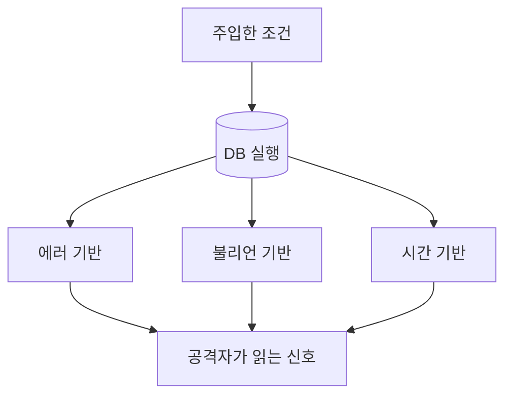

> 기본 개념은 [SQL 인젝션 완전 정리](/notes/sql-injection/)에서 다뤘습니다. 이 글은 거기서 표 한 장으로 지나간 **"결과가 안 보일 때 어떻게 값을 읽는가"** 를 원리 중심으로 풀어 봅니다. 핵심은 하나입니다. 응답에서 **관찰할 수 있는 차이가 곧 통신 채널**이 됩니다.

## 원리: 한 번에 한 비트라도 새면 읽힌다

SQL 인젝션으로 질의에 조건을 끼울 수 있으면, 공격자는 DB에 질문을 던지고 **응답의 어떤 차이**로 답을 받습니다. 차이를 만드는 방식이 에러, 불리언, 시간입니다.



| 방식 | 관찰하는 신호 | 한 번에 얻는 정보 | 필요 조건 |
|---|---|---|---|
| 에러 기반 | 오류 메시지 본문 | 값 일부를 문자열째 | 상세 오류가 응답에 노출 |
| 불리언 기반 | 내용·길이·상태 코드 차이 | 1비트(참/거짓) | 참/거짓 응답이 구분됨 |
| 시간 기반 | 응답 시간 | 1비트(지연 유무) | 지연 함수 실행 가능 |
| 외부 채널 | 내 서버로 오는 요청 | 문자열째 | DB가 외부로 이름 조회·접속 가능 |

비트 수가 적을수록 요청 수가 늘어납니다. 그래서 블라인드 추출은 "느리지만 가능"하고, 그만큼 **로그에 흔적이 많이 남습니다**.

## 취약한 코드 → 고친 코드

세 방식이 모두 같은 코드 패턴에서 나옵니다.

```python
# vulnerable.py
@app.get("/item")
def item():
    pid = request.args["id"]
    sql = f"SELECT name FROM items WHERE id = {pid}"   # 숫자 문맥에 문자열 결합
    try:
        row = db.execute(sql).fetchone()
    except Exception as e:
        return str(e), 500          # 에러 기반의 통로: DB 오류를 그대로 노출
    return "있음" if row else "없음"   # 불리언 기반의 통로: 참/거짓 응답이 다름
```

- `str(e)`는 에러 기반 추출의 통로입니다.
- 결과가 "있음/없음"으로 갈리면 불리언 기반이 가능합니다.
- 응답 내용이 같아도 DB가 지연 함수를 실행하면 시간 기반이 가능합니다.

고친 코드입니다.

```python
# fixed.py
@app.get("/item")
def item():
    try:
        pid = int(request.args["id"])                 # 타입 검증
    except (KeyError, ValueError):
        return "잘못된 요청", 400
    row = db.execute("SELECT name FROM items WHERE id = ?", (pid,)).fetchone()
    return ("있음" if row else "없음"), 200           # 바인딩으로 근본 차단
```

오류를 숨기는 것만으로는 **불리언·시간 채널이 닫히지 않습니다.** 바인딩(파라미터화된 쿼리)만이 세 방식을 한 번에 막습니다.

## 확인 방법(진단 순서)

1. **채널 파악**: 응답에 DB 오류가 나오는지, 정상 요청과 조건이 다른 요청의 응답이 어디서 다른지(본문, 길이, 상태 코드, 헤더, 시간) 비교합니다.
2. **에러 기반 확인**
   - 보내는 것: 문법을 깨는 입력(따옴표 하나 등)
   - 보는 것: 응답에 DB 종류·쿼리 조각이 보이면 상세 오류 노출입니다. 이 자체가 별도 지적 사항입니다.
3. **불리언 확인**
   - 보내는 것: 항상 참인 조건과 항상 거짓인 조건을 각각
   - 보는 것: 두 응답이 **일관되게** 다른가. 한 번이 아니라 같은 조건을 여러 번 보내 흔들림이 없는지 확인합니다.
4. **시간 확인**
   - 보내는 것: 참일 때만 일정 시간(예: 5초) 지연되도록 한 조건과 거짓 조건
   - 보는 것: 지연이 설정값에 비례해 변하는가. 흔들림 구분은 [SQL 인젝션](/notes/sql-injection/)의 시간 기반 판단 포인트를 따릅니다.
5. **존재 증명에서 멈춤**: 허가된 진단에서는 "조건 제어가 가능함"을 한두 개의 무해한 값(예: DB 버전 문자열의 일부)으로 보이고 멈춥니다. 대량 추출은 DB 부하와 로그 폭증만 부르고, 보고서에 필요하지 않습니다.

> **실무 포인트** 불리언 신호는 본문이 아니라 **길이, 상태 코드, 리다이렉트 여부, 쿠키 설정 같은 사소한 차이**에도 숨어 있습니다. 화면이 똑같아 보여도 응답 크기를 비교하세요. 반대로 시간 신호는 서버 부하, 캐시, 로드밸런서에 따라 흔들리므로 한 번의 지연으로 결론 내리지 말고 대조군을 같이 보냅니다.

> **실무 포인트** "에러 메시지를 숨겼으니 괜찮다"는 가장 흔한 오판입니다. 오류 숨김은 에러 기반만 막고, 보고서 문구도 "정보 노출 완화"이지 "인젝션 해결"이 아닙니다. 개발팀에는 **채널이 아니라 원인(문자열 결합)** 을 고쳐야 한다고 전달하세요. 여기서 많이 놓칩니다.

## 로그에서 알아보는 법 (방어·탐지 관점)

블라인드 추출은 같은 엔드포인트에 **조금씩 다른 요청이 반복**되는 형태로 나타납니다.

| 신호 | 로그에서 보이는 모습 |
|---|---|
| 동일 경로 반복 | 한 IP가 같은 URL에 파라미터만 바꿔 수백~수천 회 요청 |
| 응답 시간 분포 | 특정 요청군만 정확히 N초 안팎으로 모임(시간 기반) |
| 비정상 파라미터 | 숫자 자리에 SQL 키워드, 비교 연산자, 함수 호출 형태가 포함 |
| 오류율 상승 | 같은 시간대 DB 오류 로그 급증(에러 기반) |
| 응답 크기 이분화 | 두 가지 크기의 응답만 번갈아 나옴(불리언 기반) |

탐지는 보조 수단이고, 속도 제한(rate limit)과 알림은 피해를 줄이는 역할만 합니다.

## 대응 방안

### 코드 수준
- **바인딩(Prepared Statement)** 이 기본이며 세 방식을 모두 막습니다. 문자열 결합과 포맷팅은 쓰지 않습니다.
- 정렬 컬럼·테이블명처럼 바인딩이 안 되는 자리는 **허용 목록**으로 고정합니다.
- 예외 내용은 서버 로그에만 남기고 응답에는 일반 메시지만 돌려줍니다.

### 설정 수준
- 애플리케이션 DB 계정은 **필요한 테이블에만 최소 권한**을 줍니다. 파일 접근·외부 통신 기능은 끕니다.
- DB 서버의 아웃바운드 통신을 방화벽에서 막아 외부 채널을 차단합니다.
- 쿼리 실행 시간 상한(timeout)을 두어 지연 기반 신호의 효용을 줄입니다.

### 구조 수준
- 요청 빈도 제한과 이상 패턴 알림을 두어 반복 추출을 일찍 발견합니다. 단 이것은 방어선이지 수정이 아닙니다.

## 함께 보기

- [SQL 인젝션 완전 정리](/notes/sql-injection/)
- [레이스 컨디션](/notes/race-conditions/)

## 참고 자료

- [OWASP Cheat Sheet: SQL Injection Prevention](https://cheatsheetseries.owasp.org/cheatsheets/SQL_Injection_Prevention_Cheat_Sheet.html)
- [OWASP Cheat Sheet: Query Parameterization](https://cheatsheetseries.owasp.org/cheatsheets/Query_Parameterization_Cheat_Sheet.html)
- [CWE-89: SQL Injection](https://cwe.mitre.org/data/definitions/89.html)
- [CWE-209: Information Exposure Through an Error Message](https://cwe.mitre.org/data/definitions/209.html)
