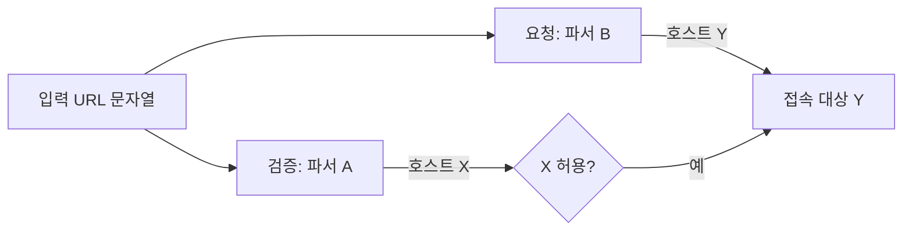

> 기본 개념은 [SSRF: 서버가 대신 요청하게 만드는 공격](/notes/ssrf/)에서 다뤘습니다. 이 글은 그 글에서 짧게 넘어간 **"URL 검증이 왜 자꾸 깨지는가"** 를 원리 중심으로 깊게 봅니다. 결론부터 말하면, 검증하는 코드와 요청하는 코드가 **같은 URL을 서로 다르게 읽기 때문**입니다.

## 이런 분께

- `startswith`, `endswith`, 정규식으로 URL 허용 목록을 만든 분
- 검증 라이브러리와 HTTP 클라이언트가 다른 프로젝트에서 SSRF 방어를 맡은 분
- 진단 중 "허용 도메인만 통과시킨다"는 필터를 만나 판단 기준이 필요한 분

## 원리: 검증과 요청, 두 번의 해석

SSRF 방어 코드는 보통 두 단계입니다. (1) 문자열 URL에서 호스트를 뽑아 허용 목록과 비교하고, (2) 같은 문자열을 HTTP 클라이언트에 넘겨 요청합니다. 문제는 **(1)과 (2)가 서로 다른 해석기를 쓴다**는 점입니다.



X와 Y가 같으면 안전하고, 다르면 허용 목록은 장식이 됩니다. 불일치가 생기는 지점은 크게 세 가지입니다.

| 지점 | 무슨 일이 생기나 |
|---|---|
| 문자열 비교 | 호스트를 "뽑지" 않고 URL 전체에 `startswith`/`endswith`/`in`을 씀 |
| 구분자 해석 | `@`, `#`, `\`, 공백 등을 파서마다 다르게 처리 |
| 이름 해석 시점 | 검사할 때 푼 IP와 접속할 때 푼 IP가 다름 |

## 취약한 코드 → 고친 코드

흔한 실수 세 가지를 한 함수에 모은 최소 예제입니다.

```python
# vulnerable.py
def is_allowed(url: str) -> bool:
    # (a) 접두사 일치: 호스트가 아니라 문자열의 앞부분만 봄
    if url.startswith("https://images.example.com"):
        return True
    # (b) 접미사 일치: 도메인 경계(점)를 확인하지 않음
    host = url.split("/")[2]
    return host.endswith("example.com")
```

- (a) `https://images.example.com.attacker.example/`, 또는 `https://images.example.com@attacker.example/`처럼 **접두사는 같지만 실제 호스트는 다른** 주소가 통과합니다. `@` 앞은 호스트가 아니라 userinfo(사용자 정보)입니다([RFC 3986](https://www.rfc-editor.org/info/rfc3986/) 3.2절).
- (b) `evilexample.com`도 `endswith("example.com")`을 만족합니다. 점(`.`) 경계가 없기 때문입니다.
- `split("/")[2]`는 `host:port`, userinfo, 대괄호 IPv6를 모두 문자열로 취급합니다.

고친 방향입니다.

```python
# fixed.py
from urllib.parse import urlsplit

ALLOWED = {"images.example.com", "api.example.org"}   # 정확히 일치하는 호스트만
ALLOWED_PORTS = {443}                                  # 허용 포트만

def parse_once(url: str):
    u = urlsplit(url)                       # 한 번만 파싱하고 결과 객체만 재사용
    if u.scheme != "https" or u.username or u.password:
        return None                         # userinfo 자체를 거부
    if u.hostname not in ALLOWED:           # 문자열 비교는 '추출된 호스트'에만
        return None
    if (u.port or 443) not in ALLOWED_PORTS:  # 허용 포트만 (명시 안 하면 443)
        return None
    return u

# 요청은 원본 문자열이 아니라, 검증을 통과한 파싱 결과로 만든 URL로 보냄
# safe_url = u.geturl()
```

한계: `geturl()`로 다시 만든 문자열을 HTTP 클라이언트가 **또 파싱**하므로 해석기가 둘이라는 사실은 남습니다. 가능하면 검증한 구성요소(스킴·호스트·포트·경로)를 클라이언트에 직접 넘기십시오.

핵심은 두 가지입니다. 허용 목록은 **정확히 일치**로 비교하고, 요청에는 **검증에 쓴 같은 파싱 결과**를 넘깁니다.

## 확인 방법(진단 순서)

1. **검증이 있는지부터 구분**: 내부 주소를 넣었을 때 오류 메시지가 "허용되지 않은 호스트" 같은 **애플리케이션 메시지**인지, 연결 실패 같은 **네트워크 오류**인지 봅니다. 앞쪽이면 문자열/파서 검증이 있는 것입니다.
2. **일치 방식 추정**: 허용된 도메인 앞뒤에 문자를 붙인 값을 각각 보내 어디서 막히는지 봅니다.
   - 보내는 것: 허용 도메인 뒤에 글자를 붙인 이름, 허용 도메인 앞에 글자를 붙인 이름(모두 내가 통제하는 이름)
   - 보는 것: 통과하는 쪽이 있으면 접두사 또는 접미사 일치입니다.
3. **구분자 해석 확인**: 허용 도메인을 userinfo 자리에 두고 실제 호스트는 내 서버로 둔 URL을 보냅니다. 콜백이 내 서버에 도착하면 검증 파서가 userinfo를 호스트로 읽은 것입니다.
4. **리다이렉트 확인**: 허용된 호스트(예: 열린 리다이렉트가 있는 페이지)가 다른 주소로 3xx를 주는지 봅니다. 클라이언트가 따라가고 재검증이 없으면 허용 목록이 우회됩니다.
5. **해석 시점 확인**: 짧은 TTL로 응답이 바뀌는 내 도메인을 두고, 같은 요청이 때에 따라 다른 결과를 내는지 봅니다. 허가된 범위에서 외부 콜백 도달 여부만 확인합니다.

> **실무 포인트** 필터를 만나면 "통과하는 문자열"을 찾기보다 **어떤 연산으로 검증하는지**부터 추정하세요. 앞/뒤 한 글자 붙이기 두 번이면 `startswith`, `endswith`, 정규식 `search`인지가 대부분 갈립니다. 방식을 알면 시도 횟수가 열 번 안쪽으로 줄고, 보고서에도 "우회 값"이 아니라 "일치 방식 결함"으로 쓸 수 있습니다.

> **실무 포인트** 코드를 볼 수 있다면 `urlparse`/`new URL` 같은 **파싱 호출이 몇 번, 어디서** 일어나는지 세어 보세요. 검증 함수 안에서 한 번, HTTP 라이브러리 안에서 한 번이면 이미 두 해석기입니다. 설정 파일 속 URL, 큐에 저장했다 꺼낸 URL도 같은 문제입니다. 여기서 많이 놓칩니다.

## 대응 방안

### 코드 수준
- URL은 **한 번만 파싱**하고, 이후 검증과 요청 모두 그 결과(구성요소)를 사용합니다. 원본 문자열을 다시 클라이언트에 넘기지 않습니다.
- 허용 목록은 **정확한 호스트 일치**(필요하면 정확한 포트)로 비교합니다. `endswith`가 필요하면 `"." + 도메인` 형태로 경계를 포함합니다.
- userinfo가 있는 URL, 허용되지 않은 스킴, 비표준 포트는 거부합니다.
- 호스트 이름을 푼 뒤 **IP 범위(사설, 루프백, 링크 로컬)** 를 검사하고, 그 IP로 연결합니다. 이름을 다시 풀게 두지 않습니다.
- 리다이렉트는 끄거나, 매 홉마다 같은 검증을 반복합니다.

### 설정·구조 수준
- 검증 코드가 완벽하다는 가정을 두지 않고, **egress 프록시나 방화벽**에서 내부 대역·메타데이터 주소로의 아웃바운드를 막습니다.
- 가능하면 사용자가 URL을 주는 대신 **식별자(ID)를 받아 서버가 고정 주소를 조합**하게 설계합니다.

## 점검 체크리스트

- [ ] 허용 목록이 파싱된 호스트의 정확한 일치로 동작하는가
- [ ] `startswith`, `endswith`, `in`, 정규식 부분 일치로 URL 전체를 검사하지 않는가
- [ ] userinfo(`@`)가 있는 URL을 거부하는가
- [ ] 검증과 요청이 같은 파싱 결과를 쓰는가
- [ ] 디코딩·정규화가 검증보다 먼저 끝나는가
- [ ] 이름을 푼 IP로 직접 연결하는가
- [ ] 리다이렉트를 막거나 매 홉 재검증하는가
- [ ] 네트워크 계층(egress)에서도 내부 대역을 차단하는가

## 함께 보기

- [SSRF: 서버가 대신 요청하게 만드는 공격](/notes/ssrf/)
- [경로 조작(Path Traversal)](/notes/path-traversal/)

## 참고 자료

- [OWASP Cheat Sheet: Server-Side Request Forgery Prevention](https://cheatsheetseries.owasp.org/cheatsheets/Server_Side_Request_Forgery_Prevention_Cheat_Sheet.html)
- [CWE-918: Server-Side Request Forgery (SSRF)](https://cwe.mitre.org/data/definitions/918.html)
- [RFC 3986: URI Generic Syntax](https://www.rfc-editor.org/info/rfc3986/)
- [WHATWG URL Standard](https://url.spec.whatwg.org/)
