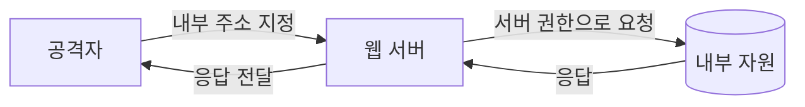

> 사용자가 준 URL을 서버가 대신 가져오는 기능(미리보기, 웹훅, 이미지 불러오기 등)은 **공격자가 서버의 네트워크 위치를 빌려 쓰는 통로**가 될 수 있습니다. 이것이 SSRF(Server-Side Request Forgery)입니다.

## 이런 분께

- URL을 입력받아 서버가 가져오는 기능을 개발하거나 점검하는 분
- 클라우드 환경에서 "SSRF가 왜 그렇게 위험한가"를 설명해야 하는 분
- 블랙리스트 필터를 만들었는데 계속 뚫린다는 얘기를 들은 분

## 1. 원리: 서버는 내부망에 닿는다

외부 사용자는 내부망의 관리 페이지나 데이터베이스 관리 포트에 접근하지 못합니다. 하지만 **웹 서버는 접근할 수 있습니다.** 서버가 사용자가 준 주소로 요청을 보내 주면, 공격자는 그 서버를 중계기로 씁니다.



노릴 수 있는 대상은 크게 세 가지입니다.

| 대상 | 예 | 영향 |
|---|---|---|
| 같은 서버의 로컬 서비스 | `http://127.0.0.1:포트/` 의 관리 콘솔 | 인증 없는 내부 기능 호출 |
| 내부망의 다른 시스템 | 내부 대역의 관리 도구, 모니터링 | 정보 노출, 내부 기능 실행 |
| 클라우드 메타데이터 | `http://169.254.169.254/` | 인스턴스 역할(role)의 임시 자격 증명 탈취 |

특히 클라우드에서는 메타데이터 주소 하나가 임시 자격 증명을 내주기 때문에, SSRF가 서버 한 대의 문제가 아니라 **클라우드 계정 침해**로 번질 수 있습니다.

## 2. 취약한 코드 → 고친 코드

취약한 예시입니다(직접 만든 최소 Flask 예제).

```python
# vulnerable.py
import requests
from flask import Flask, request

app = Flask(__name__)

@app.get("/preview")
def preview():
    url = request.args["url"]          # 검증 없음
    r = requests.get(url, timeout=3)   # 서버가 그대로 요청, 리다이렉트도 따라감
    return r.text[:2000]
```

- URL 검증이 없고, 응답 본문을 그대로 돌려줍니다(전체 읽기 SSRF).
- `requests`는 기본적으로 리다이렉트를 따라가므로, 검증을 통과한 외부 주소가 내부로 돌려보내도 막지 못합니다.

고친 예시입니다.

```python
# fixed.py
import ipaddress
import socket
from urllib.parse import urlparse

import requests
from flask import Flask, abort, request

app = Flask(__name__)
ALLOWED_HOSTS = {"images.example.com", "api.example.org"}   # 허용 목록

def is_public_ip(ip: str) -> bool:
    addr = ipaddress.ip_address(ip)
    return not (addr.is_private or addr.is_loopback or addr.is_link_local
                or addr.is_reserved or addr.is_multicast or addr.is_unspecified)

@app.get("/preview")
def preview():
    u = urlparse(request.args["url"])
    if u.scheme != "https" or u.hostname not in ALLOWED_HOSTS:
        abort(400)
    # 부분 완화: 이름을 풀어 검사하지만, 아래 requests가 이름을 다시 풀기 때문에 TOCTOU가 남습니다
    ip = socket.gethostbyname(u.hostname)
    if not is_public_ip(ip):
        abort(400)
    r = requests.get(u.geturl(), timeout=3, allow_redirects=False)
    return r.text[:2000]
```

- 스킴(`https`)과 호스트를 **허용 목록**으로 제한합니다.
- 이름을 풀어 얻은 IP가 내부 대역이면 거부합니다.
- `allow_redirects=False`로 리다이렉트를 막습니다. 필요하면 직접 따라가며 매 단계 검증합니다.

주의할 점이 있습니다. 위 코드는 **부분 완화**입니다. `gethostbyname`으로 검사한 IP와 `requests.get`이 다시 이름을 풀어 접속하는 IP가 달라질 수 있는 **DNS 재바인딩(TOCTOU)** 이 남기 때문입니다. 완전한 방법은 둘 중 하나입니다.

1. **해석한 IP로 고정 연결**: 한 번 푼 IP로 직접 접속하고 `Host` 헤더·TLS SNI에는 원래 호스트명을 유지합니다(커스텀 어댑터나 연결 단계 후킹 필요).
2. **egress 프록시 또는 네트워크 차단**: 외부 요청을 전용 프록시로만 보내고, 내부 대역·링크 로컬로 나가는 트래픽을 방화벽에서 막습니다.

코드 검증만으로 끝내지 않는 이유입니다.

## 3. 확인 방법(진단 순서)

1. **입력점 찾기**: URL, 도메인, 파일 경로를 받는 파라미터를 찾습니다. 웹훅 등록, 프로필 이미지 URL, 문서 미리보기, PDF 변환, 가져오기(import), 알림 URL이 대표적입니다.
2. **외부 콜백으로 서버 요청 여부 확인**
   - 보내는 것: 내가 제어하는 외부 수신 서버(허가된 진단용)의 주소
   - 보는 것: 그 서버에 **대상 서버 IP에서 온 요청**이 찍히면 서버 측 요청 기능이 있다는 뜻입니다.
3. **내부 주소로 차이 비교**
   - 보내는 것: `http://127.0.0.1/` 처럼 로컬 주소, 열린 포트와 닫힌 포트
   - 보는 것: 응답 내용이 달라지거나, 응답 시간·오류 메시지가 달라지면 내부 접근이 가능한 것입니다. 포트별 차이로 서비스 존재 여부를 알 수 있습니다.
4. **필터가 있다면 우회 시도** (아래 4절 표 참고)
5. **블라인드 확인**: 응답이 화면에 안 나와도 외부 콜백이 도달하거나, 내부 주소에 따라 응답 시간이 달라지면 SSRF입니다. 이 경우 데이터 읽기는 못 해도 내부 포트 지도와 부수효과(상태 변경 요청) 위험이 있습니다.
6. **클라우드 여부 판단**: 클라우드 환경이면 메타데이터 주소 접근 가능 여부를 확인하되, 실제 자격 증명 값은 가져오지 않고 접근 가능 사실과 권한 범위만 보고합니다.

> **실무 포인트** 입력 필드만 보지 말고 **저장 후 나중에 요청하는 경로**를 찾으세요. 웹훅 URL, 프로필 이미지 URL, RSS 구독 주소는 등록 시점에는 검증하고 실제 요청은 백그라운드 워커가 합니다. 워커는 검증 코드를 우회하는 별도 경로인 경우가 많고, 콜백 도착이 몇 분 늦을 수 있어 짧게 기다렸다 "없음"으로 결론 내리기 쉽습니다.

> **실무 포인트** 같은 기능이 PDF 변환이나 헤드리스 브라우저 렌더링을 쓴다면, HTML 안의 ``·`<iframe>`·CSS `url()`이 서버 쪽 요청이 됩니다. URL 파라미터가 없어도 SSRF가 되므로 "URL을 받는 기능"의 정의를 넓혀서 보세요.

여기서 많이 놓칩니다. "응답이 안 보이니 영향 없음"으로 결론 내는 경우가 많은데, 블라인드 SSRF도 내부 서비스의 상태를 바꾸는 GET 한 번(예: 인증 없는 내부 API)으로 피해가 날 수 있습니다. 또 하나, 점검 때 `http://127.0.0.1`이 막혀서 안전하다고 보는데, 막는 쪽은 **문자열 비교**인 경우가 많아서 같은 주소의 다른 표기가 통과하는지를 꼭 따로 확인해야 합니다.

## 4. 유형·변형

| 유형 | 원리 | 확인 포인트 |
|---|---|---|
| 전체 읽기 SSRF | 응답이 그대로 돌아옴 | 내부 페이지 내용이 응답에 나오는가 |
| 블라인드 SSRF | 응답은 안 보이고 부수효과·시간차만 있음 | 외부 콜백 도달, 응답 시간 차이 |
| 주소 표기 변형 | `127.0.0.1`을 10진수·16진수·축약형·IPv6(`[::1]`) 등으로 표기 | 필터가 문자열 비교인가 |
| 도메인 우회 | 내 도메인의 A 레코드를 내부 IP로 설정 | 이름을 푼 뒤 IP를 검사하는가 |
| 리다이렉트 이용 | 허용된 주소가 내부 주소로 3xx 응답 | 리다이렉트를 자동 추적하는가 |
| DNS 재바인딩 | 검사 시점과 접속 시점에 다른 IP로 응답 | 검증 IP와 접속 IP가 같은가 |
| 스킴 악용 | `file:`, `gopher:` 등 HTTP 외 스킴 | 라이브러리가 허용하는 스킴이 무엇인가 |
| URL 파서 불일치 | 검증용 파서와 요청용 파서가 `@`, `#`, 백슬래시를 다르게 해석 | 검증과 요청에 같은 파서를 쓰는가 |
| 클라우드 메타데이터 | 링크 로컬 주소로 자격 증명 접근 | 메타데이터 서비스 버전과 홉 제한 설정 |

## 5. 대응 방안

### 코드 수준
- **허용 목록**이 기본입니다. 블랙리스트(내부 대역 문자열 차단)는 표기 변형 때문에 끝없이 뚫립니다.
- 스킴은 `https`(필요시 `http`)만 허용합니다.
- 이름을 푼 IP를 검사하고, **검증한 IP로 직접 연결**해 재바인딩을 막습니다.
- 리다이렉트를 끄거나, 따라갈 때마다 같은 검증을 반복합니다.
- 검증과 요청에 **같은 URL 파서**를 사용합니다.
- 응답을 그대로 노출하지 않습니다. 가져온 내용의 형식(예: 이미지 MIME)을 확인하고 필요한 필드만 돌려줍니다.

### 설정 수준
- 클라우드는 **메타데이터 서비스 v2(IMDSv2, 세션 토큰 필수)** 로 강제하고 v1은 끕니다. v2는 토큰을 먼저 받는 PUT 요청과 헤더가 필요해 단순 GET형 SSRF로는 접근하기 어렵습니다. 홉 제한(hop limit)을 1로 두면 컨테이너 등 한 단계 너머의 접근도 줄어듭니다.
- 인스턴스 역할에는 **최소 권한**만 줍니다. 침해되어도 피해가 제한되도록 합니다.

### 구조 수준
- 외부 요청 기능은 **별도 격리 구간**(전용 프록시, 아웃바운드 허용 목록이 있는 서브넷)에서 수행합니다. 앱 서버 자체는 내부망 접근을 최소화합니다.
- 내부 서비스도 인증을 요구합니다. "내부니까 인증 없음"이 SSRF의 피해를 키웁니다.
- 아웃바운드 방화벽에서 내부 대역과 링크 로컬 주소로 가는 트래픽을 차단합니다.

## 6. 점검 체크리스트

- [ ] 사용자 입력 URL을 서버가 요청하는 기능을 모두 목록화했는가
- [ ] 허용 목록(호스트·스킴)으로 제한하고 있는가
- [ ] 이름 해석 후 IP가 내부·루프백·링크 로컬이면 거부하는가
- [ ] 리다이렉트를 차단하거나 매 단계 검증하는가
- [ ] DNS 재바인딩을 고려해 검증 IP로 직접 연결하는가
- [ ] 응답을 필요한 만큼만 반환하는가
- [ ] 클라우드 메타데이터가 IMDSv2 강제, 홉 제한 1로 설정되어 있는가
- [ ] 인스턴스 역할이 최소 권한인가
- [ ] 내부 서비스에도 인증이 있는가

## 7. 참고 자료

- [OWASP Top 10 2021: A10 Server-Side Request Forgery](https://top10.owasp.org/A10_2021-Server-Side_Request_Forgery_(SSRF)/)
- [OWASP Cheat Sheet Series: Server-Side Request Forgery Prevention](https://cheatsheetseries.owasp.org/cheatsheets/Server_Side_Request_Forgery_Prevention_Cheat_Sheet.html)
- [CWE-918: Server-Side Request Forgery (SSRF)](https://cwe.mitre.org/data/definitions/918.html)
- [AWS 문서: Use IMDSv2 / Instance metadata service configuration](https://docs.aws.amazon.com/AWSEC2/latest/UserGuide/configuring-instance-metadata-service.html)
- [RFC 3986: URI Generic Syntax](https://www.rfc-editor.org/info/rfc3986/)
