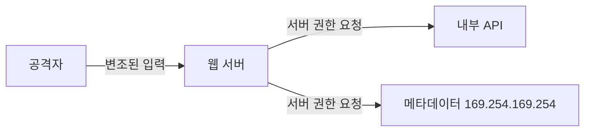

> SSRF는 서버가 보내는 요청을 공격자가 변조하는 취약점이다. 브라우저 권한으로 요청을 보내는 CSRF와 달리, 요청이 **서버 권한**으로 나가기 때문에 외부에서 닿지 못하는 내부망·내부 API에 간접적으로 접근할 수 있다.

## SSRF란

웹 서비스가 다른 주소로 HTTP 요청을 보낼 때, 그 요청에 사용자 입력이 들어가면 공격자가 요청의 목적지나 내용을 바꿀 수 있다. 서버가 대신 요청을 보내므로, 공격자는 서버만 접근 가능한 자원에 닿는다.

영향이 큰 이유는 구조에 있다. 요즘 서비스는 기능을 여러 **마이크로서비스**로 나누고 내부망에서 HTTP·gRPC로 통신한다. 관리자 기능(백오피스), 클라우드 메타데이터(`169.254.169.254`), 내부 전용 API는 외부에서 직접 닿을 수 없지만, 취약한 서버를 경유하면 닿을 수 있다.



## 어떤 코드에서 발생하는가

SSRF의 핵심은 요청이 **어디로** 가는지가 바뀌는 것이다. 사용자 입력이 요청 목적지에 들어가는 두 형태다.

### 1. 사용자가 URL 자체를 입력하는 경우

```python
@app.route("/image_downloader")
def image_downloader():
    image_url = request.args.get("image_url", "")
    response = requests.get(image_url)   # 입력 URL로 그대로 요청
    return response.content
```

입력값이 요청 목적지 전체가 된다. `image_url`에 내부 주소를 넣으면 서버가 그 주소로 요청을 보낸다. 이미지·썸네일 가져오기, 웹훅, PDF 생성, 링크 미리보기가 대표적이다.

### 2. 사용자 입력이 요청 경로에 들어가 다른 내부 자원으로 가는 경우

```python
INTERNAL_API = "http://api.internal"

@app.route("/v1/api/user/information")
def user_info():
    user_idx = request.args.get("user_idx", "")
    response = requests.get(f"{INTERNAL_API}/user/{user_idx}")
```

목적지 호스트(`api.internal`)는 고정이지만 경로 일부를 사용자가 채운다. `user_idx`에 `../search`를 넣으면 요청 경로가 `http://api.internal/search`로 바뀐다. 의도한 `/user/<id>`가 아니라 **다른 내부 엔드포인트**로 요청이 가므로 SSRF의 변형(경로 조작)으로 본다.

## SSRF와 구분할 것: HTTP 파라미터 인젝션

요청의 **목적지**가 아니라 **내용(파라미터 값)**만 바뀌는 것은 SSRF가 아니다.

```python
# 목적지는 /board/write 로 고정, Body만 사용자가 채운다
data = f"title={title}&body={body}&user={session['idx']}"
response = requests.post(f"{INTERNAL_API}/board/write", data=data)
```

`title`에 `title&user=admin`을 넣으면 `user` 파라미터가 하나 더 생겨 `user`가 `admin`으로 바뀐다. 하지만 요청은 여전히 같은 곳(`/board/write`)으로 간다. 서버를 "엉뚱한 곳으로" 보내는 게 아니라 "같은 곳에 보내는 요청의 값"을 바꾸는 것이므로, 이것은 **HTTP 파라미터 인젝션(파라미터 오염)**이다. 예시 2에서 `#`로 고정 파라미터를 잘라내는 것도 같은 계열이다. SSRF와 원인(입력을 그대로 요청에 붙임)은 겹치지만 결과가 다르므로 분류를 구분한다.

## 왜 발생하는가

공통 원인은 하나다. **사용자 입력을 그대로 요청에 붙인다.** URL에는 구분 문자(`/` 경로, `?` 쿼리, `#` 프래그먼트, `&` 파라미터 구분)가 있는데, 입력에 이 문자가 섞여도 걸러지지 않으면 공격자가 요청의 목적지·경로를 재해석시킬 수 있다.

## 점검 대상인지 판별하는 방법

### 테스트할 곳 (확실한 신호)

- 파라미터 값이 URL·도메인·IP 형태다 (`url=`, `target=`, `callback=`, `webhook=`).
- 기능이 "외부 자원을 서버가 가져온다": 이미지·파일 다운로드, 썸네일 생성, PDF/문서 변환, 링크 미리보기, 웹훅 전송.
- 고정된 내부 API 경로에 사용자 값(`user_idx` 등)이 끼어든다.

### 발생한다고 볼 수 있는 근거 (확실한 것)

요청이 **서버에서 나갔다**는 직접 증거가 있을 때다.

- 응답에 서버 측 흔적이 보인다. 예: User-Agent가 `python-requests/...`로 바뀜.
- 내가 통제하는 외부 주소(OAST)로 요청이 실제 도착한다.
- 내부 전용 주소를 넣었을 때만 응답·동작·오류가 달라진다.

### 단정할 수 없는 경우 (불확실한 것)

- 응답 본문이 돌아오지 않는 **블라인드 SSRF**. 이때는 OAST 수신이나 응답 시간 차이 같은 간접 신호 없이 "취약하다"고 단정하면 안 된다.
- 입력이 URL에 들어가도 서버가 요청을 보내지 않고 저장·표시만 하는 경우. 이건 SSRF가 아니다.
- 요청이 나가도 목적지가 허용 목록으로 고정되어 공격자가 바꿀 수 없으면 영향이 없다.

## 확인·우회 구문

대상은 플레이스홀더로 일반화했다. 점검은 허가된 범위에서만 한다.

| 상황 | 입력 | 확인 포인트 |
|---|---|---|
| URL 파라미터 | `http://169.254.169.254/latest/meta-data/` | 클라우드 메타데이터 응답 여부 |
| 내부 서비스 | `http://localhost/admin`, `http://127.0.0.1:<port>/` | 내부 전용 페이지 응답 |
| 경로 조작 | 경로 파라미터에 `../` | 상위 경로로 이동되는지 |
| 쿼리 자르기 | 쿼리 파라미터에 `#` | 뒤 고정 파라미터가 생략되는지 |
| 파라미터 추가 | Body·쿼리 값에 `&key=value` | 뒤 파라미터가 덮어써지는지 |
| 블라인드 확인 | 내가 통제하는 OAST 주소 | 외부 수신 로그 도착 여부 |

## 대응 방안

- 사용자 입력을 요청 목적지로 쓰지 않는다. 꼭 필요하면 **허용 목록**(도메인·IP·포트)으로 제한한다.
- URL을 한 번만 파싱하고, 파싱한 결과의 호스트·포트를 검증한다. 재직렬화 후 클라이언트가 다시 파싱하면 해석이 어긋날 수 있다.
- 내부 대역(사설 IP, 링크로컬 `169.254.169.254`, `localhost`)으로의 요청을 차단한다. DNS 재바인딩을 고려해 **해석된 IP**를 기준으로 막는다.
- 경로·파라미터에 들어가는 입력은 구분 문자(`/ ? # &`)를 검증·인코딩한다.
- 클라우드는 메타데이터 접근을 제한한다(예: IMDSv2).

## 함께 보기

- [SSRF URL 검증 우회](/notes/ssrf-url-validation-bypass/)
- [경로 조작 (Path Traversal)](/notes/path-traversal/)

## 참고 자료

- [OWASP: Server Side Request Forgery](https://owasp.org/www-community/attacks/Server_Side_Request_Forgery)
- [CWE-918: Server-Side Request Forgery (SSRF)](https://cwe.mitre.org/data/definitions/918.html)
