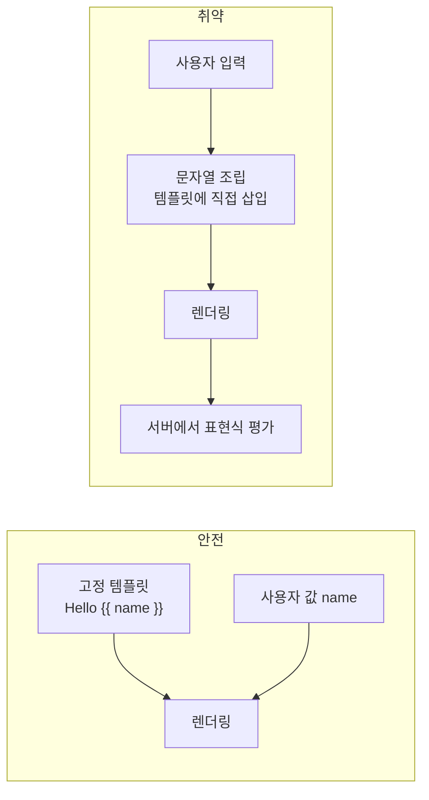

> 템플릿 엔진은 `{{ ... }}` 안을 **코드처럼 평가**합니다. 사용자 입력이 템플릿 "데이터"가 아니라 템플릿 "문자열 자체"에 섞이면, 사용자는 서버 안에서 표현식을 실행하게 됩니다. 이것이 SSTI입니다.

## 이런 분께

- Flask, Django, Spring 등 서버 사이드 템플릿을 쓰는 개발자
- 오류 페이지나 알림 문구를 문자열 조립으로 만드는 분
- XSS와 SSTI의 차이를 설명해야 하는 진단자

## 1. 원리: 데이터가 템플릿 문법에 섞일 때

안전한 사용은 템플릿은 고정, 사용자 값은 변수로 넘기는 것입니다. 취약한 사용은 사용자 값을 **템플릿 문자열을 만드는 재료**로 쓰는 것입니다.



XSS와 비교하면 영향 범위가 다릅니다.

| 구분 | XSS | SSTI |
|---|---|---|
| 해석 주체 | 사용자 브라우저 | 서버 |
| 영향 | 해당 사용자 세션 | 서버 설정값, 객체, 경우에 따라 코드 실행 |
| 원인 | 출력 인코딩 부재 | 입력이 템플릿 문법으로 해석됨 |

## 2. 취약한 코드 → 고친 코드

취약한 예시입니다(직접 만든 최소 Flask 예제).

```python
# vulnerable.py
from flask import Flask, request, render_template_string

app = Flask(__name__)

@app.get("/hello")
def hello():
    name = request.args.get("name", "guest")
    page = f"<h1>Hello {name}</h1>"        # 입력이 템플릿 문자열에 들어감
    return render_template_string(page)    # 이 문자열이 템플릿으로 해석됨

@app.errorhandler(404)
def not_found(e):
    # 요청 경로를 템플릿에 붙이는 실수도 같은 종류
    return render_template_string("<p>Not found: " + request.path + "</p>"), 404
```

- `{{ 7*7 }}`처럼 평가되는 입력을 넣으면 `49`가 출력되고, 이것이 SSTI의 가장 단순한 징후입니다.
- 템플릿 컨텍스트에서 설정 객체(`config`)나 내부 객체에 닿을 수 있으면 비밀키 같은 값이 노출됩니다.

고친 코드입니다.

```python
# fixed.py
from flask import Flask, request, render_template_string

app = Flask(__name__)

HELLO = "<h1>Hello {{ name }}</h1>"       # 템플릿은 상수

@app.get("/hello")
def hello():
    name = request.args.get("name", "guest")
    return render_template_string(HELLO, name=name)   # 값은 변수로 전달, 자동 이스케이프

@app.errorhandler(404)
def not_found(e):
    return render_template_string("<p>Not found: {{ p }}</p>", p=request.path), 404
```

> **실무 포인트** 같은 사고가 `f-string`, `%` 포맷, `+` 연결, `.format()` 어디서든 납니다. "검증 정규식에서 `{}`를 막았다"는 방어도 믿지 마세요. 템플릿 문자열을 만드는 순간에 이미 입력이 섞여 있다는 사실이 문제입니다.

## 3. 확인 방법(진단 순서)

1. **입력 위치 찾기**: 응답에 그대로 반영되는 값(검색어, 이름, 경로, 오류 메시지, 헤더, 쿠키)을 모읍니다.
2. **무해한 산술 식 넣기**: 엔진별 구분자(`{{ }}`, `${ }`, `<%= %>` 등)로 단순 계산식을 넣고 → **계산 결과가 출력되면** 템플릿으로 평가되는 것입니다. 이 단계의 확인으로 충분합니다.
3. **엔진 추정**: 구분자별 반응 차이(어떤 구분자만 평가되는지, 오류 메시지 형식)로 엔진을 좁힙니다.
4. **오류 응답 관찰**: 문법 오류 입력에 템플릿 엔진의 스택 트레이스나 오류 문구가 나오면 입력이 템플릿에 섞인다는 증거입니다.
5. **영향 범위 보고**: 설정값 노출 가능 여부 정도까지만 확인하고, 임의 코드 실행 시도는 허가 범위 안에서만 합니다.

> **실무 포인트** 입력창에서만 찾지 마세요. 404 페이지의 경로, 에러 메시지, 이메일 본문 템플릿, 사용자 이름이 들어가는 알림 문구처럼 "서버가 문구를 만들어 주는 곳"에서 자주 나옵니다.

## 4. 유형·변형

| 유형 | 원리 | 확인 포인트 |
|---|---|---|
| 렌더 함수에 문자열 전달 | `render_template_string` 등에 조립한 문자열 | 템플릿 인자에 입력이 들어가는가 |
| 포맷 문자열 혼용 | f-string 등으로 만든 뒤 템플릿으로 렌더링 | 조립 후 렌더 여부 |
| 자동 이스케이프 해제 | <code>&#124;safe</code> 류로 평가 가능한 문자열 삽입 | 예외 지정 목록 |
| 뷰 이름·경로 해석 | 프레임워크가 뷰 이름을 표현식으로 파싱 | 사용자 값이 뷰 이름에 들어가는가 |
| 컨텍스트 과다 노출 | 설정 객체 등이 템플릿에서 접근 가능 | 템플릿 컨텍스트 변수 목록 |

## 5. 대응 방안

### 코드 수준
- **템플릿은 상수, 사용자 값은 변수**로 분리합니다. 파일 템플릿(`render_template`)을 우선 씁니다.
- 사용자가 템플릿을 편집해야 하는 기능이라면 샌드박스 환경(예: Jinja2 `SandboxedEnvironment`)과 허용된 변수만 노출하는 컨텍스트를 씁니다. 샌드박스는 완전한 보증이 아니므로 보조 수단입니다.
- 템플릿 컨텍스트에서 `config` 등 민감 객체를 노출하지 않습니다.

### 설정 수준
- 자동 이스케이프를 켜 두고 예외를 최소화합니다.
- 비밀키, 자격 증명을 코드/설정 객체에 두지 않고 비밀 관리 도구로 주입해, 노출되더라도 피해를 줄입니다.
- 앱 프로세스를 최소 권한 계정, 컨테이너 격리로 실행합니다.

### 구조 수준
- 코드 리뷰와 정적 분석으로 `render_template_string`, 문자열 조립 후 렌더 패턴을 검사합니다.
- 사용자 편집 템플릿(메일 양식 등)은 별도 샌드박스 서비스나 로직 없는 치환 방식(변수 치환만 지원)으로 제공합니다.

## 6. 점검 체크리스트

- [ ] 템플릿 문자열을 입력으로 조립하는 코드가 없는가
- [ ] 렌더 함수 호출에서 템플릿 인자가 상수 또는 파일인가
- [ ] 오류 페이지·알림 문구도 변수 전달 방식인가
- [ ] 자동 이스케이프가 켜져 있고 예외가 관리되는가
- [ ] 템플릿 컨텍스트에 민감 객체가 노출되지 않는가
- [ ] 사용자 편집 템플릿은 샌드박스 또는 치환 전용 방식인가
- [ ] 비밀값이 템플릿에서 접근 가능한 위치에 있지 않은가

## 함께 보기

- [OS 커맨드 인젝션](/notes/os-command-injection/)
- [SQL 인젝션](/notes/sql-injection/)

## 참고 자료

- [OWASP WSTG: Testing for Server-side Template Injection](https://owasp.org/www-project-web-security-testing-guide/latest/4-Web_Application_Security_Testing/07-Input_Validation_Testing/18-Testing_for_Server-side_Template_Injection)
- [CWE-1336: Improper Neutralization of Special Elements Used in a Template Engine](https://cwe.mitre.org/data/definitions/1336.html)
- [Jinja 공식 문서: Sandbox](https://jinja.palletsprojects.com/en/stable/sandbox/)
- [Flask 공식 문서: Templates](https://flask.palletsprojects.com/en/stable/templating/)
- [OWASP Top 10 2021: A03 Injection](https://owasp.org/Top10/A03_2021-Injection/)
