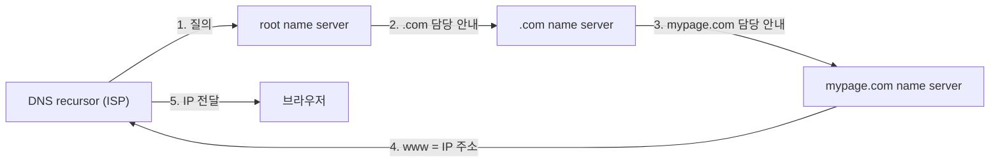

> 주소창에 URL을 입력하고 Enter를 누르면, 화면에 페이지가 뜨기까지 DNS 조회 → TCP 연결 → HTTP 요청 → 서버 응답 → 렌더링이 순서대로 일어난다. 이 글은 그중 **렌더링 직전까지**를 다룬다.

## 1. DNS: 도메인을 IP로

브라우저는 `www.mypage.com`의 IP 주소를 찾기 위해 먼저 **캐시를 순서대로** 확인한다.

1. **브라우저 캐시** — 이전에 방문한 사이트의 DNS 레코드를 일정 기간 보관한다.
2. **OS 캐시** — 브라우저가 OS에 시스템 호출(예: Windows `gethostbyname`)을 보내 레코드를 가져온다.
3. **라우터 캐시** — 자체 DNS 레코드 캐시를 가진 라우터와 통신한다.
4. **ISP 캐시** — ISP(인터넷 서비스 제공자)가 운영하는 DNS 서버의 캐시를 마지막으로 확인한다.

캐시는 네트워크 트래픽을 줄이고 전송 시간을 개선하기 때문에 여러 계층에서 관리된다.

캐시에 없으면 ISP의 DNS 서버(**DNS recursor**)가 IP를 찾기 위해 다른 DNS 서버들(**name server**)을 오가며 조회한다. 이렇게 서버에서 서버로 반복 조회하는 것을 **재귀적 검색(recursive search)** 이라 하고, 끝내 못 찾으면 에러를 반환한다.

1. recursor가 **root name server**에 연락한다.
2. root는 **.com name server**로 안내한다.
3. .com은 **mypage.com name server**로 안내한다.
4. mypage.com name server가 DNS 레코드에서 `www.mypage.com`의 IP를 찾아 recursor로 보낸다.
5. recursor가 이를 브라우저로 전달한다.

모든 요청은 작은 **데이터 패킷**으로 오간다. 패킷에는 요청 내용과 recursor의 IP가 담기고, 경로는 라우팅 테이블(routing table)이 가장 빠른 길을 기준으로 정한다. 도중에 패킷이 유실되면 요청 실패 에러가 난다.

## 2. 클라이언트 측: 연결과 요청

IP를 알아낸 뒤 브라우저가 하는 일이다.

1. **TCP 연결 설정** — TCP/IP 3-way 핸드셰이크(SYN → SYN-ACK → ACK)로 연결을 맺는다. HTTPS면 이어서 TLS 핸드셰이크가 붙는다.
2. **HTTP 요청** — 서버로 `GET` 요청을 보낸다.
3. **브라우저 엔진** — 네트워크 작업과 렌더링 엔진 사이를 조정한다.

## 3. 서버 측: 응답

서버는 상태 코드와 함께 응답한다.

| 코드 | 의미 |
|---|---|
| 1xx | 정보 메시지 |
| 2xx | 성공 |
| 3xx | 리디렉션 |
| 4xx | 클라이언트 오류 |
| 5xx | 서버 오류 |

## 4. 그다음: 렌더링

응답으로 받은 HTML·CSS·JavaScript는 브라우저 렌더링 엔진이 DOM·CSSOM·렌더 트리·레이아웃·페인팅 순으로 처리해 화면에 그린다. 이 과정은 [브라우저 렌더링 순서](/notes/browser-rendering-process/)에서 따로 정리한다.

## 참고 자료

- [MDN: What happens when you navigate to a website?](https://developer.mozilla.org/en-US/docs/Web/Performance/Guides/Navigation_and_resource_timings)
- [MDN: DNS](https://developer.mozilla.org/en-US/docs/Glossary/DNS)
- [MDN: TCP handshake](https://developer.mozilla.org/en-US/docs/Glossary/TCP_handshake)
