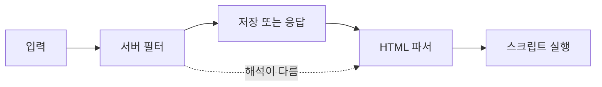

> XSS 필터가 뚫리는 이유는 공격이 영리해서가 아니라 **"위험한 문자열을 찾아 지운다"는 전제 자체가 약하기 때문**입니다. 입력을 걸러 내는 대신 출력 위치에 맞게 인코딩하는 쪽이 정답입니다.

## 원리: 필터와 브라우저는 다르게 읽습니다

필터는 서버에서 문자열을 보고, 브라우저는 HTML 파서로 해석합니다. 두 해석이 어긋나는 곳이 우회 지점입니다.



필터가 약해지는 대표 패턴입니다.

| 패턴 | 왜 통하는가 | 확인 포인트 |
|---|---|---|
| 1회 치환 | 금지 문자열을 한 번만 지우면 지운 결과가 다시 금지 문자열이 됨 | 치환이 반복되는가 |
| 대소문자 | 소문자만 검사하고 브라우저는 대소문자를 구분하지 않음 | 정규화 후 검사하는가 |
| 구분자 | 태그·속성 사이에 공백 외 문자(줄바꿈, `/` 등)가 허용됨 | 파서 규칙과 같은 기준인가 |
| 이벤트 속성 | `script` 태그만 막고 `on...` 속성을 놓침 | 태그가 아닌 속성도 보는가 |
| 인코딩 시점차 | 검사 뒤에 디코딩이 한 번 더 일어남 | 디코딩 후에 검사하는가 |
| 컨텍스트 무시 | 속성값, 스크립트 블록, URL 안은 필요한 이스케이프가 다름 | 출력 위치별 인코딩인가 |

## 취약한 코드 → 고친 코드

취약한 예시입니다(직접 만든 최소 Flask 예제).

```python
# vulnerable.py - 블랙리스트 치환 필터
from flask import Flask, request, make_response

app = Flask(__name__)
BLOCKED = ["<script", "onerror", "javascript:"]

@app.get("/search")
def search():
    q = request.args.get("q", "")
    for word in BLOCKED:
        q = q.replace(word, "")      # 한 번만 지우고, 대소문자도 구분
    return make_response(f"<h1>검색: {q}</h1>")
```

- 지운 결과가 다시 금지어가 될 수 있고, `ONERROR`처럼 대소문자만 바꿔도 통과합니다.
- 목록에 없는 다른 이벤트 속성, 다른 태그는 애초에 검사 대상이 아닙니다.

고친 코드입니다.

```python
# fixed.py - 출력 인코딩 + 템플릿 자동 이스케이프
from flask import Flask, request, render_template_string

app = Flask(__name__)

PAGE = "<h1>검색: {{ q }}</h1>"   # Jinja2 자동 이스케이프가 < > & " ' 를 변환

@app.get("/search")
def search():
    q = request.args.get("q", "")[:100]   # 길이 제한은 부가 방어
    return render_template_string(PAGE, q=q)
```

> **실무 포인트** 필터는 "차단 목록 누락"과 "해석 차이"라는 두 방향으로 무너집니다. 목록을 늘려도 두 번째 문제는 해결되지 않습니다. 보고서에서는 "우회 문자열"이 아니라 "출력 인코딩이 없다"를 원인으로 적어야 재발하지 않습니다.

## 확인 방법(진단 순서)

1. **반사 위치 찾기**: 고유한 무해 문자열(예: `zq7test`)을 넣고 → 응답 어디에 나오는지(본문, 속성값, 스크립트 안, URL 안) 확인합니다.
2. **문자 통과 확인**: `<`, `>`, `"`, `'` 같은 특수문자가 변환되어 나오는지 봅니다. 그대로 나오면 인코딩이 없다는 뜻입니다. 이 단계에서 실행 가능한 코드까지 보낼 필요는 없습니다.
3. **필터 동작 파악**: 특수문자가 삭제되는지, 변환되는지, 요청이 거부되는지 구분합니다. 삭제라면 1회 치환 여부를, 거부라면 어떤 입력이 기준인지 확인합니다.
4. **정규화 순서 확인**: 대소문자 변경이나 URL 인코딩을 한 번 더 한 입력이 다르게 처리되는지 봅니다.
5. **컨텍스트 확인**: 같은 값이 HTML 본문과 속성값, 스크립트 블록에서 각각 어떻게 출력되는지 비교합니다.

> **실무 포인트** 차단 응답이 나왔다고 "막혔다"로 끝내지 마세요. 차단이 입력 단계 규칙인지, 출력 단계 인코딩인지 구분해야 합니다. 입력 규칙만 있고 출력에 인코딩이 없다면 규칙 하나가 새는 순간 취약합니다.

## 대응 방안

### 코드 수준
- **출력 시점에, 출력 위치에 맞게 인코딩**합니다. HTML 본문, 속성값, JavaScript, URL은 규칙이 서로 다릅니다.
- 템플릿 엔진의 자동 이스케이프를 끄지 않습니다(`|safe`, `innerHTML`, `v-html` 등은 예외 목록으로 관리).
- 사용자가 HTML을 쓸 수 있어야 한다면 직접 필터를 만들지 말고 검증된 sanitizer 라이브러리로 허용 목록(allow list) 방식으로 정제합니다.
- DOM에 넣을 때는 `textContent`처럼 문자열로만 취급하는 API를 우선합니다.

### 설정 수준
- 콘텐츠 보안 정책(CSP)으로 인라인 스크립트 실행을 막아 피해를 줄입니다.
- 세션 쿠키에 `HttpOnly`, `Secure`, `SameSite`를 설정합니다.

### 구조 수준
- 입력 검증은 형식 확인(길이, 문자 종류)용으로만 쓰고, XSS 방어는 출력 인코딩에 둡니다.
- 코드 리뷰에서 "원시 HTML 삽입" API 사용처를 목록으로 관리합니다.

## 함께 보기

- [Content Security Policy](/notes/content-security-policy/)
- [OS 커맨드 인젝션](/notes/os-command-injection/)

## 참고 자료

- [OWASP Cheat Sheet: Cross Site Scripting Prevention](https://cheatsheetseries.owasp.org/cheatsheets/Cross_Site_Scripting_Prevention_Cheat_Sheet.html)
- [OWASP Cheat Sheet: DOM based XSS Prevention](https://cheatsheetseries.owasp.org/cheatsheets/DOM_based_XSS_Prevention_Cheat_Sheet.html)
- [CWE-79: Improper Neutralization of Input During Web Page Generation](https://cwe.mitre.org/data/definitions/79.html)
- [CWE-184: Incomplete List of Disallowed Inputs](https://cwe.mitre.org/data/definitions/184.html)
- [Flask 공식 문서: Templates (Controlling Autoescaping)](https://flask.palletsprojects.com/en/stable/templating/)
